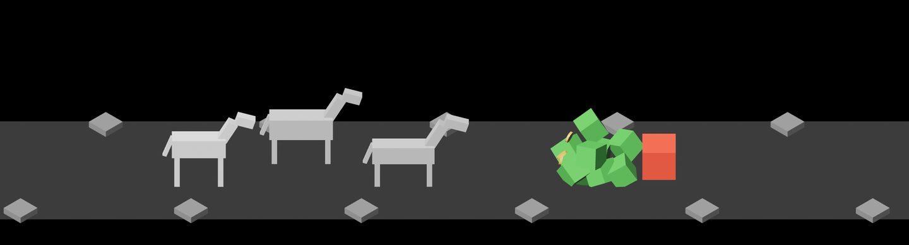
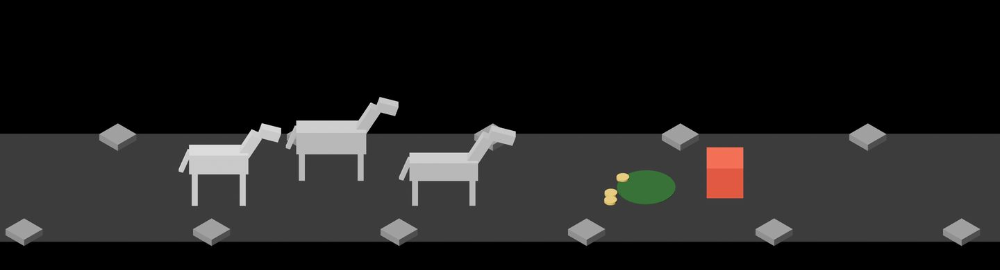
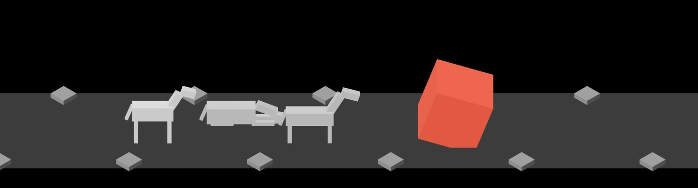
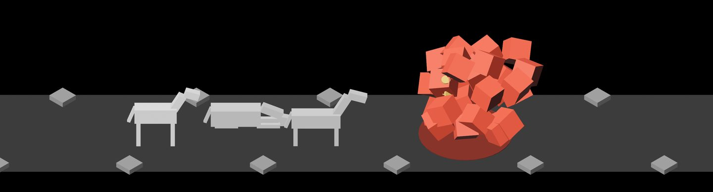
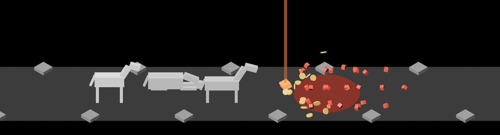
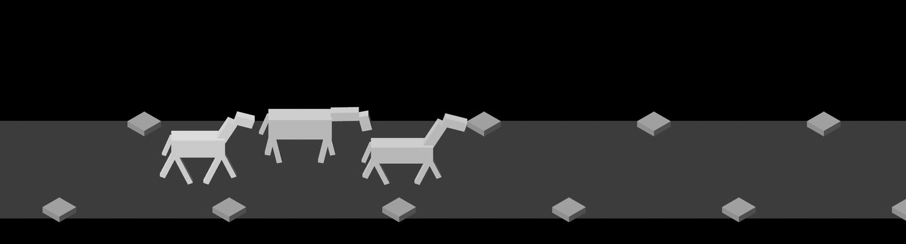
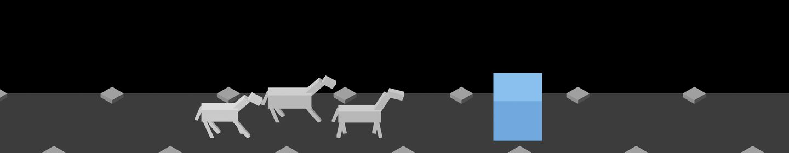

# Death events, 2026-10-10

Pictures taken while building death events (#17), cut down to the scene.
The first five are `cargo run -- --seed 6` with `IDLE_SHOT_AT` 21.6, 22.3,
64.62, 64.95 and 66.0; the sixth is `--seed 3` at 45.6 and the last
`--seed 1` at 72.8. How it works: [death-events.md](../../death-events.md).

**1.** An ordinary enemy a third of a second after it fell: it has broken into eight shards, which are in the air, and its first coins are leaving.

**2.** A second after the kill the shards have shrunk away. Its mark stays on the ground under its coins, in its element's colour, darkened.

**3.** The trail's last enemy, a tenth of a second after the blow: thrown back, tipping over and swelling. The middle horse is exhausted and lying down.

**4.** It bursts into 27 pieces as the full fountain's first coins leave.

**5.** A second later the shards are shrinking away as the loot comes down, so the pile is not covered; the mark is wider than an ordinary one and stays six seconds.

**6.** An exhausted horse (the middle one, at 0 health) gets up when the party walks on and comes along with its head low.

**7.** A lost trail, a third of a second after the last horse tired: the party is in town and getting to its feet, and the enemy it was driven back from is starting to draw off to the right. A second and a half later it is out of view.

