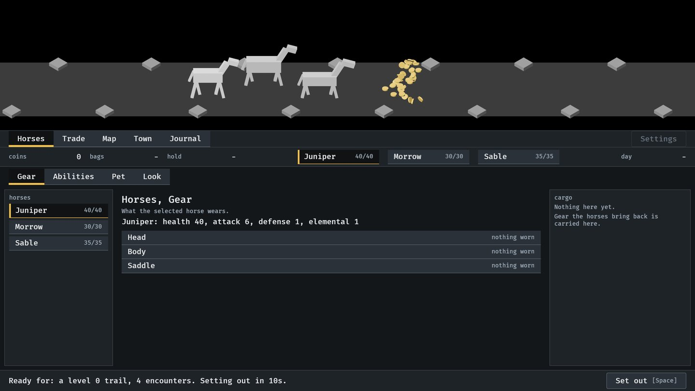
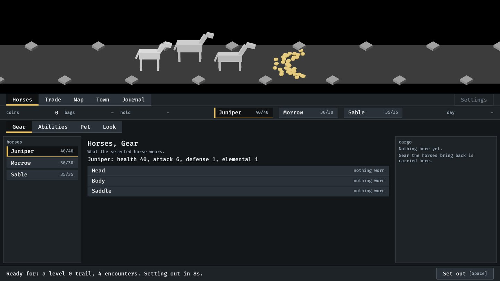
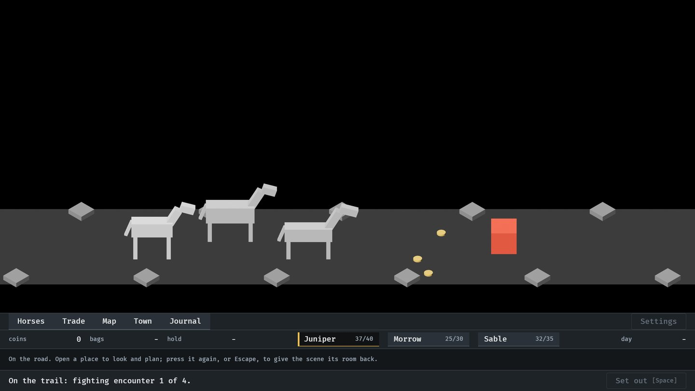

# Drops as physical objects, 2026-10-10

Pictures taken while building the first part of the loot shower (#4). The
first two are the test burst, `cargo run -- --seed 6 --burst` with
`IDLE_SHOT_AT` 2.2 and 4.5; the third is `--seed 6` with `IDLE_SHOT_AT` 23.
How it works: [loot-shower.md](../../loot-shower.md).

**1.** The test burst in the air, 1.2 s after it began: 40 coin pieces leaving one after another, tumbling.

**2.** The test burst at rest: a fan of coins lying flat, open towards the party.

**3.** A kill on the road: the first enemy's three coins lie on the trail, clear of the enemy still standing. The party stands still to fight.

