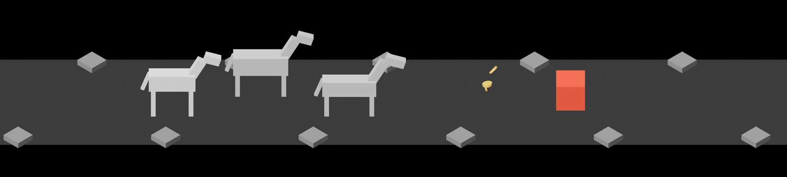
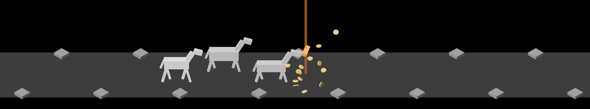
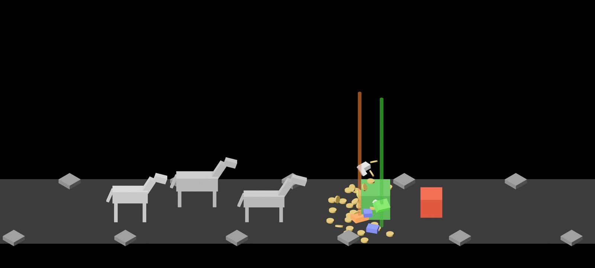

# Fountain sizes, 2026-10-10

Pictures taken while building fountain sizes (#8), cut down to the scene.
The first two are real kills, `cargo run -- --seed 6`, with `IDLE_SHOT_AT`
21.6 and 65.9; the third is the test burst on the road,
`cargo run -- --seed 6 --burst --burst-at 14` at 16.6. How it works:
[loot-shower.md](../../loot-shower.md), Fountain sizes.

**1.** An ordinary kill, the small fountain: a few coins, low and close, a third of a second after the enemy fell.

**2.** The final kill, the full fountain: fifteen coins and a Legendary, 1.4 s after the enemy fell, the last coins still going up. The party is already in town and the scene has shrunk to the top third, so the beam runs off the top.

**3.** The full fountain in the road view: the test burst late in its eruption, both beams at full height, with room to spare above them and nothing near the bar.

