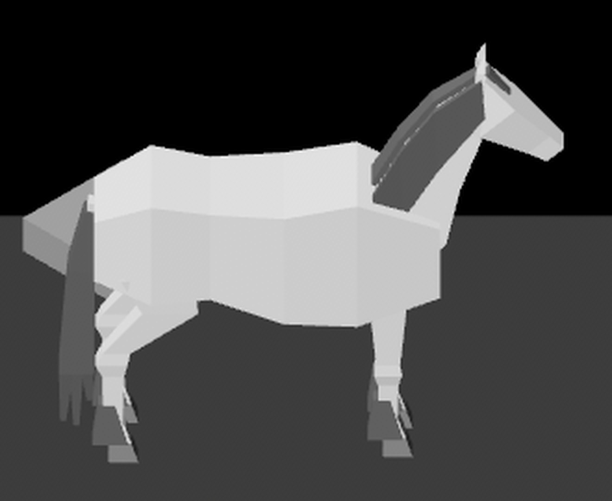
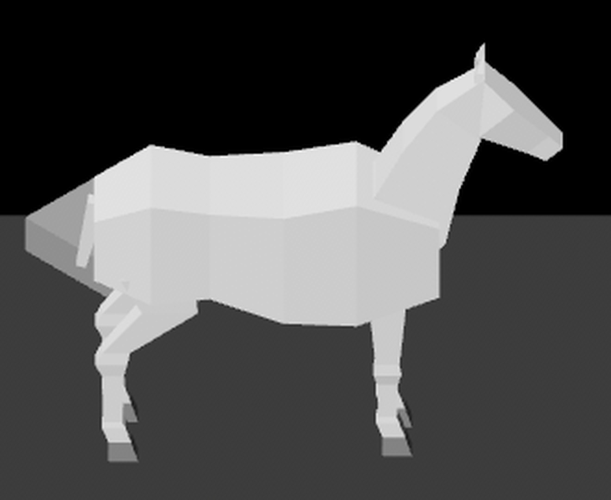
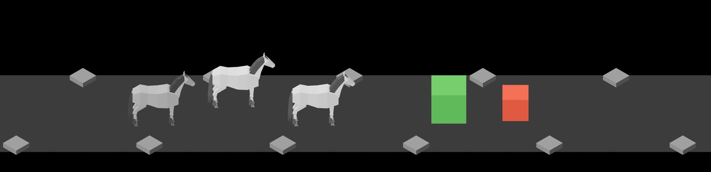
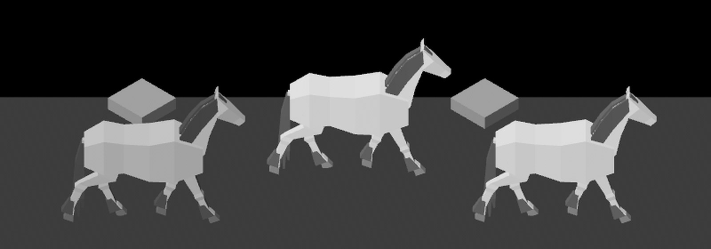
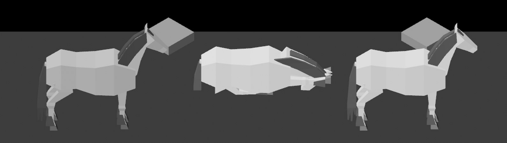
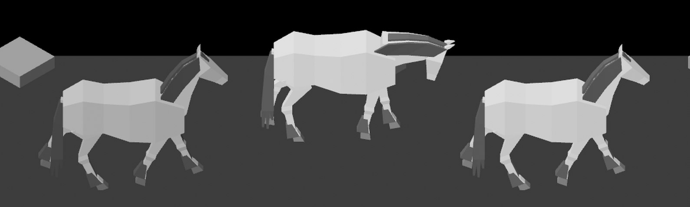

# The horse built to the base proportions, 2026-10-10

Pictures taken while rebuilding the horse (#187), cut down to the scene and
the first two enlarged about four times. All are at the gameplay camera,
which looks down at the trail, so the top of the back shows and the legs
look shorter than they are from level. `cargo run -- --seed 6` with
`IDLE_SHOT_AT` 17 (with `--bare` for the second), 3 and 66.0; the last is
`--seed 3` at 45.6. How it works: [horse-model.md](../../horse-model.md).

**1.** Standing to fight, with its hair: mane, forelock, tail and feathering. The grey block behind its hindquarters is a marker stone on the trail's far edge.

**2.** The same horse with the hair hidden (`--bare`, or F5), which leaves the dock of the tail and the bare legs.

**3.** The party and its enemies at the size the game shows them.

**4.** Walking: each leg swings as a whole from one joint.

**5.** The exhausted pose still works on the new build: the middle horse lies down while the party stands.

**6.** And walks on with its head low.

