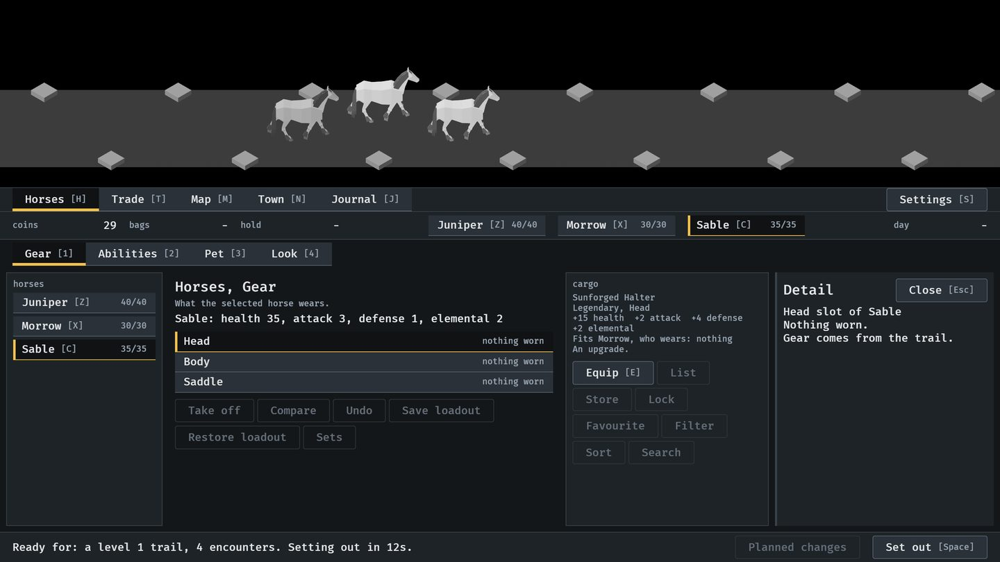
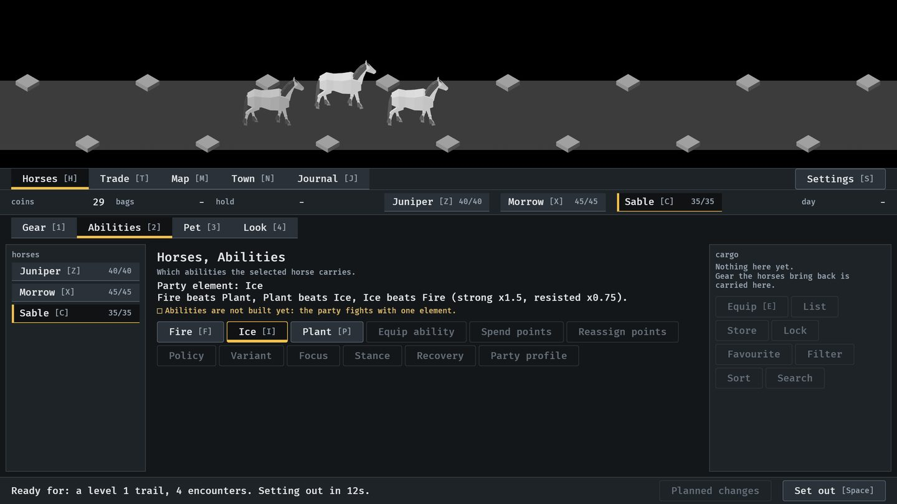
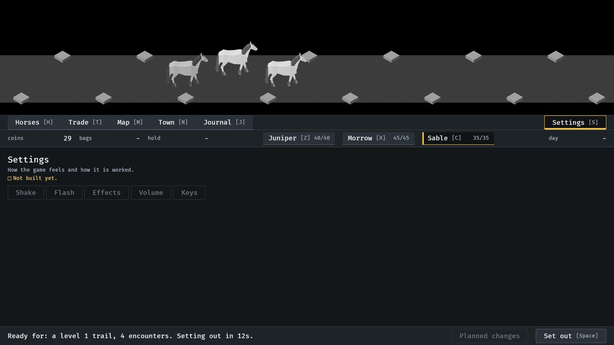
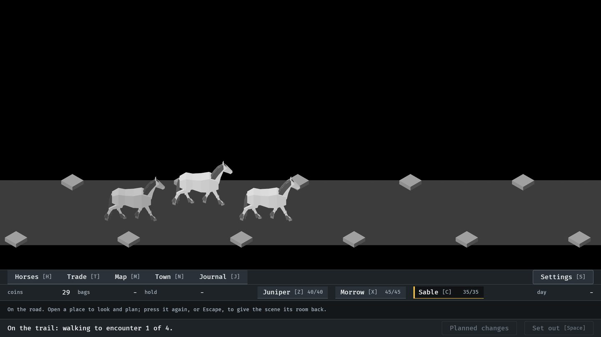
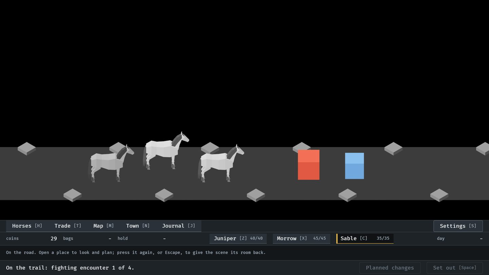
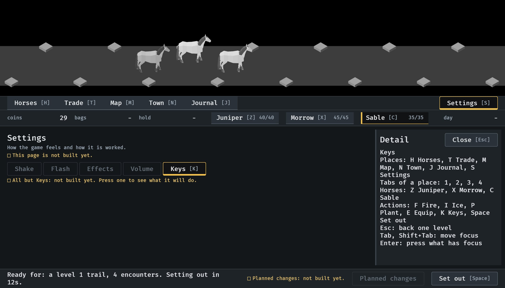

# Keys for places, tabs and horses, 2026-10-10

A town visit by keys alone (#229). From the end of the menu tour, `IDLE_TOUR`
with `--seed 6` (procedures/build-and-run.txt), which puts each key into
Bevy's keyboard state; nobody has pressed them on a real keyboard. How it
works: [menu-shell.md](../../menu-shell.md), "Keys".

**1.** Every place, tab and horse carries its key, as the working controls already did. H then 1 brought the party here from the Journal.

**2.** E equipped the drop (Morrow is at 45), 2 chose Abilities, and I chose Ice. The elements moved from 1, 2, 3 to F, I, P, since the digits are the tabs.

**3.** S opened Settings, then Escape was pressed: in town it closes a side panel and nothing else.

**4.** Space sent the party off.

**5.** On the road, J opened the Journal and Escape put it away again.

**6.** Added later the same day: K opened the Keys control in Settings, which lists every key beside what it works. Taken at the smallest window, 1120 x 640, where the list still fits the side panel.

