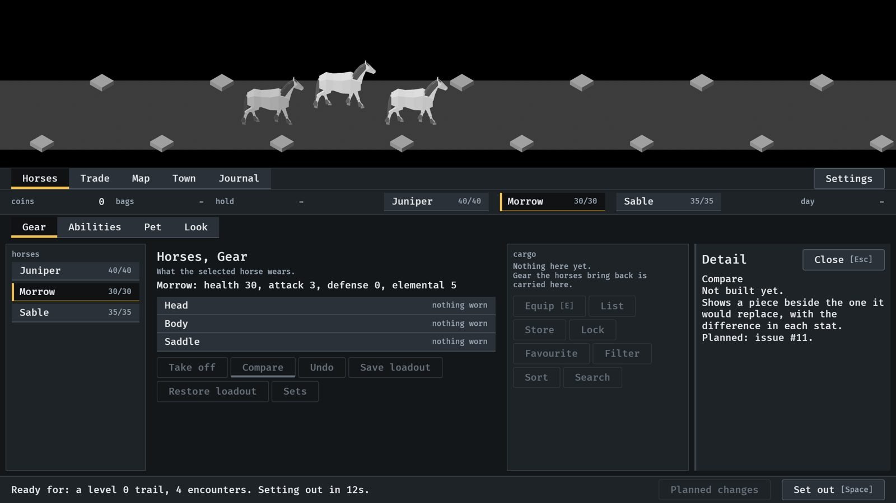
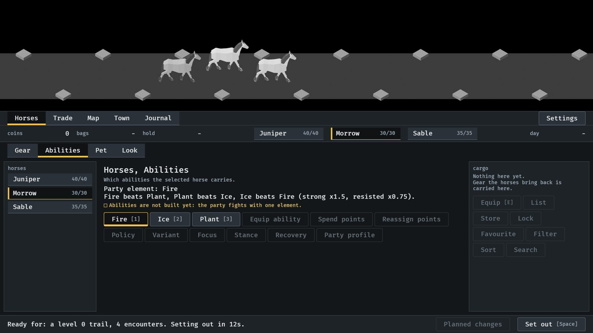
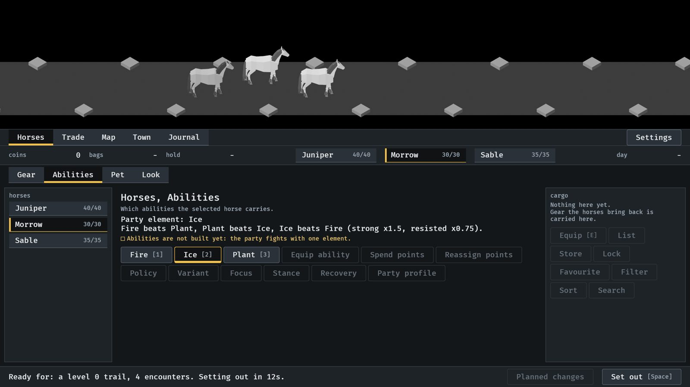
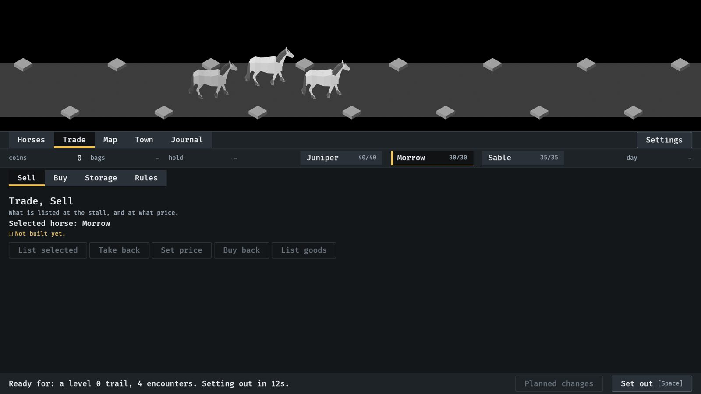
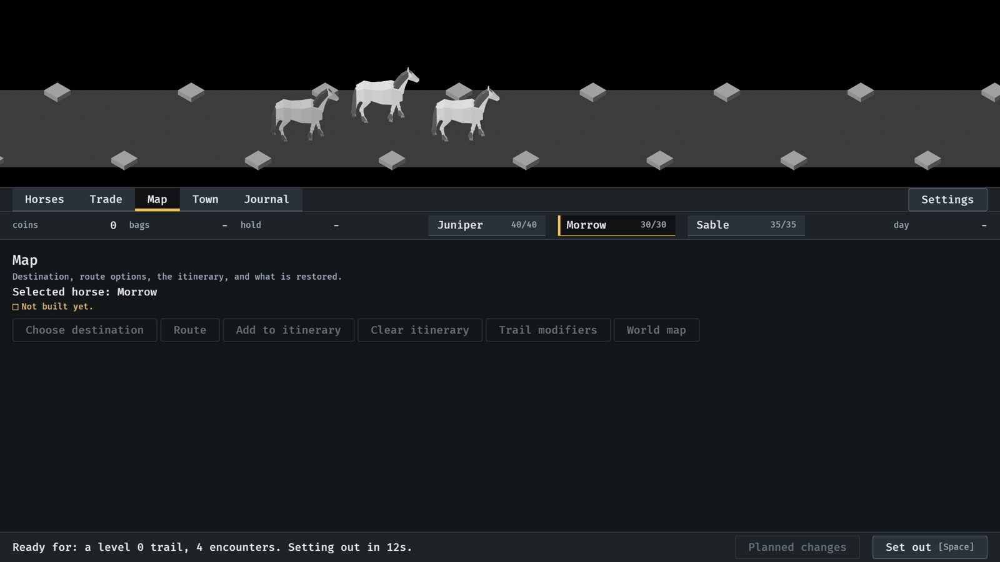
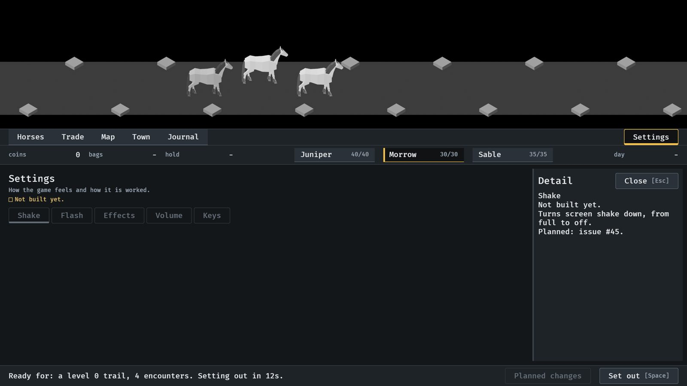
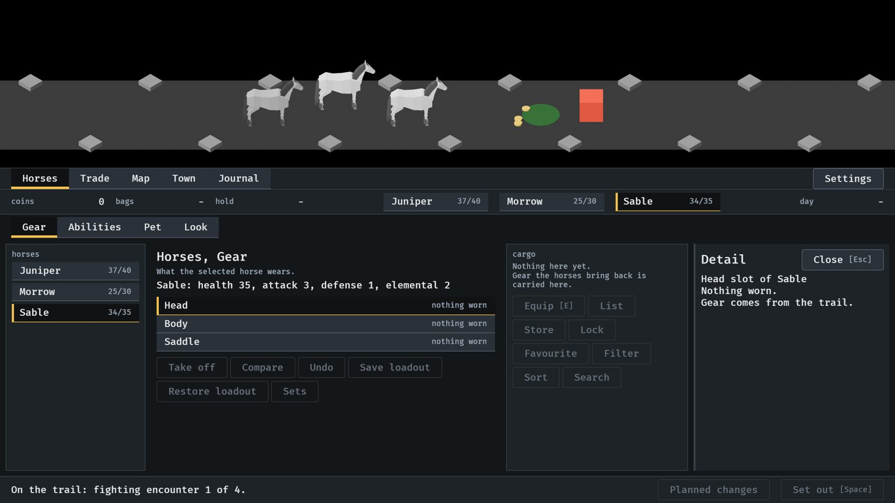
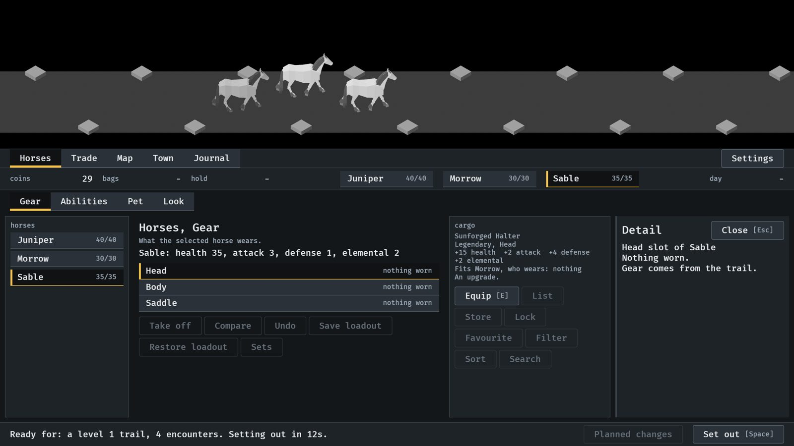
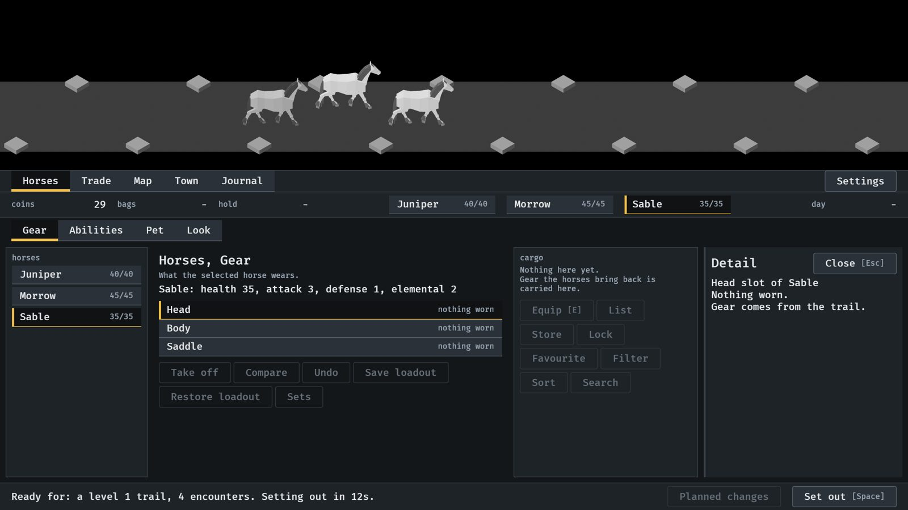

# The whole menu skeleton, 2026-10-10

Every control planned for the menus, in its place before it works (#238).
All from the menu tour, `IDLE_TOUR` with `--seed 6`
(procedures/build-and-run.txt). How it works:
[menu-shell.md](../../menu-shell.md), "Every planned control".

**1.** Horses, Gear. Compare is not built: it is drawn as unavailable, and pressing it opens the side panel with what it will do and its issue.

**2.** Horses, Abilities. The three elements work and carry their keys; the nine controls after them are planned.

**3.** Ice chosen with its button. The chosen element carries the selected mark.

**4.** Trade, Sell: a tab with nothing built, and its planned controls.

**5.** Map, a place with no tabs.

**6.** Settings, at the far end of the bar, with Shake pressed.

**7.** On the road with Horses open. Set out and Equip are unavailable there.

**8.** Back in town: the piece the trail dropped waits in the cargo column, and Equip is available.

**9.** After Equip: the piece is on Morrow (45 health in the strip) and the cargo is empty again.

