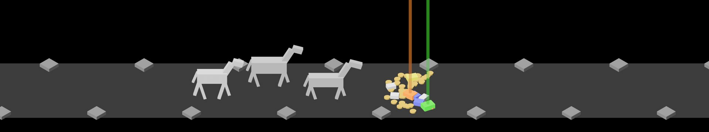
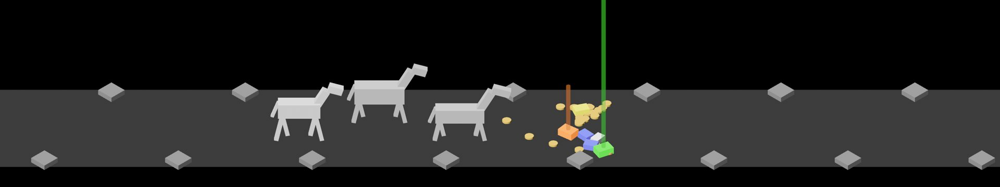
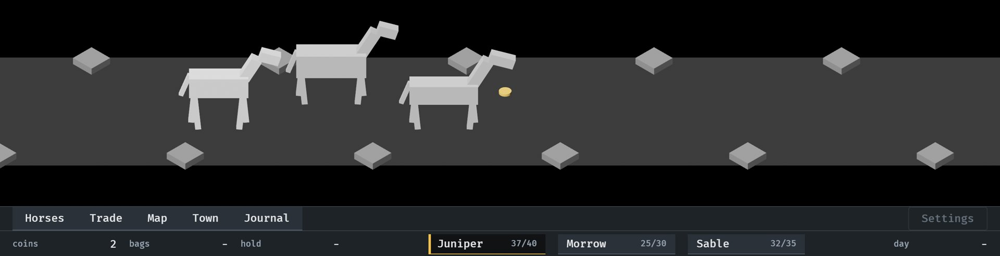

# The pickup, 2026-10-10

Pictures taken while building the pickup (#7), cut down to the scene. The
first two are the test burst, `cargo run -- --seed 6 --pickup`, with
`IDLE_SHOT_AT` 4.4 and 5.8; the third is a real kill,
`cargo run -- --seed 6` at 23.85. How it works:
[loot-shower.md](../../loot-shower.md).

**1.** The whole burst at rest, in the pause before anything is collected.

**2.** A second and a bit later: the nearest pieces have gone, three coins are on their way to the lead horse one behind another, and the Legendary's beam is sinking as its piece leaves.

**3.** On the road: the first enemy dropped 4 coins, two have arrived and the counter says 2, and the next is about to reach the lead horse. The party has already walked on.

