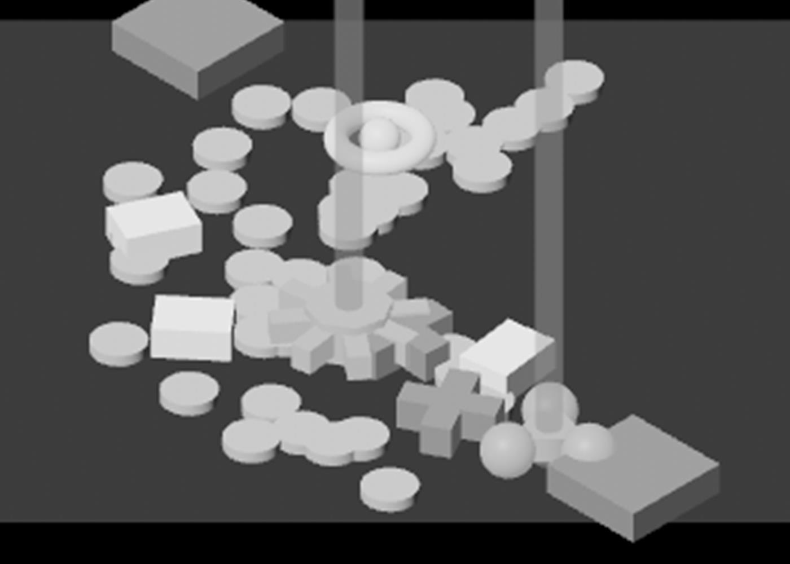
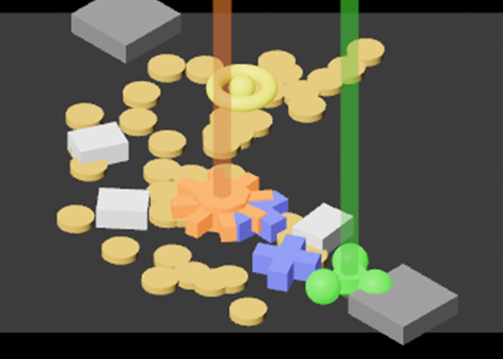

# Rarity by shape, 2026-10-10

The test burst at rest (#240), `--burst --seed 6` at `IDLE_SHOT_AT=5.2`
(procedures/build-and-run.txt), cut out of the picture and enlarged four
times. Stills read by the session; the owner has not looked. How it works:
[loot-shower.md](../../loot-shower.md), "Rarity".

**1.** With the colour taken out. Three slabs are Normal, two crosses are Magic, the ring with a stone in it is Rare, the rayed sun under the left beam is Legendary and the three stones under the right beam are Set. One cross lies under the sun, and a trail post stands in front of the Set.

**2.** The same picture in colour.

