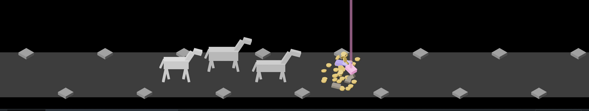
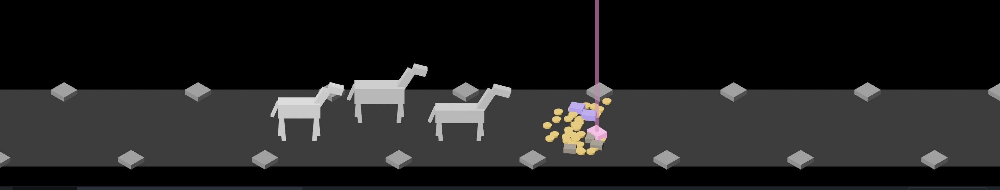

# The rarity signal, 2026-10-10

Pictures taken while building the rarity signal (#6). Both are the test
burst, `cargo run -- --seed 6 --burst`, with `IDLE_SHOT_AT` 2.8 and 4.5, cut
down to the scene. How it works: [loot-shower.md](../../loot-shower.md).

**1.** A Rare in the air: the pink piece is still tumbling, and its beam already stands over it. Two Uncommon pieces (violet) lie beside it.

**2.** The mixed burst at rest: three Common pieces (dull grey-brown), two Uncommon (violet) and the Rare (pink, larger, under its beam) among 40 coins.

