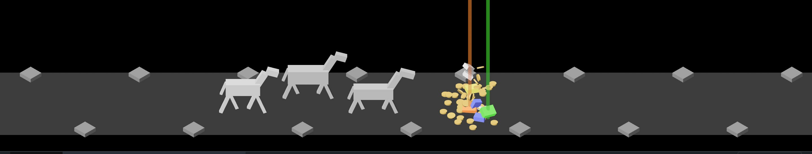

# The rarity signal, 2026-10-10

Pictures taken while building the rarity signal (#6), retaken the same day
with the owner's five tiers and colours. Both are the test burst,
`cargo run -- --seed 6 --burst`, with `IDLE_SHOT_AT` 2.9 and 4.8, cut down to
the scene. How it works: [loot-shower.md](../../loot-shower.md).

**1.** The last pieces in the air: a Normal piece (white) still tumbling at the top, and the Legendary (orange) and Set (green) beams already standing.

**2.** The mixed burst at rest among 40 coins: three Normal (white), two Magic (blue), a Rare (yellow, at the top, hard to pick out among the coins), a Legendary (orange) and a Set (green), the last two under their beams.

