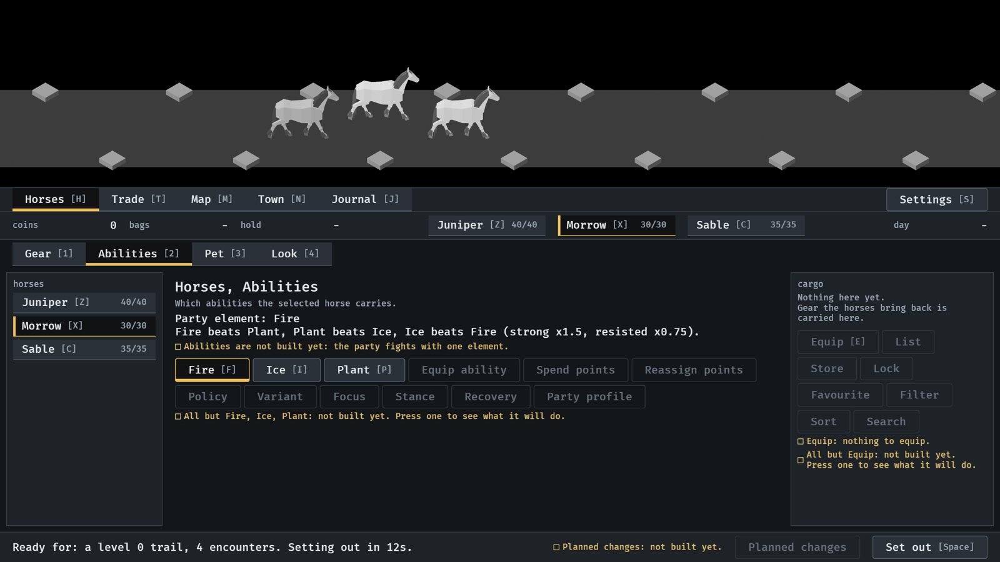
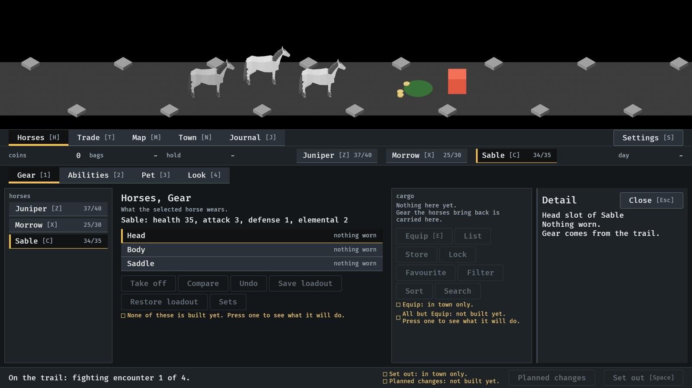
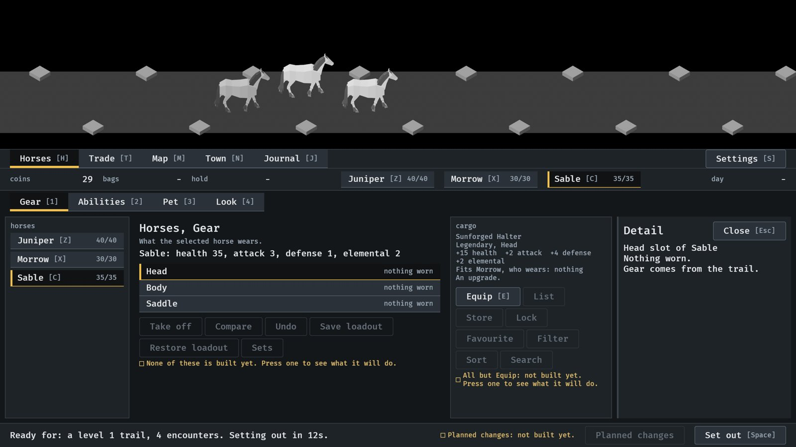
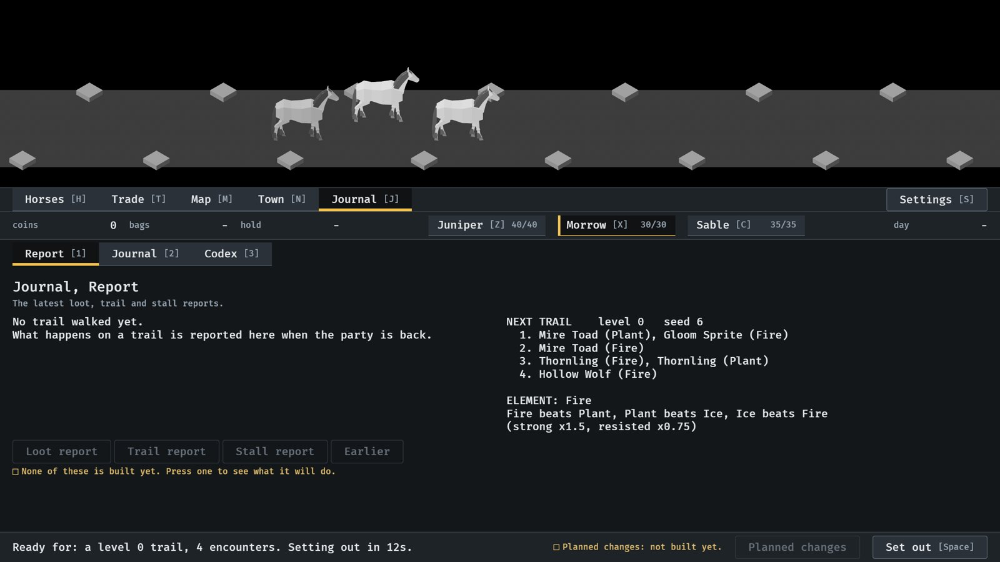

# A control that cannot be used says why, 2026-10-10

The line under each group of controls (#233). From the menu tour,
`IDLE_TOUR` with `--seed 6` (procedures/build-and-run.txt), at 1600x900;
stills read by the session, not seen moving. How it works:
[menu-shell.md](../../menu-shell.md), "Why a control cannot be used".

**1.** In town. Fire, Ice and Plant can be used, so the line under them covers only the rest: not built. In the cargo, Equip says there is nothing to equip. The footer says the same of Planned changes.

**2.** On the road. Equip and Set out now say "in town only".

**3.** Back in town with a drop. Equip can be used, and its line is gone.

**4.** Before any trail, the report says what will be reported there.

