# The two scene layouts, 2026-10-10

Pictures taken while building the road layout and the move between it and
the town layout (#205). The first eight are from the menu tour,
`IDLE_TOUR` with `cargo run -- --seed 6`; the last three are single
pictures with `--window` (procedures/build-and-run.txt). How it works:
[menu-shell.md](../../menu-shell.md), "The two layouts".

## Setting out and coming back

**1.** In town: the scene is the top third, a place fills the rest.

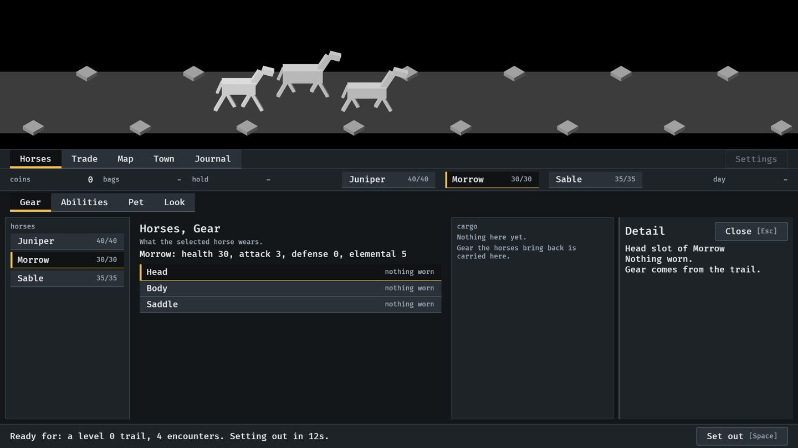

**2.** Setting out, 0.2 s in: the scene is growing and the place is being covered.

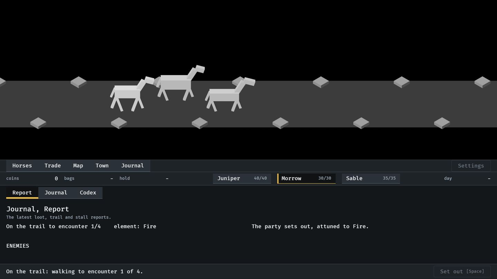

**3.** On the road: the scene has four fifths of the window. The bar, the status strip and the footer stay.

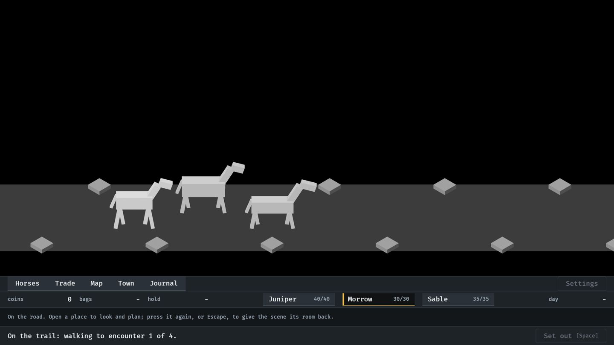

**4.** A fight in the road view. The room above the party is where drops will fly.

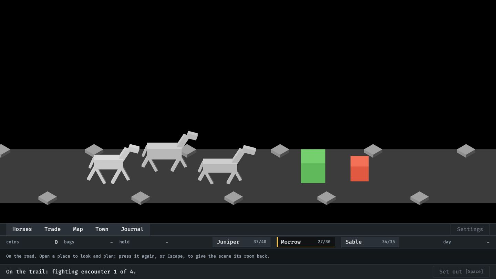

**5.** A place pressed on the road, 0.2 s in: the scene is on its way back to the top third.

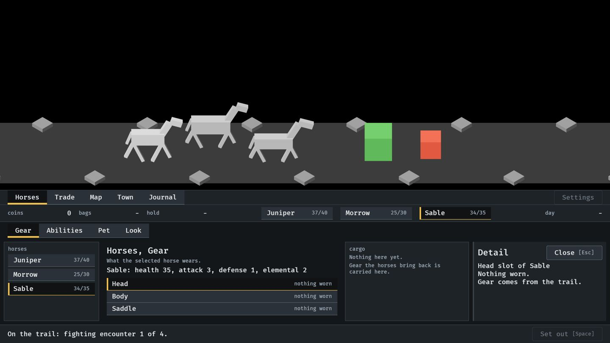

**6.** The place open on the road, as it was left in town.

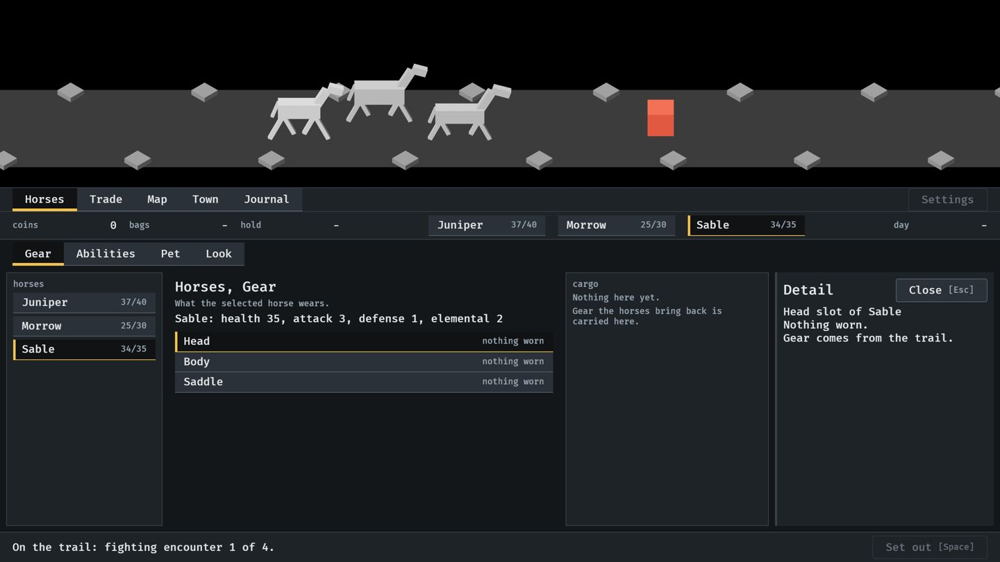

**7.** The open place pressed again, 0.2 s in: closing.

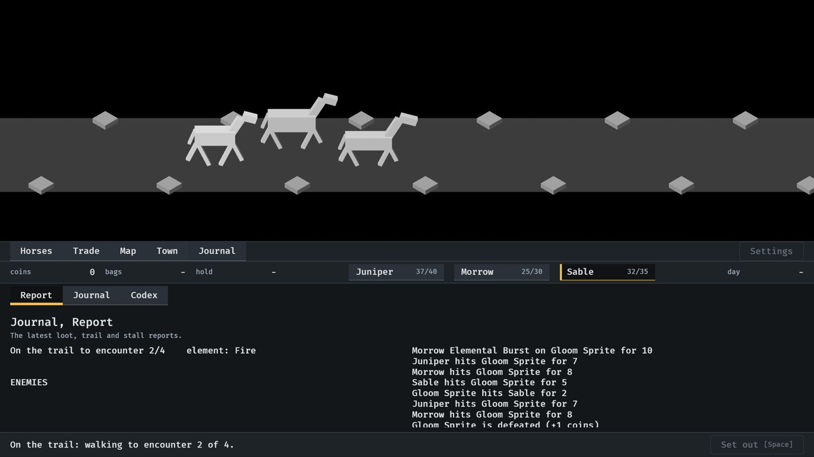

**8.** Back in town: the place the player was last in opens by itself.

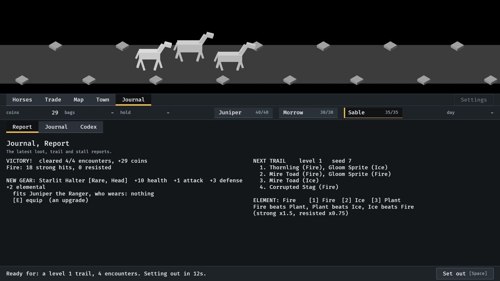

## Window sizes

**9.** The smallest window, 1120 x 640, in town.

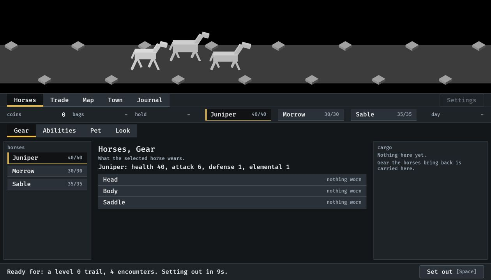

**10.** The smallest window on the road: the three bands and one line just fit under the scene.

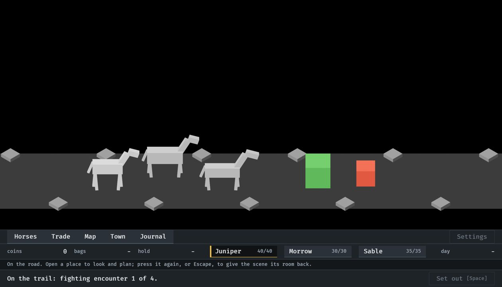

**11.** A tall, narrow window (1024 x 1000, made before the minimum width went up): the scene shows more height so that the party and its enemies stay in view.

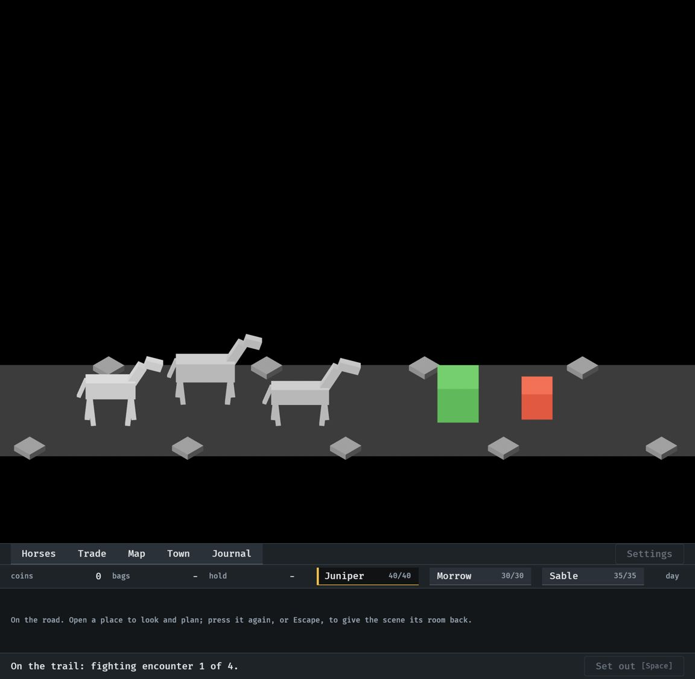
