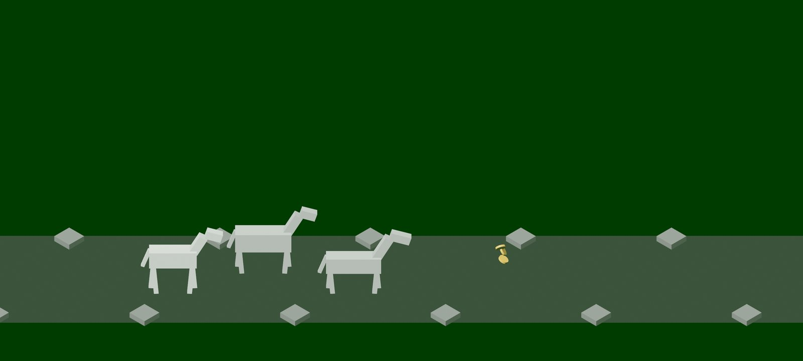
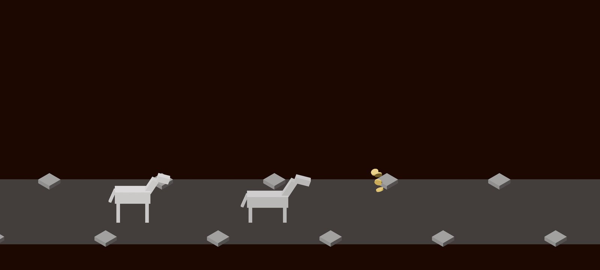
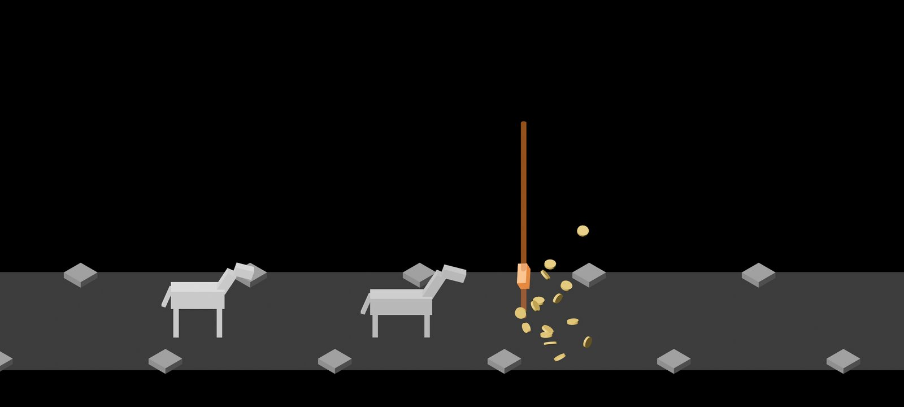
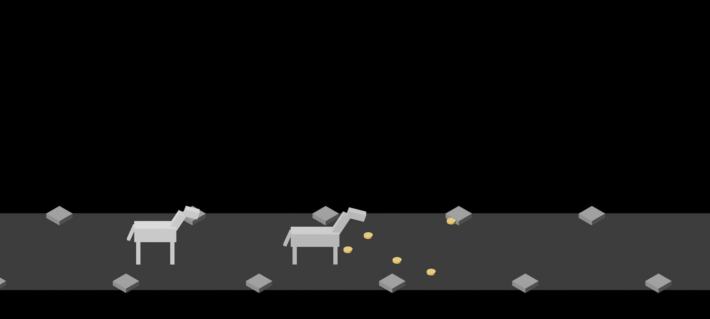

# Screen response and the calm after the kill, 2026-10-10

Pictures taken while building the screen's response (#9), cut down to the
scene. The first is the test burst on the road,
`cargo run -- --seed 6 --burst --burst-at 14` with `IDLE_SHOT_AT` 14.36;
the others are the final kill of `cargo run -- --seed 6`, at 64.86, 65.9
and 68.6. How it works: [loot-shower.md](../../loot-shower.md), Screen
response and The calm after the kill.

**1.** The test burst erupts: its best piece is a Set, so the flash is green and the strongest there is, a few hundredths of a second old. The first two coins are just leaving.

**2.** The final kill erupts, a third of a second after the enemy fell: its gear is a Legendary, so the flash is orange and a little fainter. The first coins are leaving; the party is standing.

**3.** The same fountain a second later, in the road view, with the Legendary's beam whole. Before this the party was already in town here and the beam ran off the top ([fountain sizes](../2026-10-10-fountain-sizes/README.md), picture 2).

**4.** Four seconds after the kill the road is still held: the last coins are on their way to the party, and it leaves for town when they are in.

