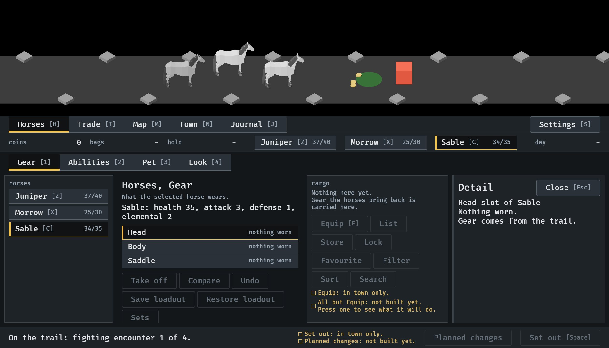
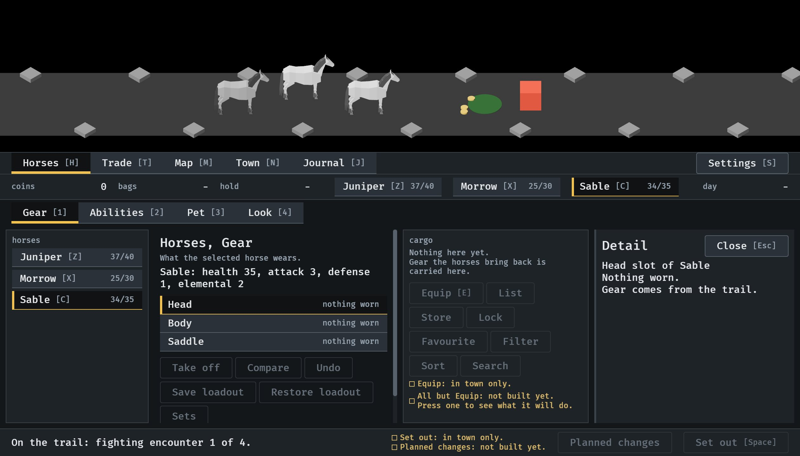
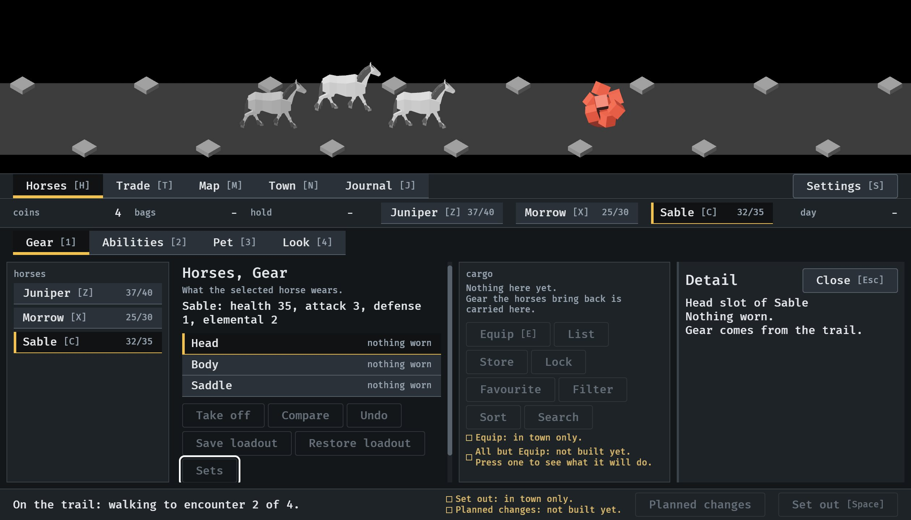
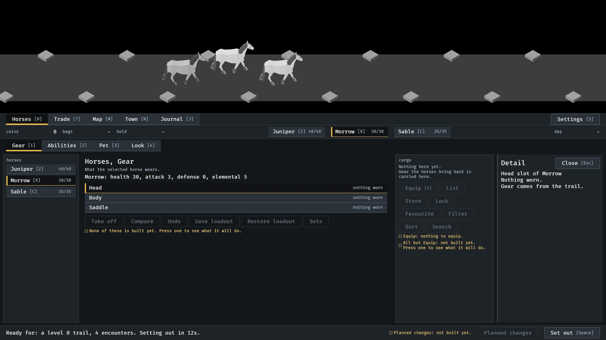

# A tab that does not fit scrolls, 2026-10-10

The Gear tab at the smallest window, 1120x640, with the side panel open
(#243). From the menu tour, `IDLE_TOUR` with `--seed 6`
(procedures/build-and-run.txt); stills read by the session, not seen moving,
and the wheel was not tried. How it works:
[menu-shell.md](../../menu-shell.md), "A tab that does not fit".

**1.** Before. Sets is cut in half by the footer and the line under the controls is out of sight, with nothing to say so.

**2.** Now. The same page has a bar beside it: there is more below.

**3.** Sets takes the keyboard focus, as Tab would give it, and the page moves to show all of it.

**4.** At 1600x900 the page fits, and there is no bar.

