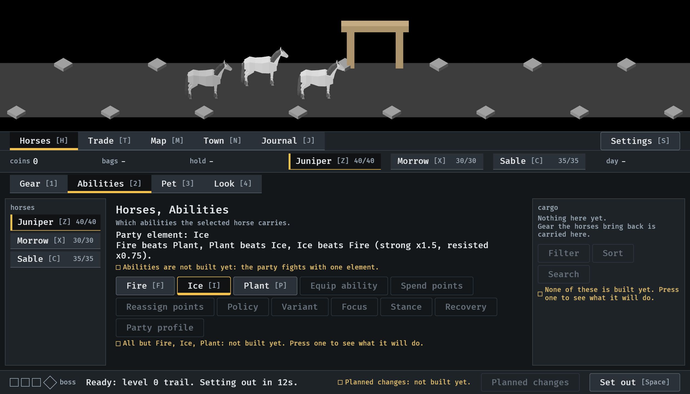
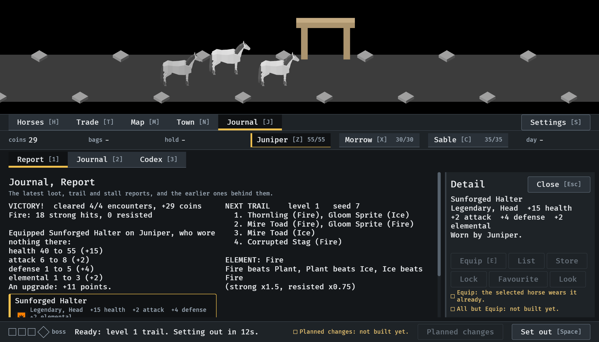
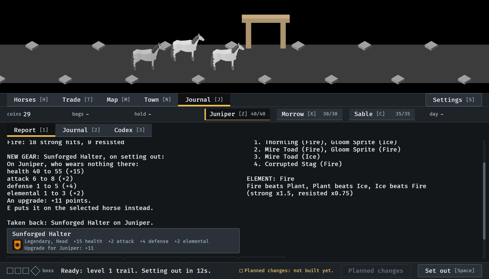

# The click budget, walked, 2026-10-11

Where three of the common jobs end, with the presses each took (#236).
Stills from the walk at `--seed 6`, at the smallest window (1120x640), read
by the session. The presses are the game's own, not a hand on a mouse. The
table: [click-budget.md](../../click-budget.md).

**1.** A different ability, by pointer, from Horses on Gear: the Abilities tab, then Ice. Two presses. By keys it is one, I.

**2.** The upgrade the report just showed, by pointer: the piece in the report, which opens its card, then Equip. Two presses. By keys it is one, E.

**3.** What becomes of the drop and why, from Horses: one press on Journal, or J. The report says which horse it goes on at setting out and by how many points it is an upgrade. (The equip above has been taken back.)

