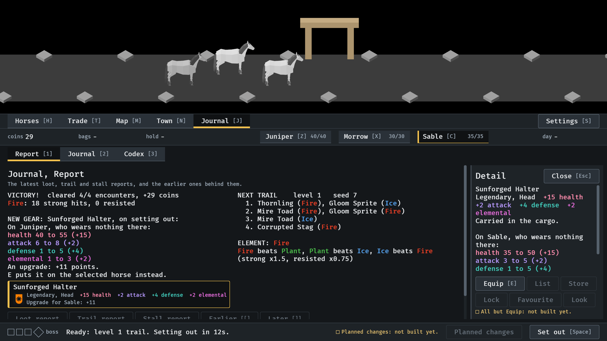
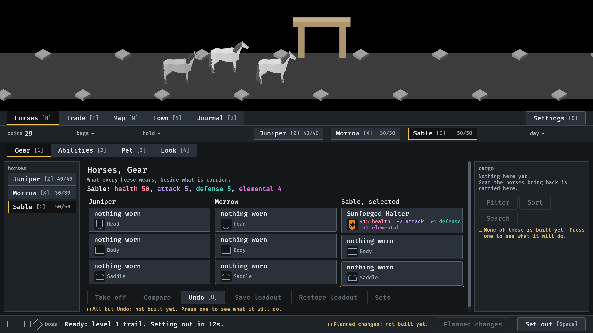
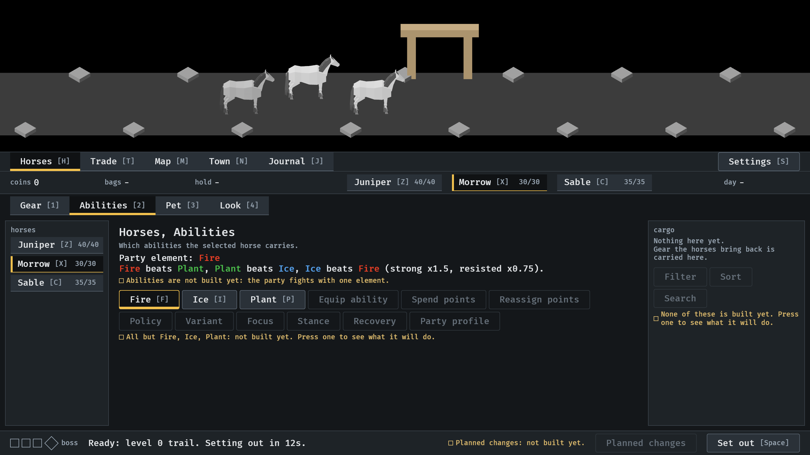

# Coloured text, 2026-10-11

An element and each stat in its own colour wherever the menus say it (#251).
Stills from the menu tour at `--seed 6`, read by the session. How it works:
[item-card.md](../../item-card.md), "Colour".

**1.** The report, the drop's row under it and its card: the same four stat colours in all three, and the elements of the trail ahead in the colours their enemies have in a fight.

**2.** The gear overview: the selected horse's stats and what a worn piece adds.

**3.** The party's element and what beats what.

