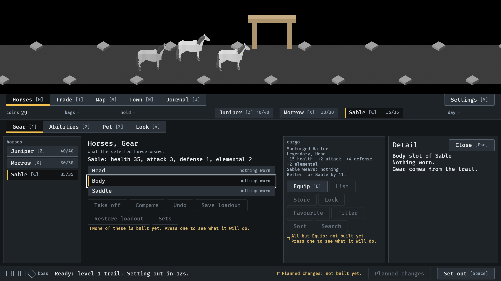
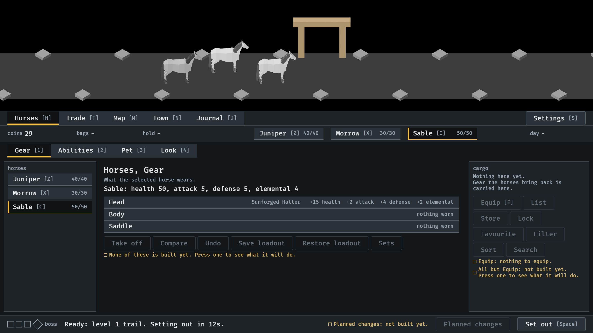

# Equip onto the selected horse, 2026-10-11

Any horse can wear any piece, and Equip puts the drop on the selected horse
(#250). Stills from the menu tour at `--seed 6`
(procedures/build-and-run.txt), read by the session. How it works:
[menu-shell.md](../../menu-shell.md), "What a tab shows".

**1.** Sable is selected, so the drop in the cargo is compared with what Sable wears: an upgrade for Sable, in points.

**2.** Equip put it on Sable. The slot row names the piece and what it adds, and Sable's health and stats have risen.

