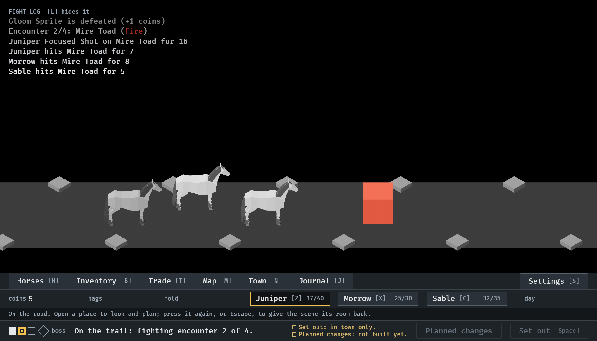
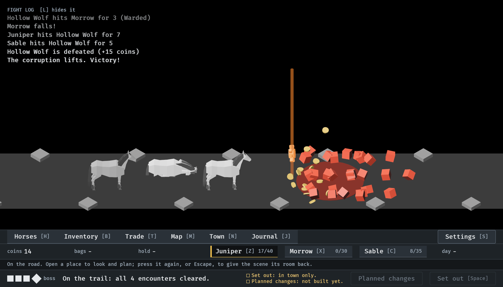

# The fight log over the road, 2026-10-11

The log of the fight moved out of the Journal and lies over the road scene,
at its top left (#306). Stills at `--seed 6`, read by the session: the first
two at the smallest window (1120x640), the third from the menu tour. How it
works: [menu-shell.md](../../menu-shell.md), "The fight log".

**1.** A fight, 30 s in: the six latest lines, the newest lowest and whole, the older ones fainter, Fire in its colour. The party and the enemy are clear of it.

**2.** The final kill, 65.9 s in: the fountain and its beam are to the right of the log and wholly in view.

**3.** L pressed: the lines are away and the heading stays, with the key that brings them back.

![The road view with only the heading "FIGHT LOG hidden [L] shows it" at the top left.](03-hidden-by-its-key.png)
