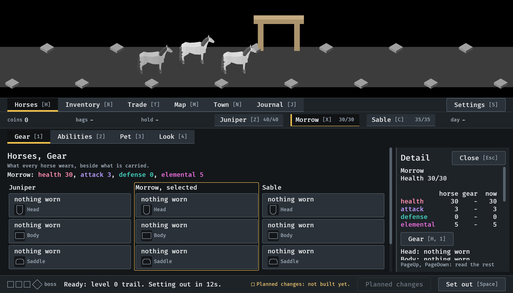
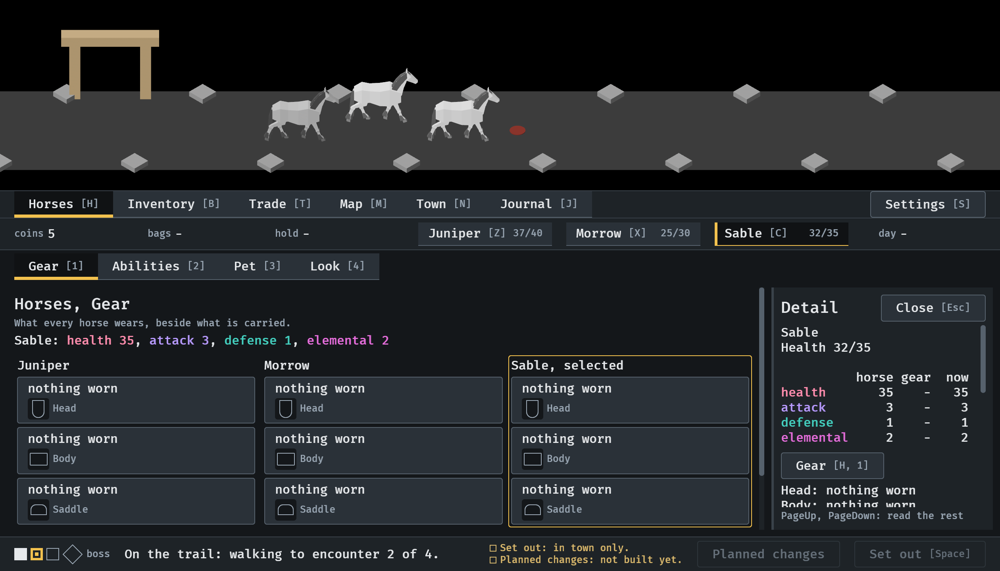
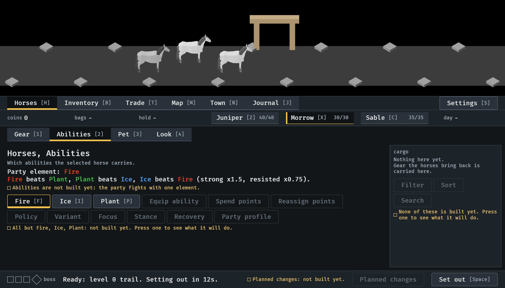

# A horse's view, 2026-10-11

A press on a horse opens everything about it, and the horses are listed
once (#311). Stills from the menu tour at `--seed 6`, at the smallest
window (1120x640), read by the session. How it works:
[menu-shell.md](../../menu-shell.md), "A horse's view".

**1.** In town, a press on Morrow in the strip: selected, and its view in the side panel, over the cargo. The list of horses down the left is gone, and the overview has its room.

**2.** On the road, a press on Sable: its health is the fight's.

**3.** Each part is headed by a button that goes to its tab. A press on Abilities in Morrow's view: the Horses place is on Abilities, Morrow still selected, and the view is put away.

