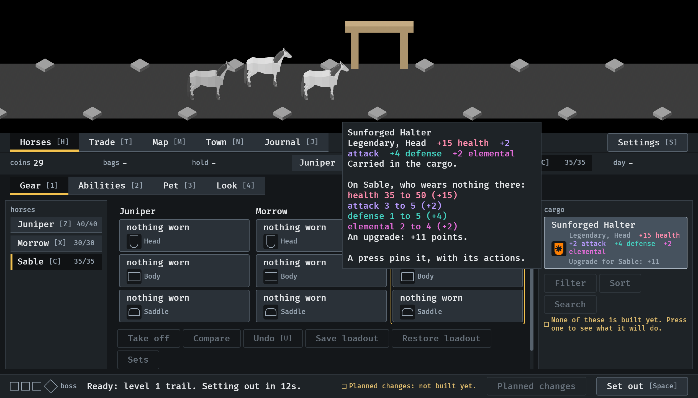
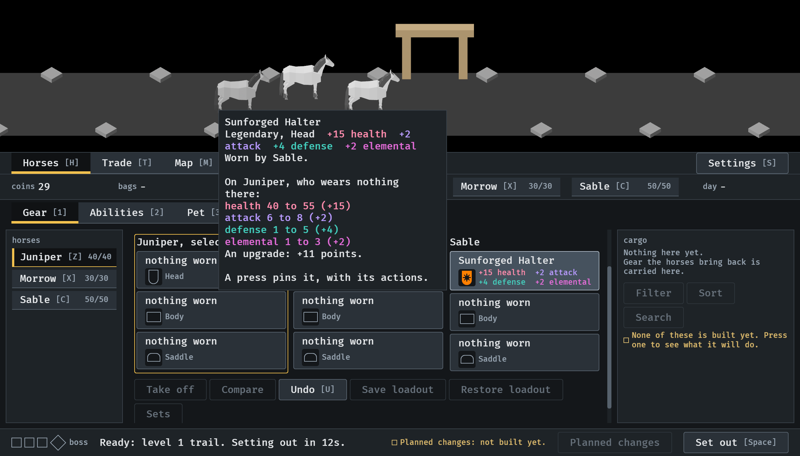
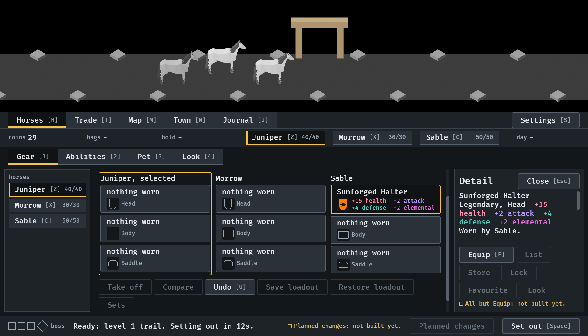

# The card under the pointer, 2026-10-11

The pointer resting on a piece shows its card beside it (#228). Stills from
the menu tour at `--seed 6`, at the smallest window (1120x640), read by the
session; the pointer is Bevy's own, moved by the tour, not a hand on a
mouse. How it works: [item-card.md](../../item-card.md), "Under the pointer".

**1.** The pointer on the drop in the cargo, with Sable selected: the card is beside the cell, with the comparison on Sable. Nothing is pinned and the cargo has not moved.

**2.** The pointer on what Sable wears, with Juniper selected: the same card, against Juniper. It covers part of the overview and of the scene while the pointer rests.

**3.** Pressed: the card is pinned in the side panel with its actions, and the pointer's card has gone, though the pointer is still on the piece.

