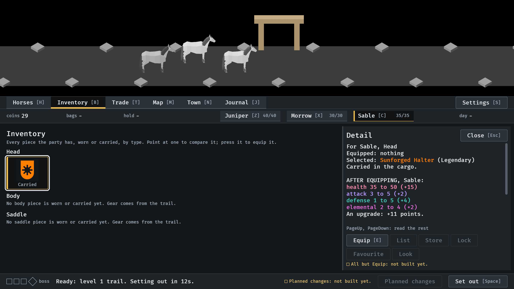

# The Inventory, 2026-10-11

Every piece the party has, in a grid of tiles by type, in a place of its
own, with the comparison under the pointer (#308). Stills from the menu
tour at `--seed 6`, at the smallest window (1120x640), read by the session.
How it works: [menu-shell.md](../../menu-shell.md), "The Inventory", and
[item-card.md](../../item-card.md), "The comparison".

**1.** Back from the first trail: Inventory is in the bar after Horses. The drop is a tile in the Head group, carried; the other types say they are empty.

**2.** The pointer resting on the tile: the comparison for Sable, nothing equipped, the piece under the pointer, what changes, and the table.

**3.** Equipped: the same tile now names who wears it.

**4.** A press (here Down, then Enter) pins the comparison at the right, with Equip.

