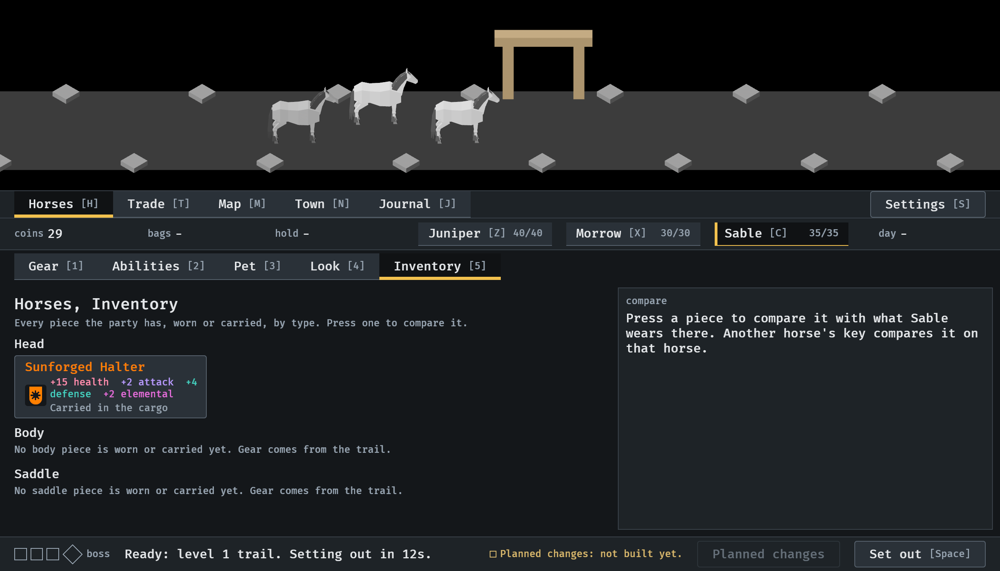
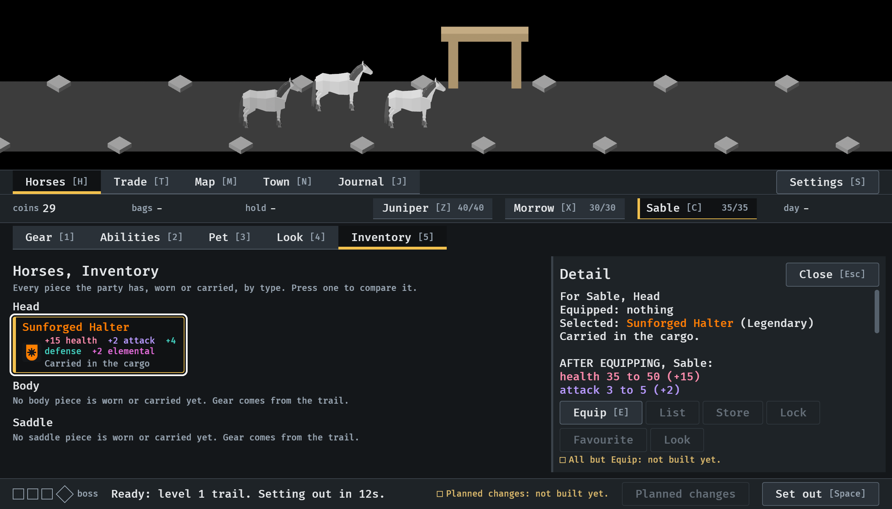
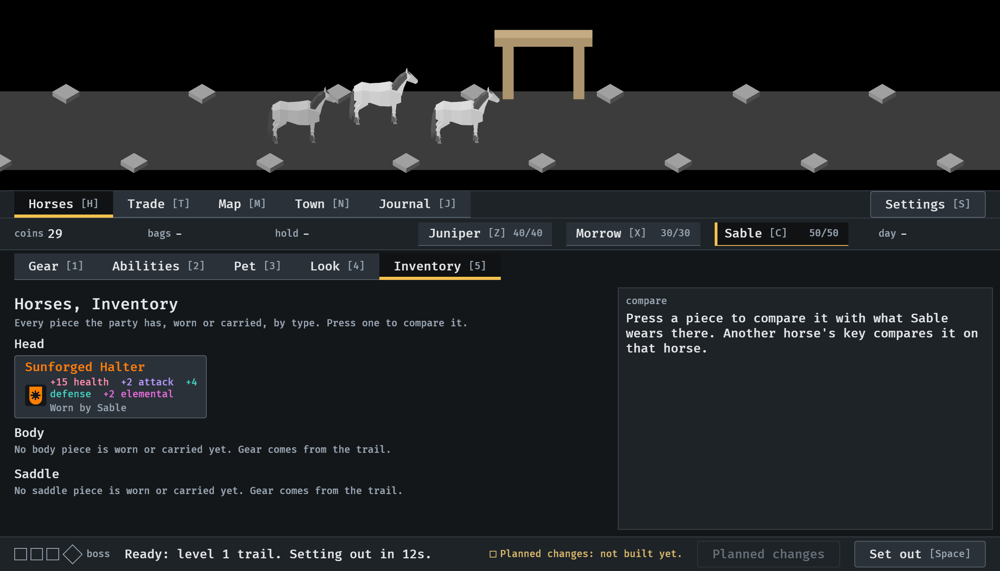

# The Inventory, 2026-10-11

Every piece the party has, in a grid by type, and the comparison beside it
(#308). Stills from the menu tour at `--seed 6`, at the smallest window
(1120x640), read by the session. How it works:
[menu-shell.md](../../menu-shell.md), "The Inventory", and
[item-card.md](../../item-card.md), "The comparison".

**1.** Back from the first trail: the drop is in the Head group, carried; the other types say they are empty. The grid has the place's width and the comparison keeps its room.

**2.** A press on the piece (here Down, then Enter) opens the comparison: for Sable, nothing equipped, the piece selected, and what changes. The table and what Equip would do are a scroll below at this size.

**3.** Equipped: the same cell now says who wears it.

