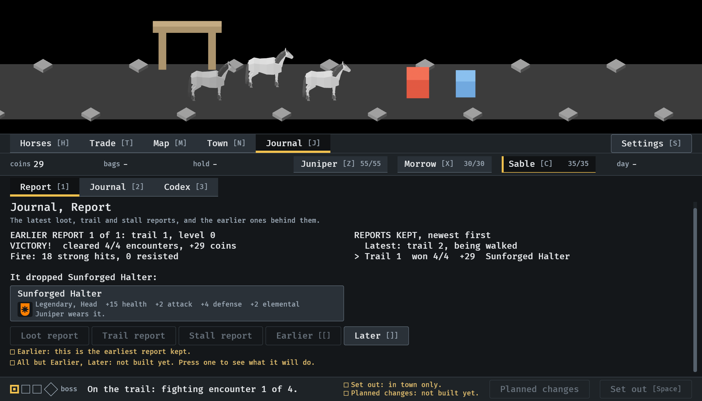
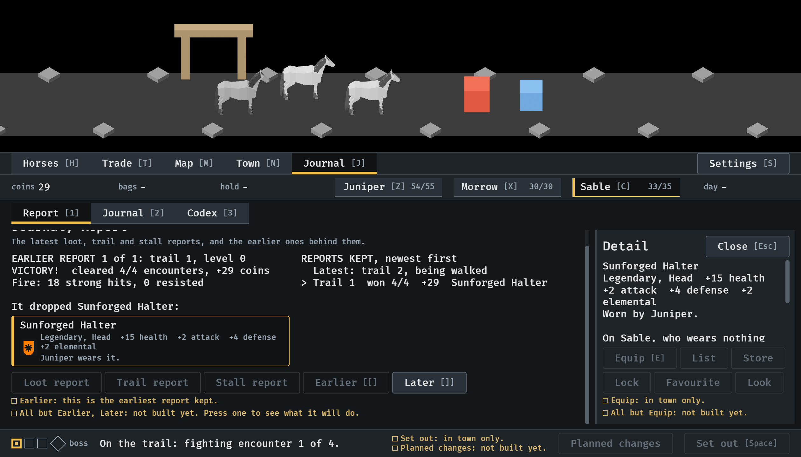
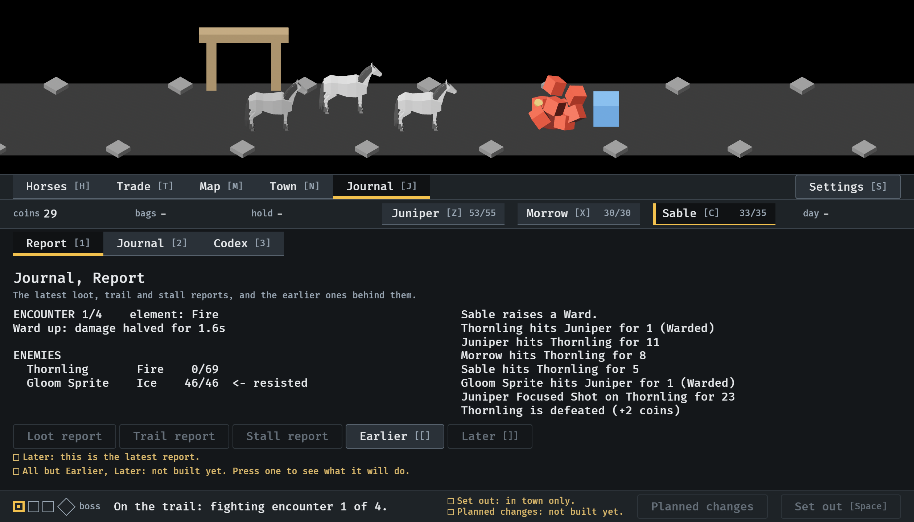

# The Journal keeps reports, 2026-10-11

A trail's report is kept after the party has moved on, and opened again
from the Journal (#231). Stills from the menu tour at `--seed 6`, at the
smallest window (1120x640), read by the session; the [ and ] keys are put
into Bevy's keyboard state, not pressed on a keyboard. How it works:
[menu-shell.md](../../menu-shell.md), "The Journal's reports".

**1.** On the road, on the second trail, [ opens the report of the first. Beside it is the list of the reports kept. The piece it dropped is shown where it is now: Juniper wears it.

**2.** A press on the piece opens its card, from the earlier report. Equip is there, and says it is for town.

**3.** ] goes back to the latest, the fight being fought. Later is now unavailable and says why.

