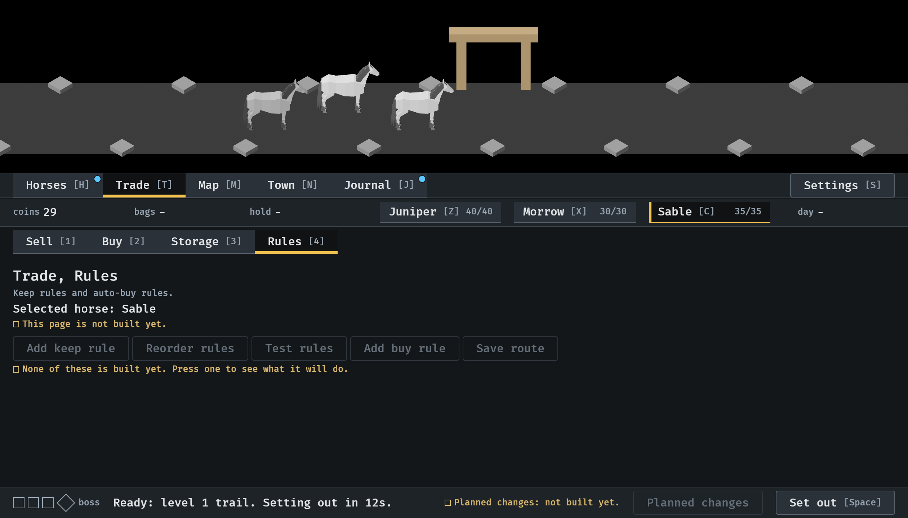
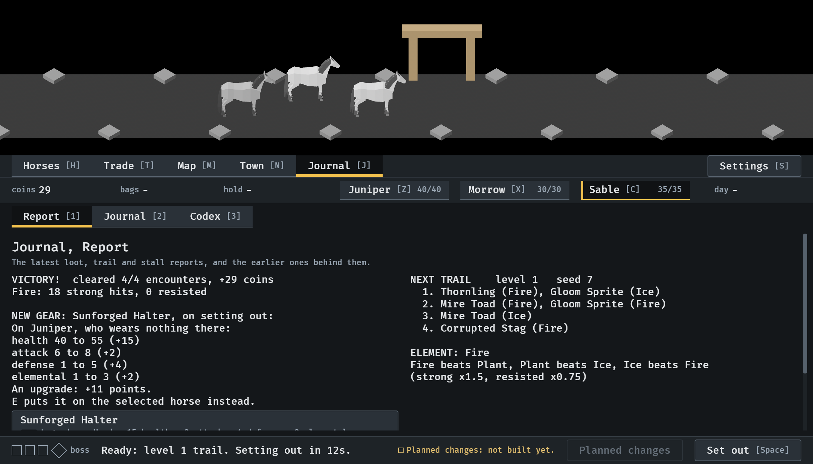
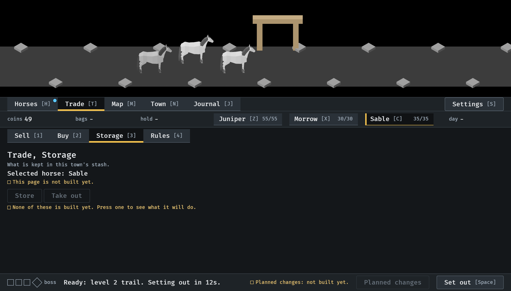
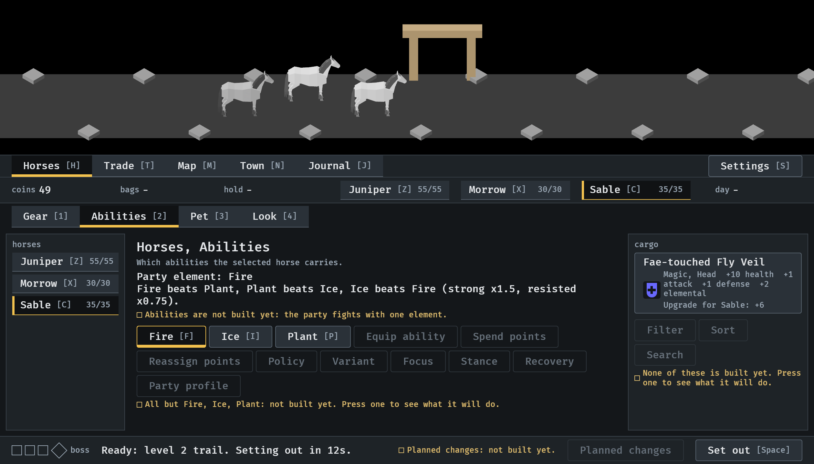
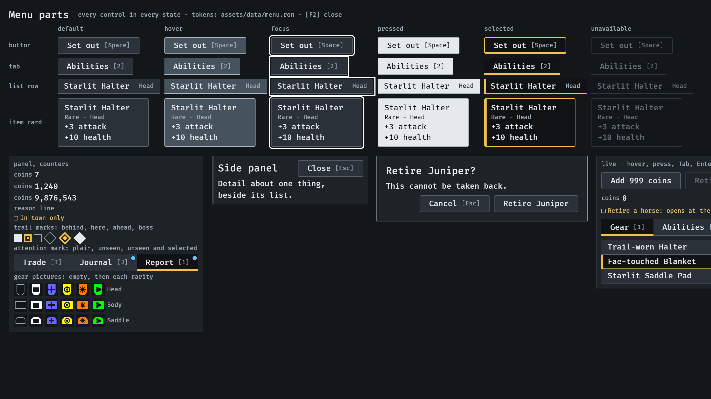

# A place says when it has something unseen, 2026-10-11

A round dot on a place in the bar when something in it has not been seen,
gone once it has (#232). Stills from the menu tour at `--seed 6`, at the
smallest window (1120x640), and one of the parts screen, read by the
session. How it works: [menu-shell.md](../../menu-shell.md), "Marks".

**1.** The party comes home from its first trail while Trade is open. It brought a Legendary piece that is an upgrade: Horses is marked for the upgrade in the cargo, Journal for the report.

**2.** One press, on Journal. The report is in view, and it shows the piece, so both marks are gone.

**3.** Home from the second trail, again with Trade open. The piece is an upgrade, so Horses is marked. The trail was won and the piece is Magic, so the report raises nothing.

**4.** One press, on Horses. The cargo is in view and the mark is gone.

**5.** The parts screen: a tab plain, a tab with the mark, and a selected tab with it. The mark is a dot in the corner; the selected mark is a bar underneath.

