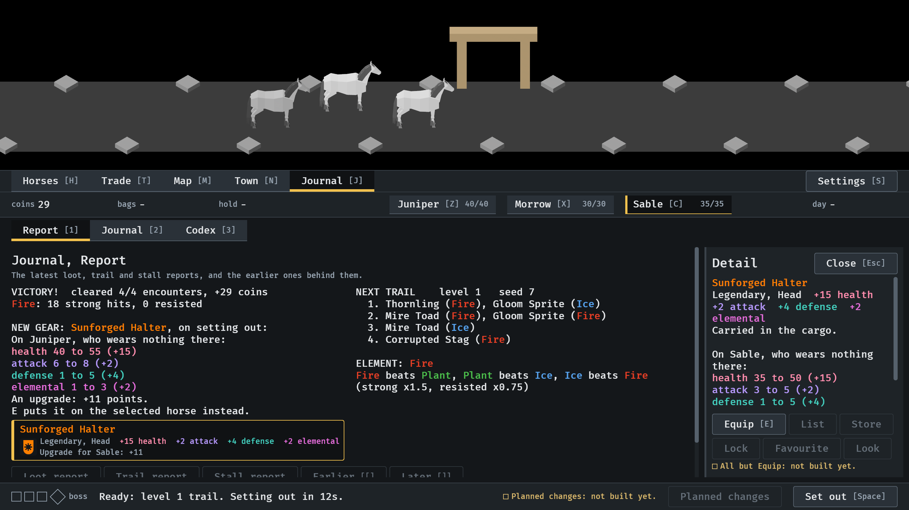
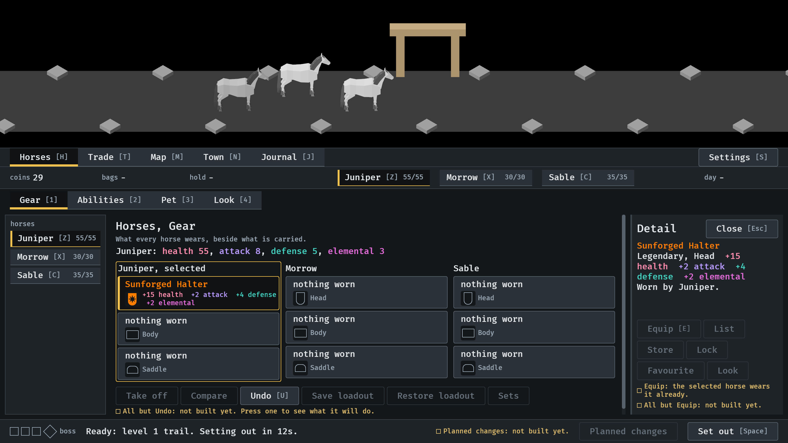
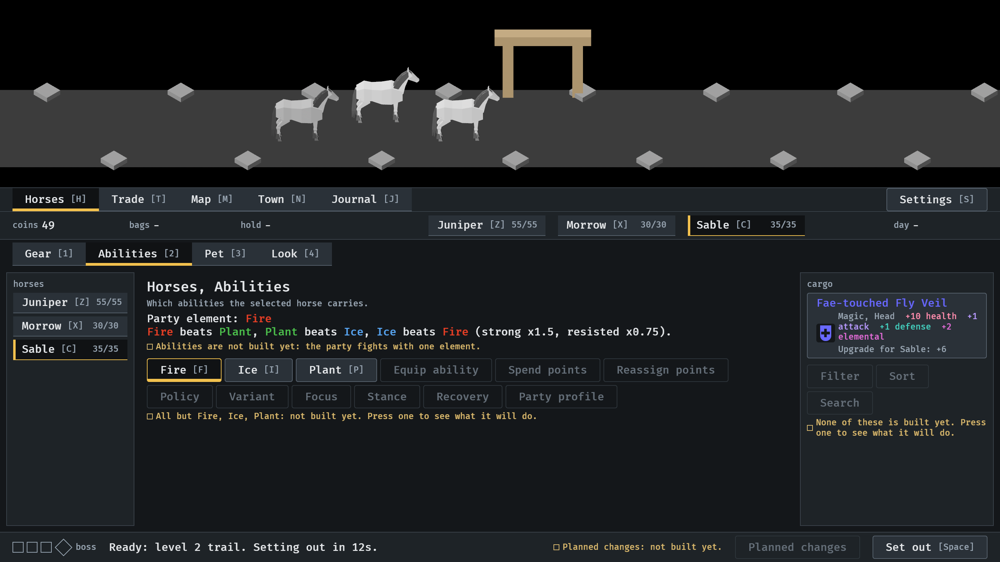

# A piece is named in its rarity, 2026-10-11

A piece's name in the colour of its rarity, wherever the menus say it
(#309). Stills from the menu tour at `--seed 6`, read by the session. How it
works: [item-card.md](../../item-card.md), "Colour".

**1.** A Legendary piece, in orange in the report's line, in its row under the report and at the head of its card.

**2.** The same piece worn: its name in orange in Juniper's slot in the gear overview, and on the pinned card.

**3.** A Magic piece carried in the cargo, in blue.

