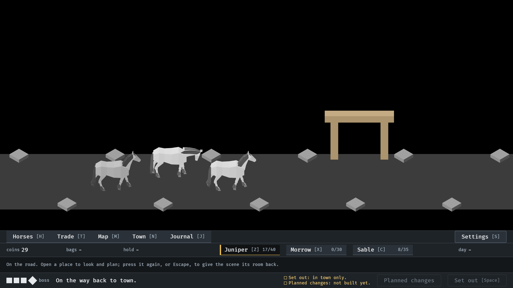

# Release 0.2.1, 2026-10-11

A picture taken for the 0.2.1 release notes, of a feature the gallery had
none of. From the release build itself, `target/stage/horse_heroes.exe
--seed 6` with `IDLE_SHOT_AT` 71.5, read by the session.

**1.** A won trail ends with the walk back: the footer says so, the town gate is coming up the trail, and the menus have not moved.

