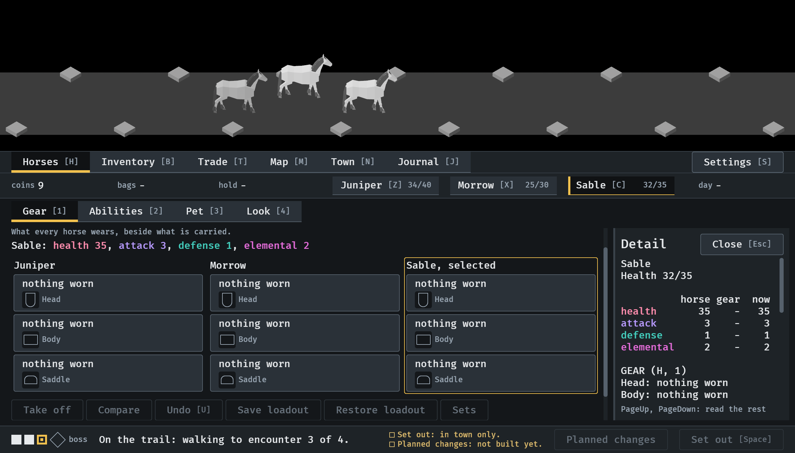
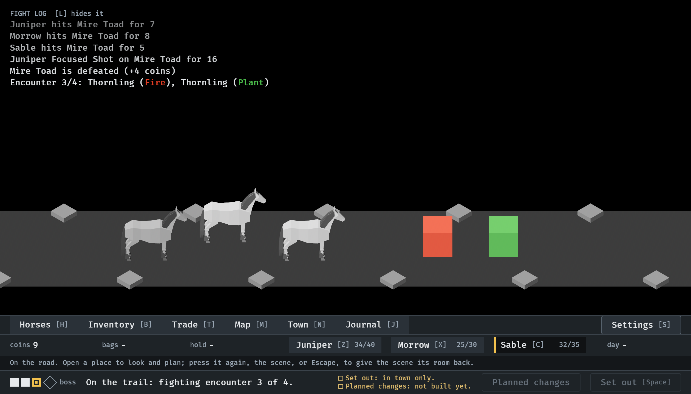

# A press on the scene closes the place, 2026-10-11

On the road, one press anywhere on the scene puts the open place away and
gives the scene its room back (#307). Stills from the menu tour at
`--seed 6`, in a window of 1120x640, read by the session. How it works:
[menu-shell.md](../../menu-shell.md), "A press on the scene".

**1.** On the road with Horses open and a horse's view in the side panel. The scene has a third of the window.

**2.** One press on the scene later: the place and its side panel are away, the scene has four fifths of the window, the fight log is back, and the line under the strip names the scene among the ways to close a place.

