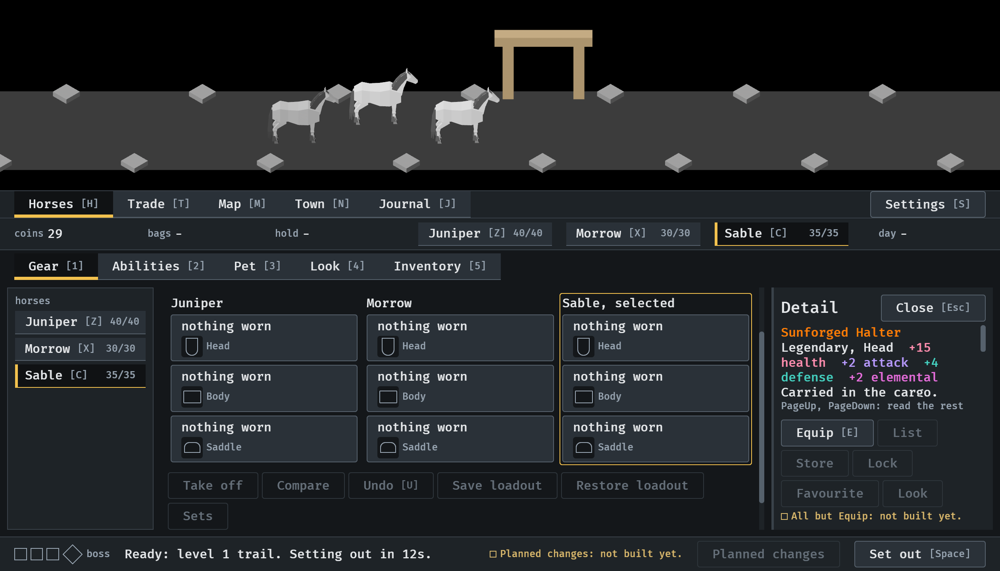
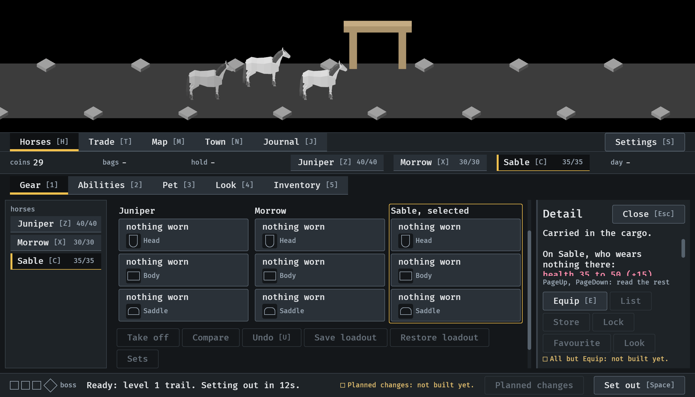
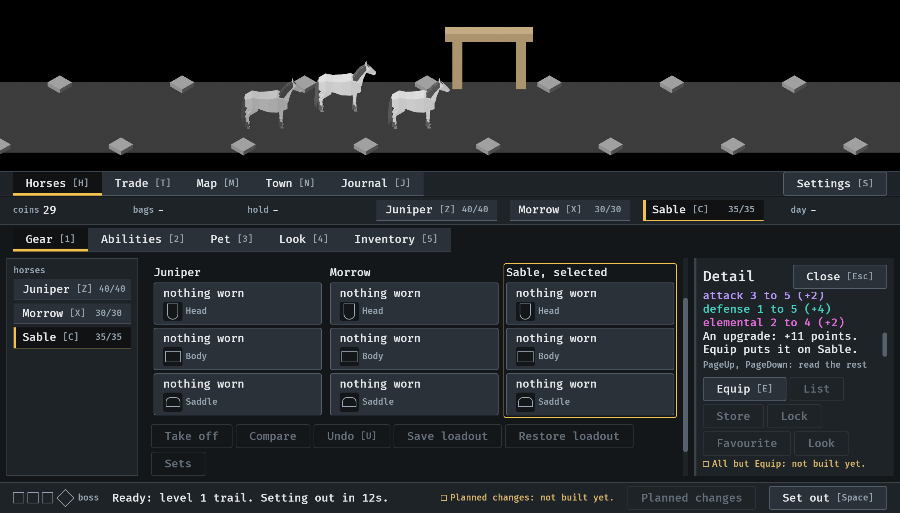
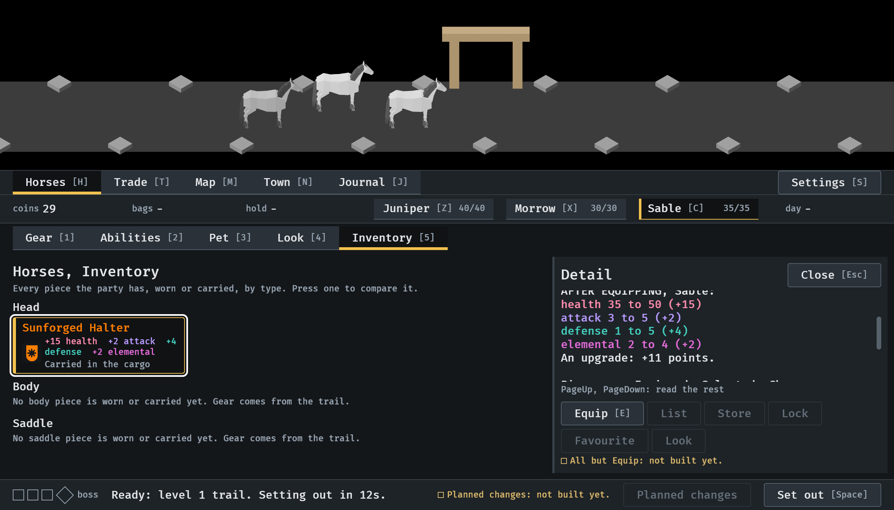

# The scroll keys, 2026-10-11

PageUp and PageDown read the rest of a card that does not fit (#304).
Stills from the menu tour at `--seed 6`, at the smallest window (1120x640),
read by the session. How it works: [item-card.md](../../item-card.md),
"Fitting", and [menu-shell.md](../../menu-shell.md), "Keys".

**1.** The drop's card in the Gear tab: five lines fit, and the line under them names the keys.

**2.** One press of PageDown: the last line read is still in view, at the top.

**3.** Six presses: the card's last line, what Equip would do.

**4.** In the Inventory one press brings the comparison's lines up.

