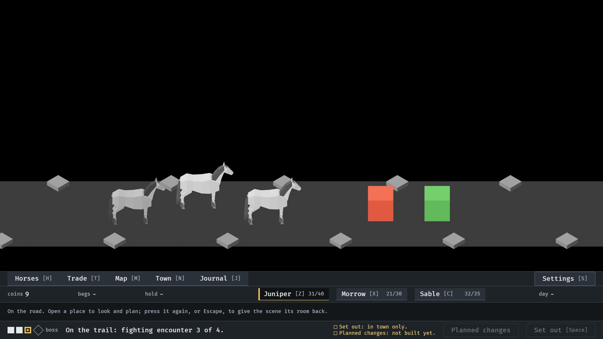
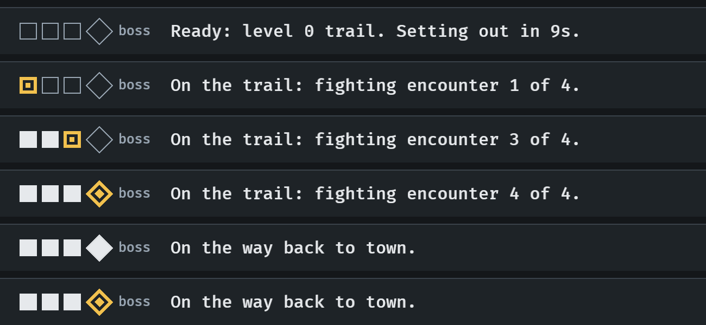

# The trail tracker, 2026-10-11

How many fights are left before the boss, in the footer (#253). Stills at
`--seed 6` (procedures/build-and-run.txt), read by the session, not seen
moving. How it works: [menu-shell.md](../../menu-shell.md), "The trail
tracker".

**1.** On the road, in the third fight of four: two behind, this one, and the boss still to come.

**2.** The footer through a trail: in town, the first fight, the third, the boss, walking home from a won trail, and (seed 1) from one lost at the boss.

