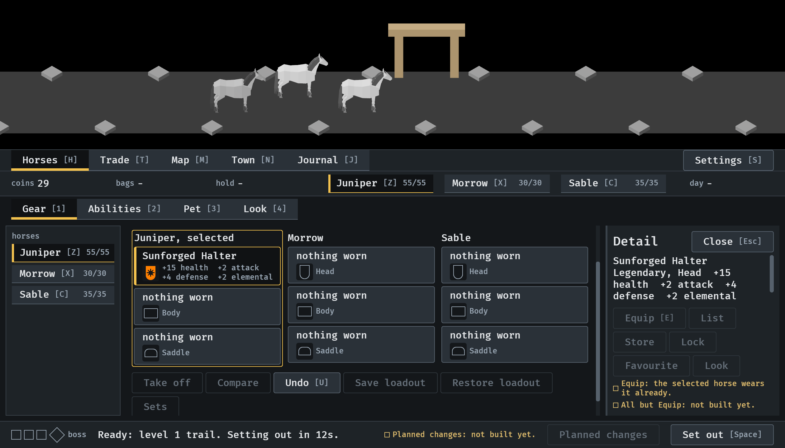
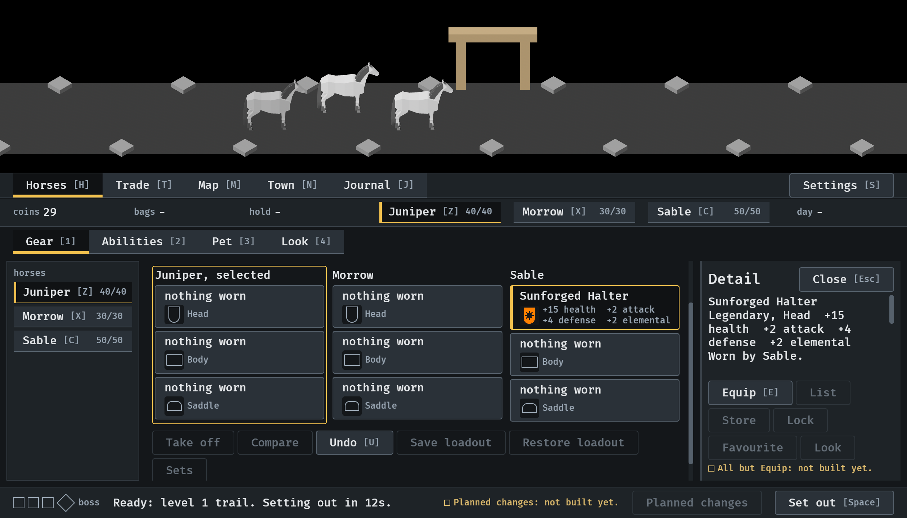
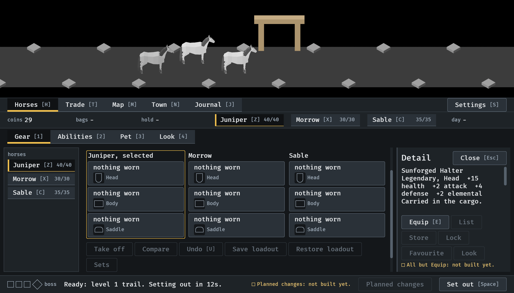

# Undo, 2026-10-11

A town visit's changes taken back, one step a press (#230). Stills from the
menu tour at `--seed 6`, at the smallest window (1120x640), read by the
session; the U key is put into Bevy's keyboard state, not pressed on a
keyboard. How it works: [menu-shell.md](../../menu-shell.md), "Undo".

**1.** Two changes made: the drop was equipped on Sable, then swapped onto Juniper. Undo, under the slots, can be used.

**2.** U once: the swap is taken back. Sable wears the piece again, and the open card has gone back with it.

**3.** U again: the equip is taken back, and the card says the piece is carried in the cargo. Nothing is left to undo, so Undo is drawn as unavailable; a third press did nothing.

