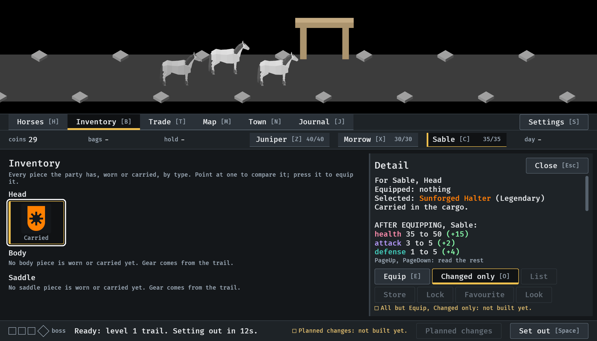
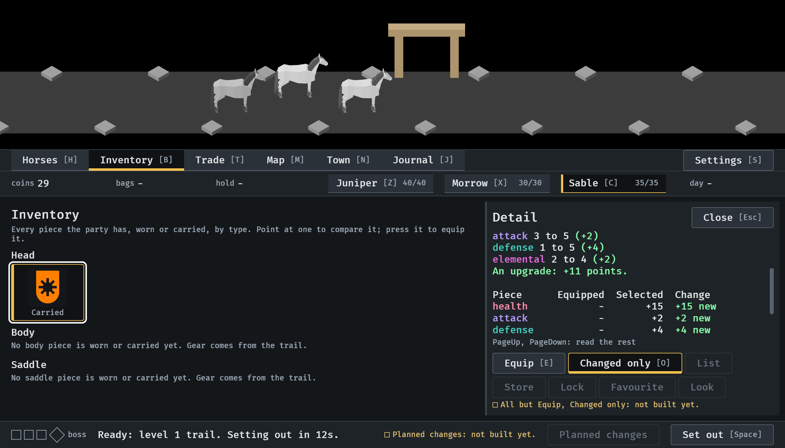
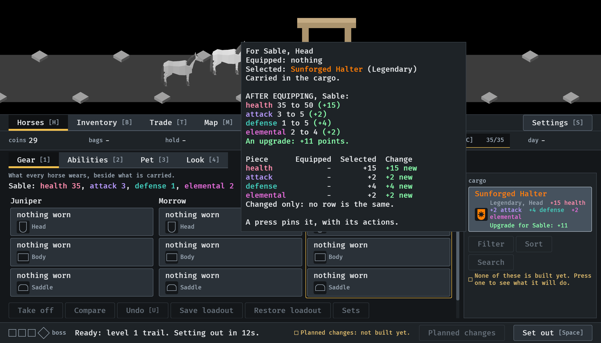
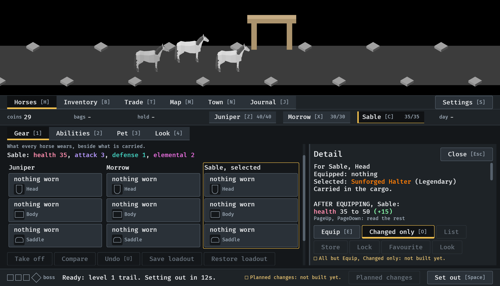
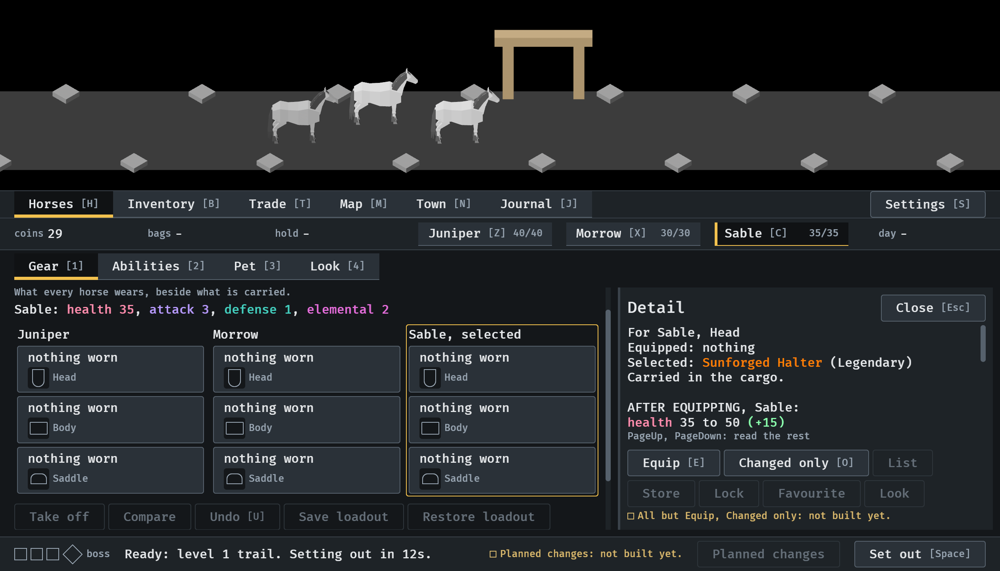
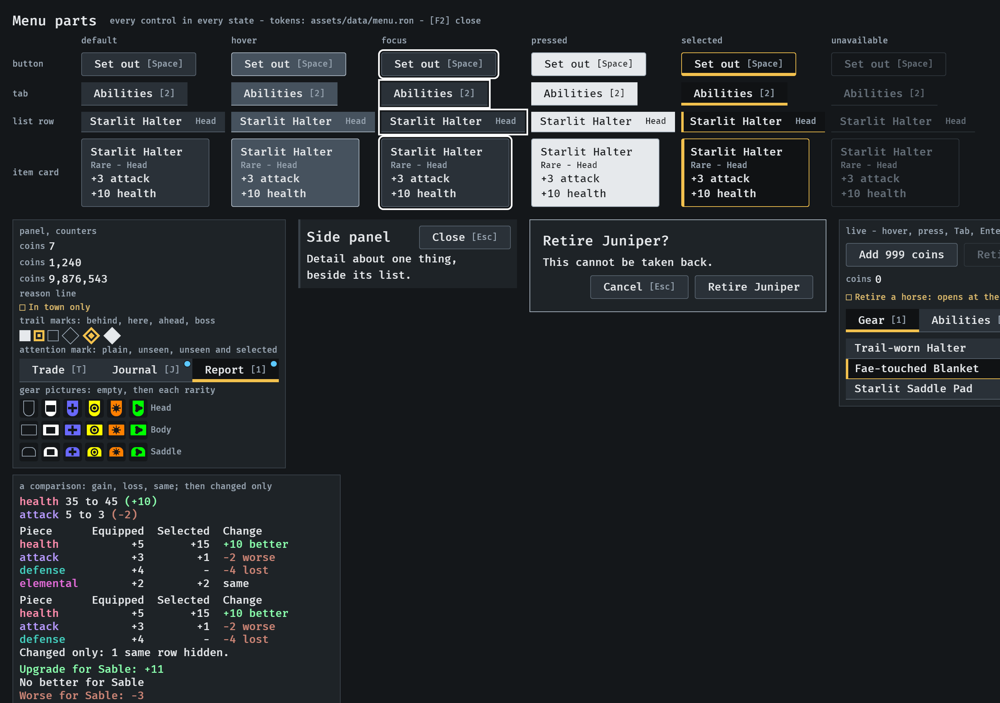

# A Changed only switch on the comparison, 2026-10-12

A control of the item card, key O, narrows the comparison's table to the
stats that differ between the two pieces (#349). The first five pictures are
stills from the menu tour at `--seed 6` in the smallest window (1120x640);
the last is the menu parts screen (`--parts`, 1280x900). Read by the
session. How it works: [item-card.md](../../item-card.md), "The comparison".

**1.** The Inventory, a piece pinned, after a press of O: Changed only is beside Equip with its key on it, and carries the selected mark, a bar under it and an accent edge, so it is told from off by more than colour.

**2.** PageDown, to the table. The party is bare, so every row is new and none is left out; the line under the table that says so is below the last row, a further press of PageDown away (picture 3 has it).

**3.** The Horses place, the pointer on the drop in the cargo: the card under the pointer is narrowed too, and ends its table with "Changed only: no row is the same."

**4.** The drop pinned from the cargo: the switch is as it was set in the Inventory.

**5.** A press on it with the pointer turns it off: the mark is gone.

**6.** The sample on the parts screen, bottom left: the table whole, with "elemental ... same", and under it the same table narrowed, without that row and with "Changed only: 1 same row hidden."

Not in the pictures: a "same" row left out in the game itself. The tour's
party is bare, so no piece it meets shares a stat with a worn one; that is
seen on the parts screen and held by the tests.
