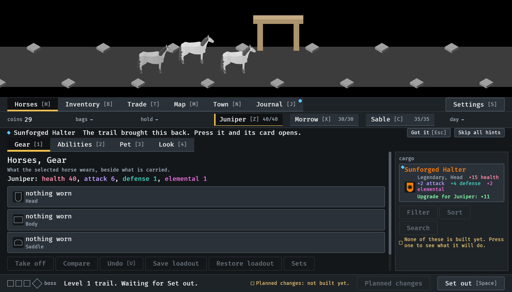
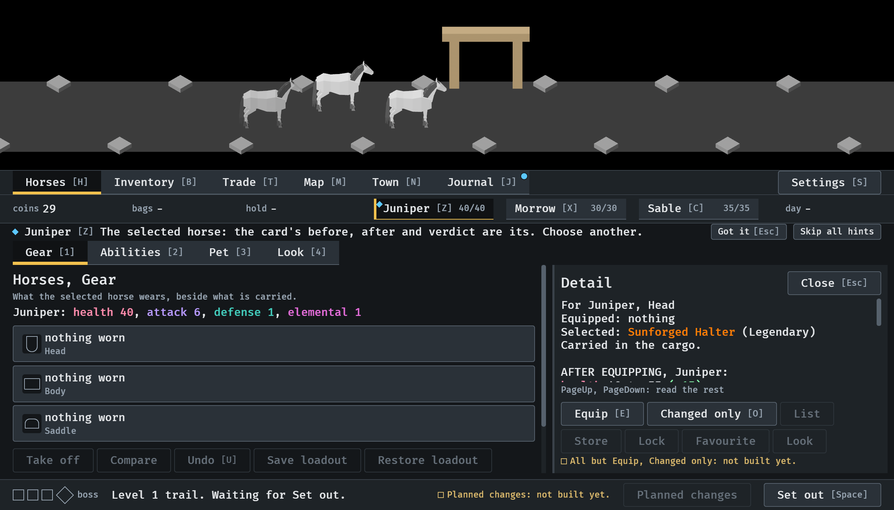
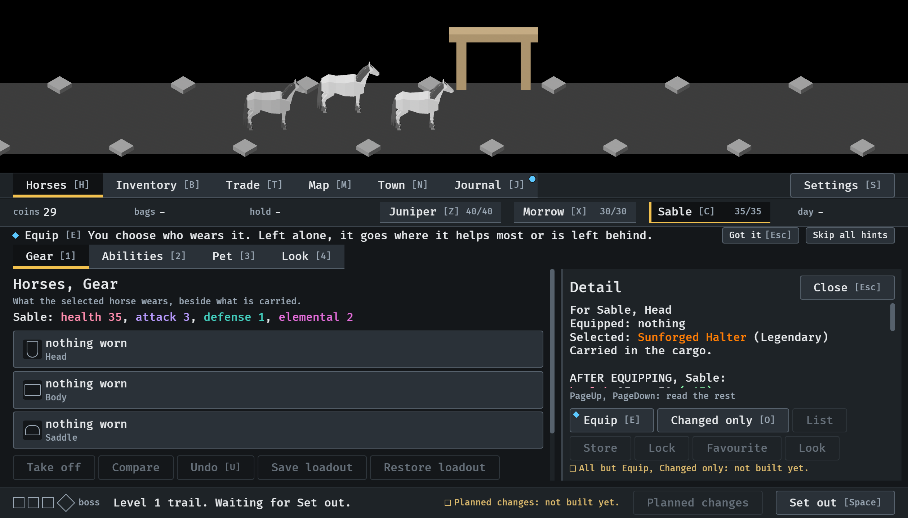
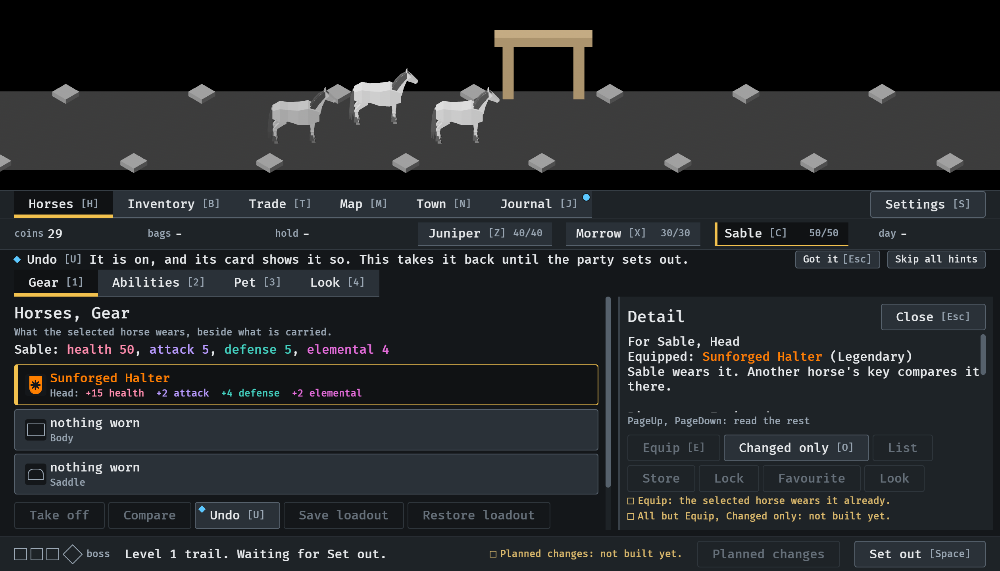
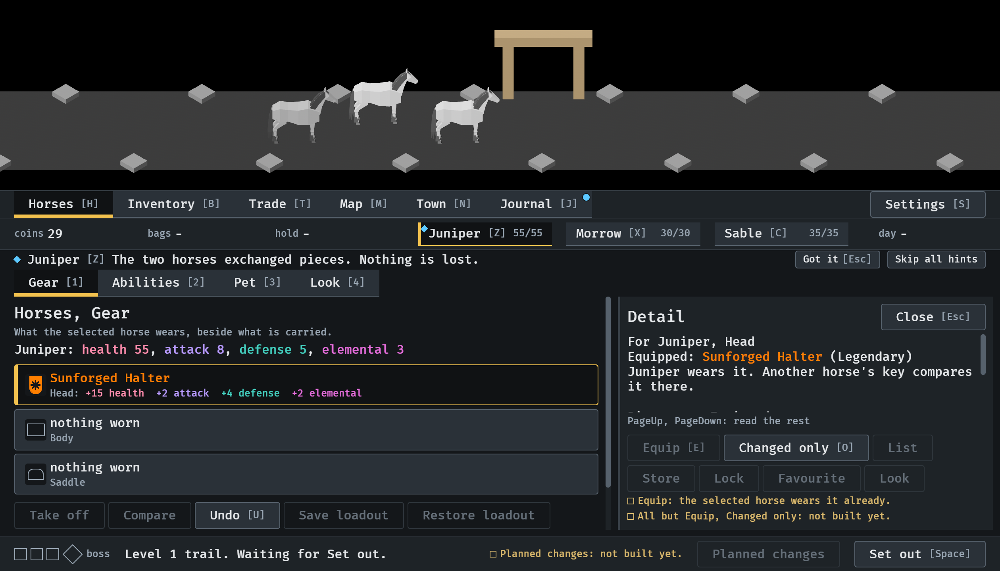

# The first item's lessons, 2026-10-12

The town lessons of `assets/data/lessons.ron` (#296), each as the player
meets it. Stills from `IDLE_LESSON` at `--seed 6` in the smallest window
(1120x640): the walk does by keys what each lesson asks. Read by the
session. How it works: [lessons.md](../../lessons.md).

**1.** Home from the first trail with a piece. The lesson names it and its mark is on it in the cargo. The party waits for Set out; nothing waits for the lesson.

**2.** The piece was pressed and its card is open. The next lesson is about the selected horse, with its mark on that horse in the strip: the card's comparison is its.

**3.** Another horse was selected, and the card is now for Sable. Equip's lesson follows, its mark on Equip, with what happens to a piece left alone.

**4.** Equip was pressed. The piece is in Sable's Head slot, the card says Sable wears it, and the line points at Undo.

**5.** With the card still open, Juniper was selected and Equip pressed again: the piece went from Sable to Juniper. Only now is the swap's line said.

