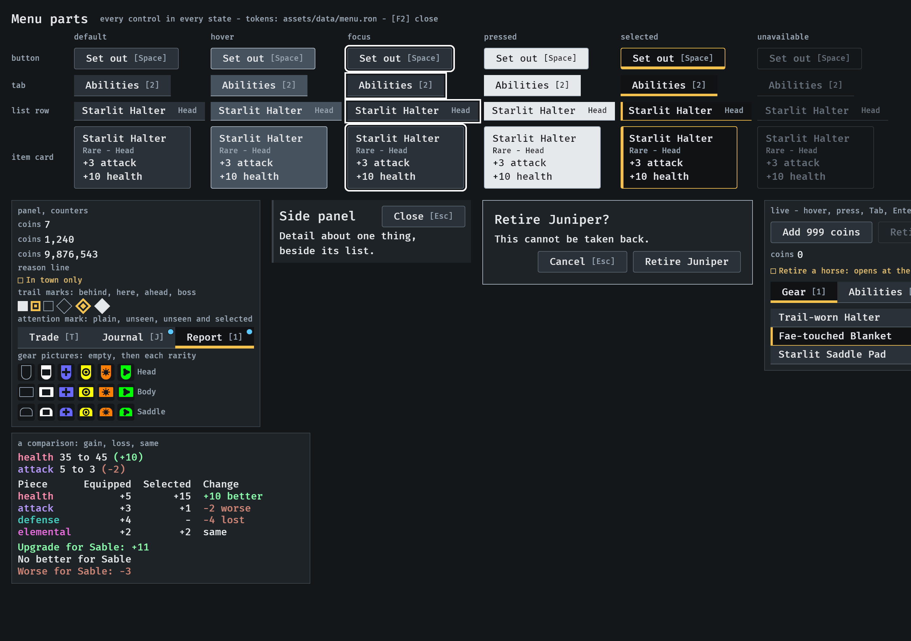
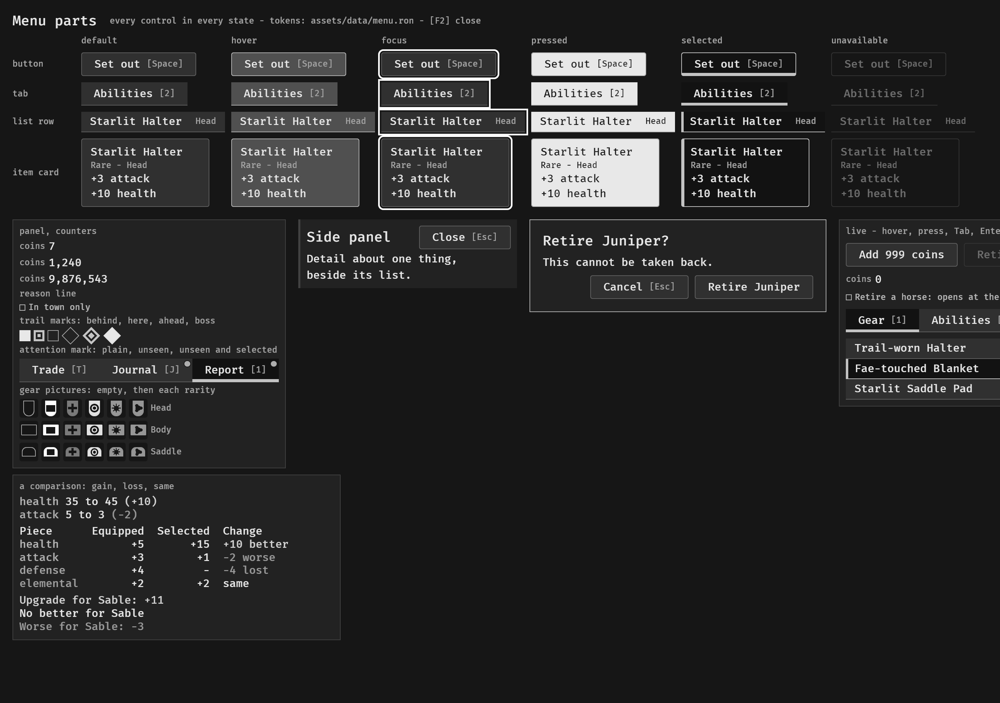
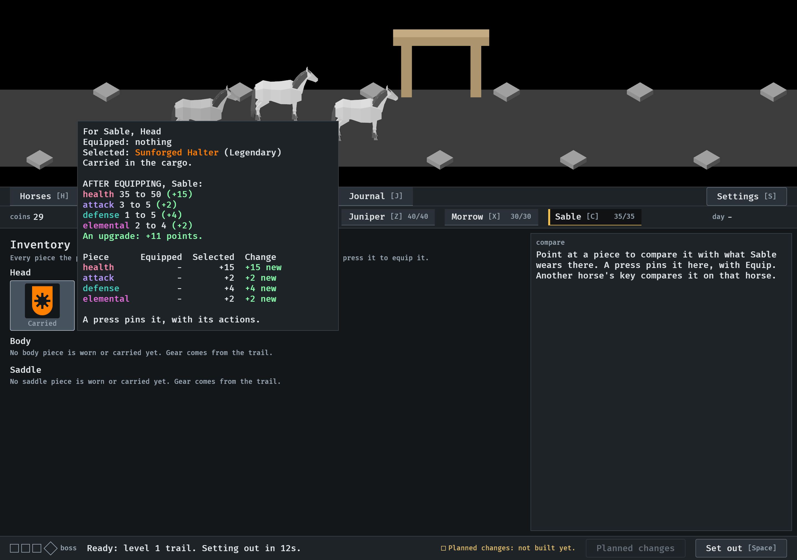
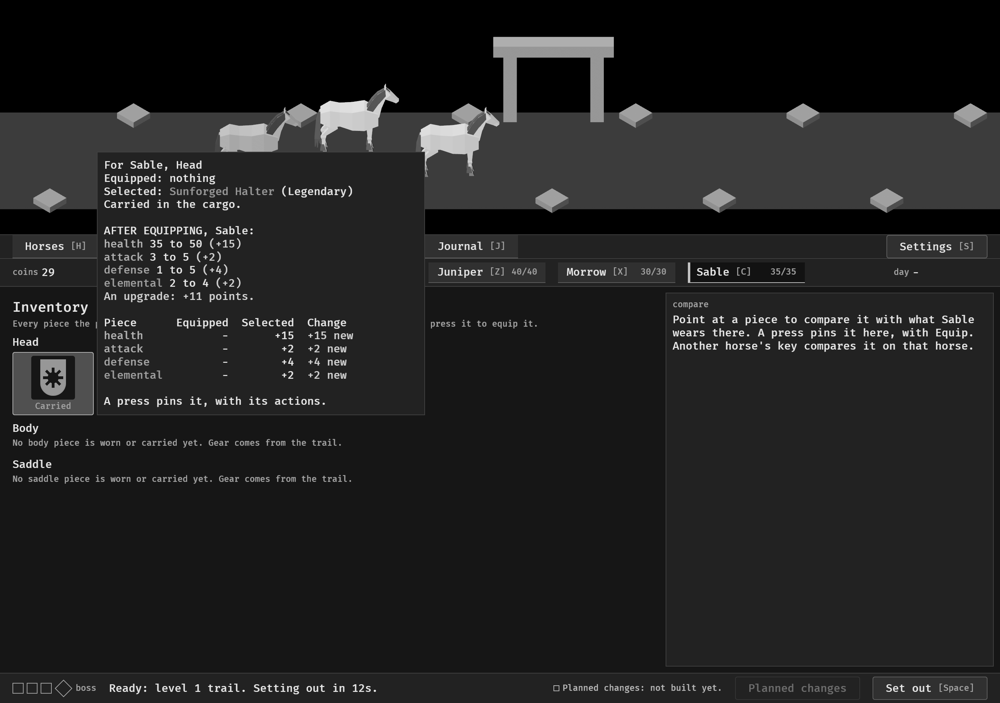
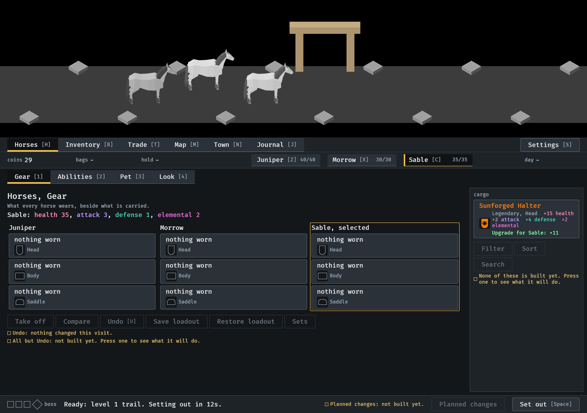
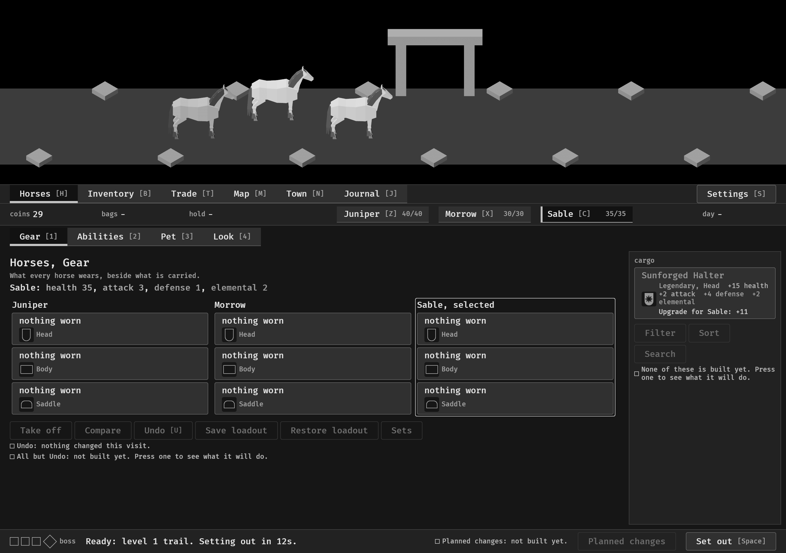

# Gain and loss in a comparison, 2026-10-12

The change in a comparison and a verdict are coloured by whether they are
good; the amounts are plain and the stat's colour is on its word alone
(#313). Each picture is here in colour and with the colour taken away. The
first is the menu parts screen (`--parts`, 1280x900), where a sample holds a
gain, a loss and a change that is neither; the others are stills from the
menu tour at `--seed 6`, 1280x900. Read by the session. How it works:
[item-card.md](../../item-card.md), "Colour".

**1.** The sample on the parts screen, bottom left: a horse's stats as they are and would be, the table of the two pieces, and the three verdicts. A gain is mint and says "better" or "new" with a plus; a loss is terracotta and says "worse" or "lost" with a minus; "same" and "No better" are plain.

**2.** The comparison under the pointer in the Inventory, on a bare horse: every change is a gain.

**3.** The verdict under the drop in the cargo: "Upgrade for Sable: +11".

Not in the pictures: a loss in the game itself. The tour's party is bare, so
no piece it meets is worse than a worn one; the loss is seen on the parts
screen only.
