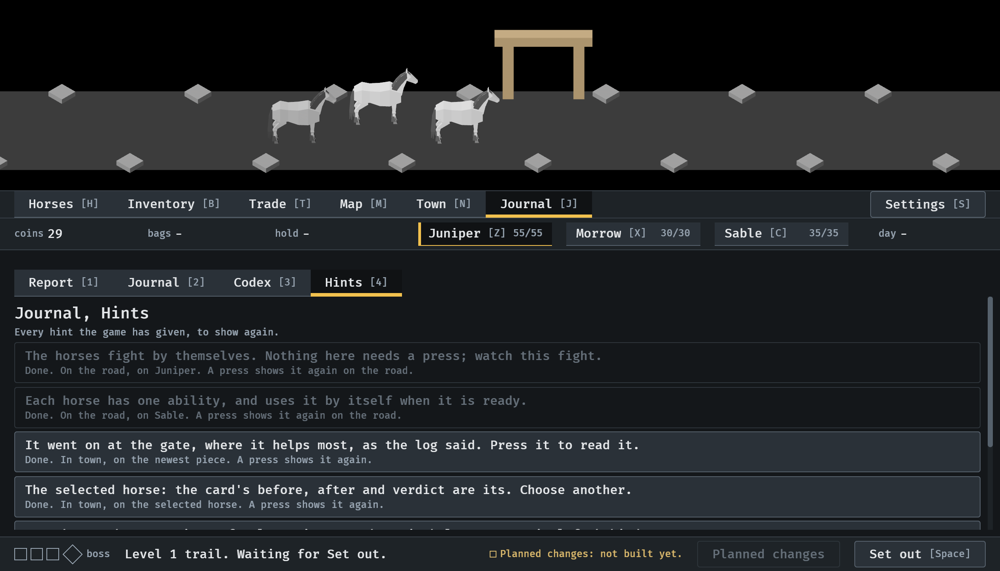
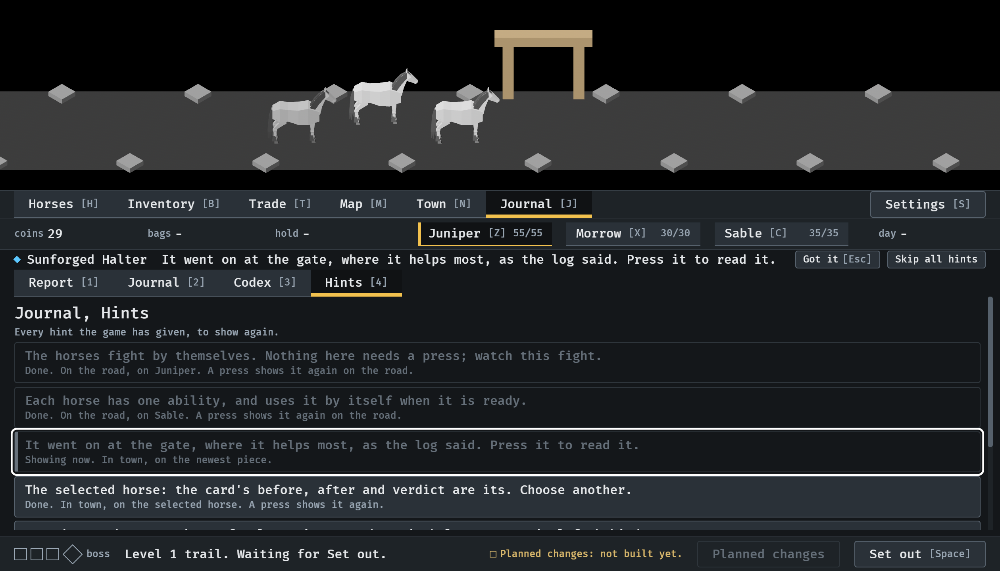
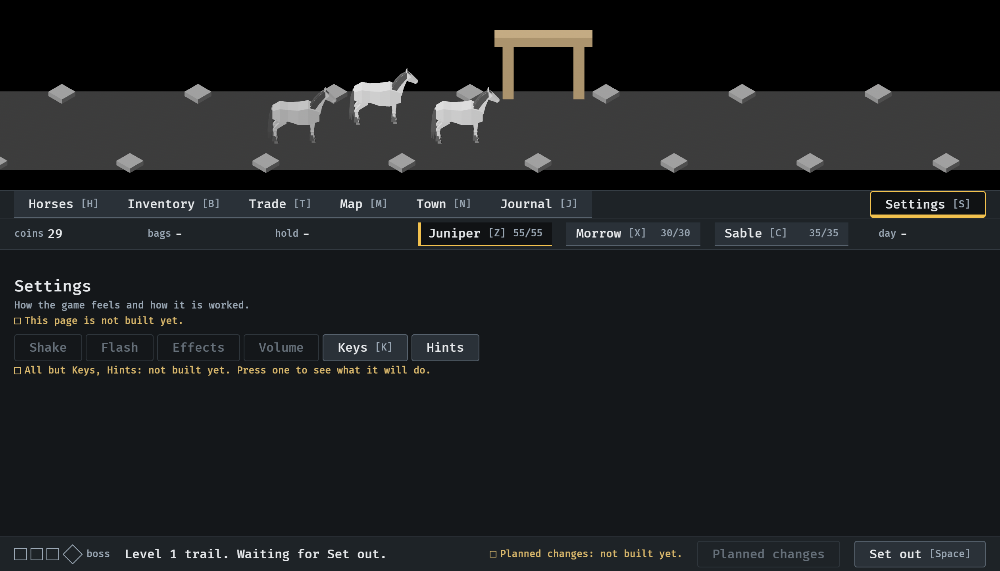

# Hints found again, 2026-10-12

The Journal's list of hints and the switch in Settings (#300). Stills from
`IDLE_LESSON` at `--seed 6` in the smallest window (1120x640), after the
first item's lessons have been walked. Read by the session. How it works:
[lessons.md](../../lessons.md), "Put away, turned off, found again".

**1.** Journal, Hints (J, 4): every hint given so far, in the order it came, with what became of it and where it applies. The road's two cannot be shown in town; they are drawn as unavailable and say where a press would show them.

**2.** Enter on the third row: its hint is on the hint's line again, about the piece where it is now, and the row says "Showing now".

**3.** Settings, Hints pressed: the hints are off, and the one that was showing has left its line.

**4.** Back in the Journal with hints off: the list is as it was, and a press on a row still shows that one.

