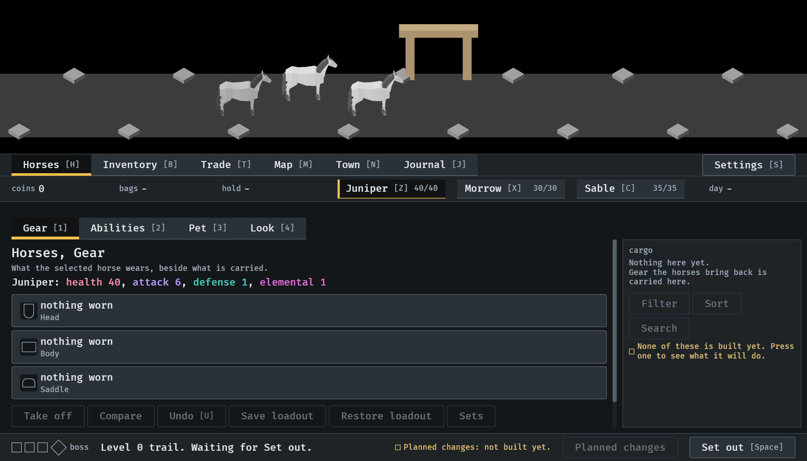
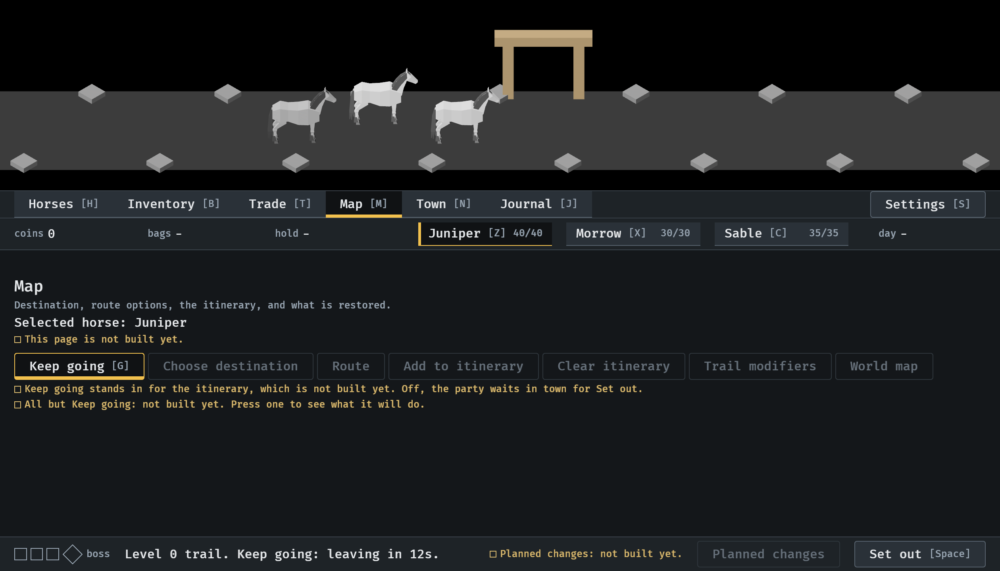
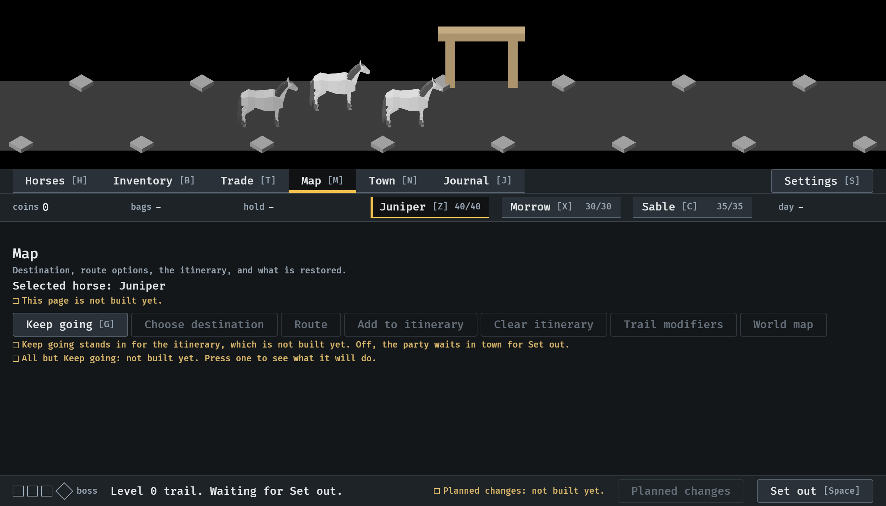

# Keep going, 2026-10-12

No town leaves by itself, and a Keep going switch stands in for the
itinerary (#305). Stills at `--seed 6` in the smallest window (1120x640):
the first and third are single pictures, the second and fourth are from
the menu tour. Read by the session. How it works:
[menu-shell.md](../../menu-shell.md), "Leaving town".

**1.** A new game, left alone for 40 seconds: still in town. The footer says what the party is waiting for, and there is no countdown.

**2.** Keep going, on the Map where the itinerary will be, turned on by its key, G. It is marked as chosen, the line under it says what it stands in for, and the footer counts down.

**3.** With Keep going on, any place shows it in the footer: leaving in 7s.

**4.** Off again by a press: the footer waits for Set out.

