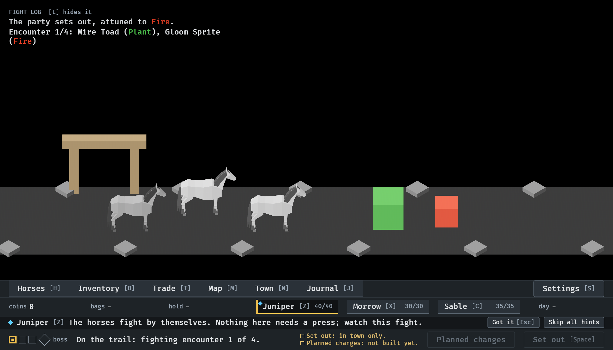
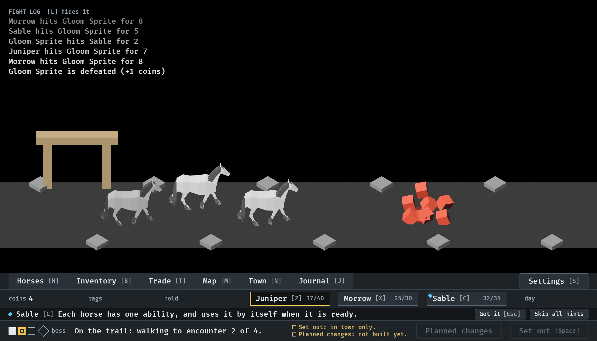
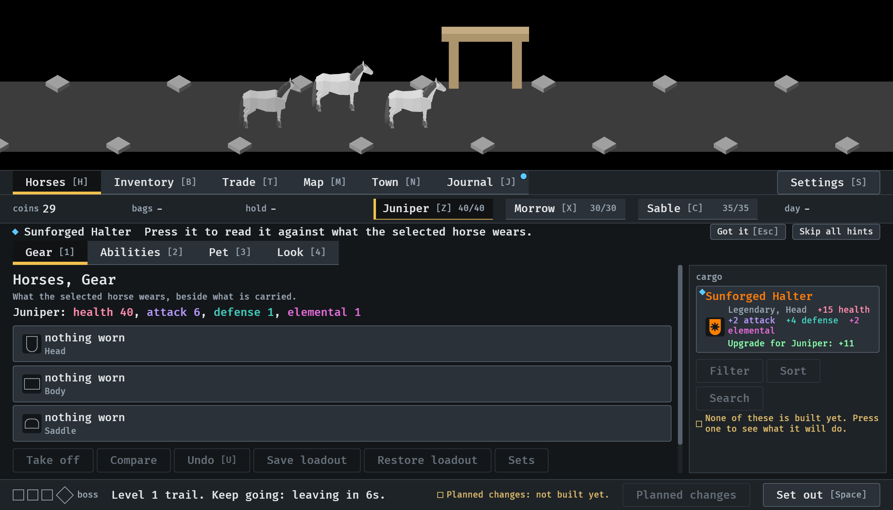

# Lessons as data, 2026-10-12

The lessons of `assets/data/lessons.ron`, queued and shown one at a time on
the hint's line while the party goes on by itself (#290). Stills at
`--seed 6 --keep-going` in the smallest window (1120x640), at 17, 24 and 80
seconds, with nobody at the game. Read by the session. How it works:
[lessons.md](../../lessons.md).

**1.** The first fight. The first lesson is on the hint's line, with its mark on a horse in the strip. Nothing waits for it: the fight is going on above.

**2.** The first enemy has gone down, which is what the first lesson was waiting to see watched. The next lesson, due since an ability first fired, takes its place.

**3.** Back in town with a piece. The road's lessons do not follow the party in; the piece's lesson names the piece and puts its mark on it in the cargo. The party leaves in six seconds whether or not it is read.

