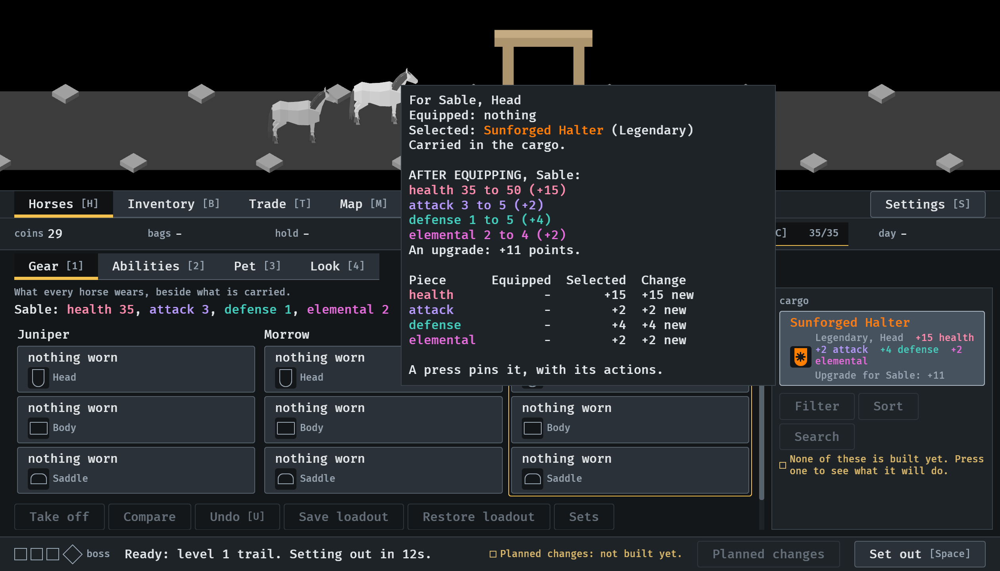
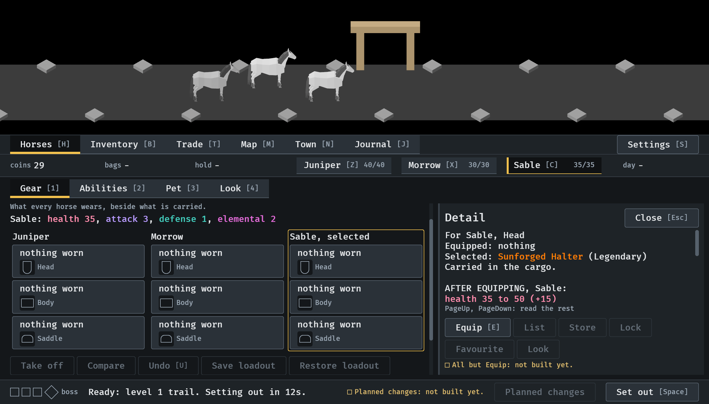
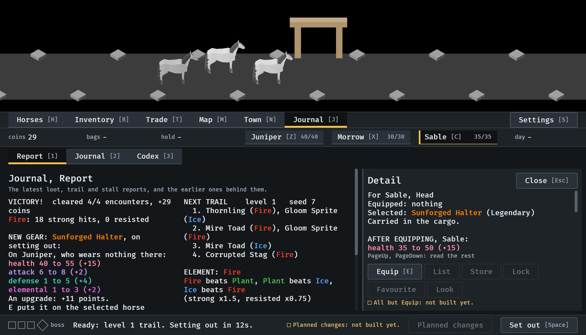
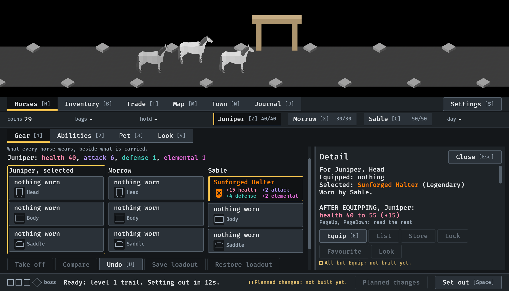
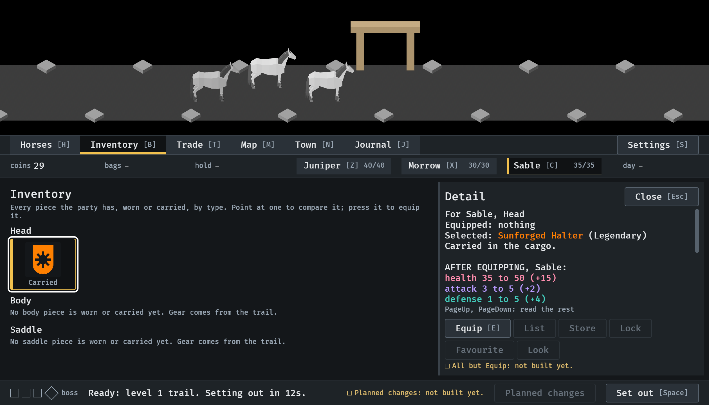

# One comparison wherever a piece is pinned, 2026-10-12

A piece pressed in the cargo, the gear overview or a report shows the
comparison the Inventory shows (#312). Stills from the menu tour at
`--seed 6`, at the smallest window (1120x640), read by the session; the
pointer is Bevy's own, moved by the tour, not a hand on a mouse. How it
works: [item-card.md](../../item-card.md), "The comparison".

**1.** The pointer on the drop in the cargo, with Sable selected: the whole comparison beside the cell, table and all. Nothing is pinned.

**2.** A press pins it in the cargo's room, at the comparison's width. The overview's columns are narrower while it is open. The table is a press of PageDown away.

**3.** The same piece pressed in the report, in the Journal: the same lines.

**4.** What Sable wears, pressed in the overview with Juniper selected: the same comparison, against Juniper, and it says who wears the piece.

**5.** In the Inventory, as before.

