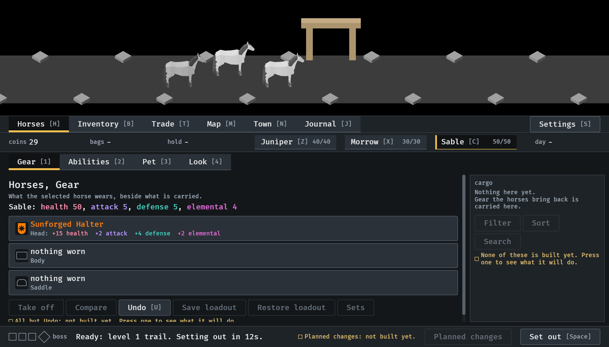
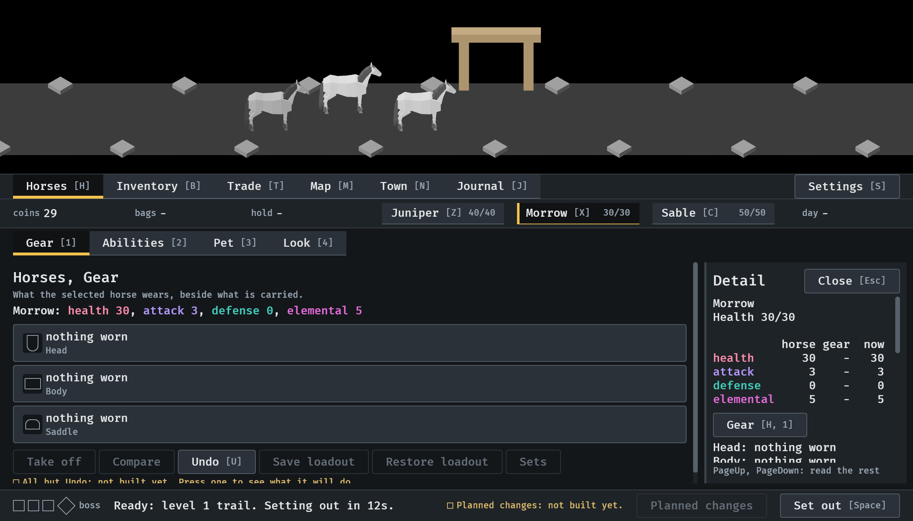
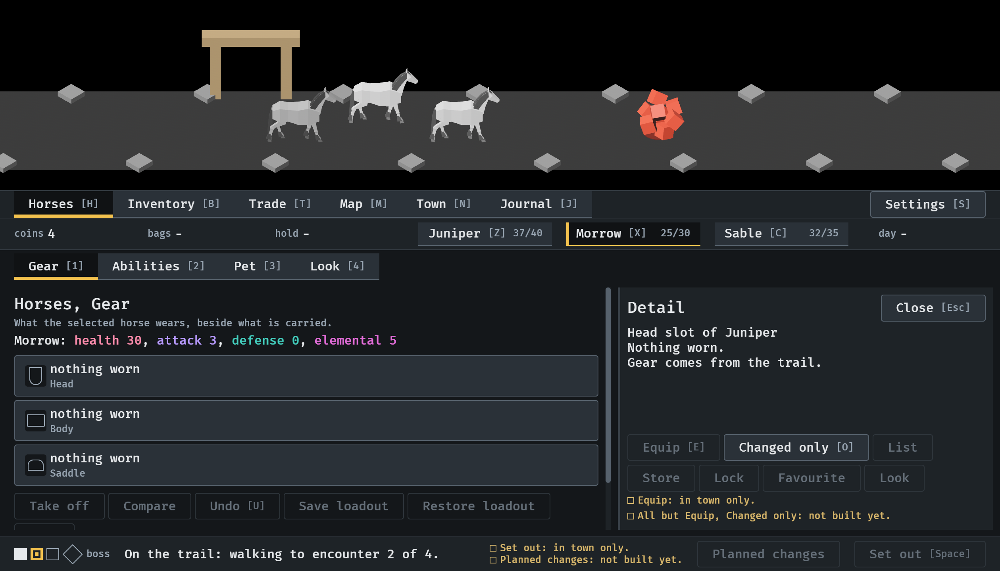
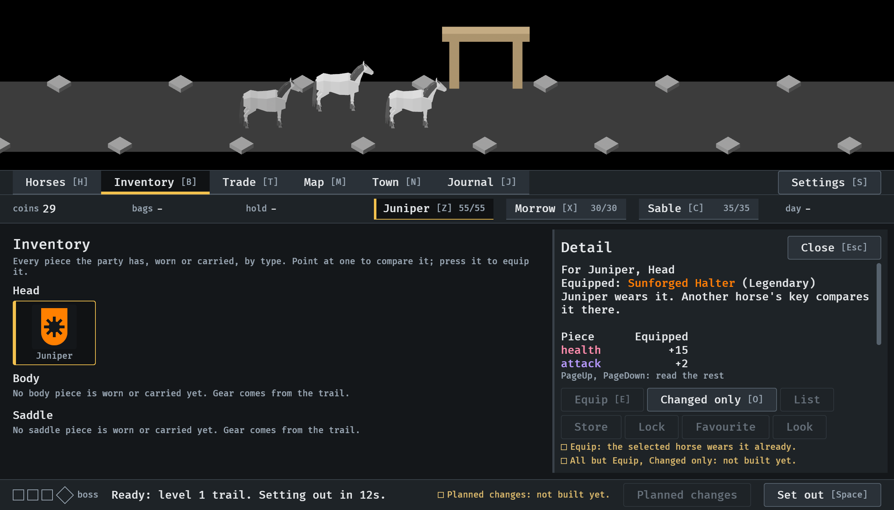

# Gear shows only the selected horse's gear, 2026-10-12

The Gear tab of Horses is the selected horse's gear and no other horse's
(#314). Stills from the menu tour at `--seed 6` in the smallest window
(1120x640). Read by the session. How it works:
[menu-shell.md](../../menu-shell.md), "What a tab shows".

**1.** Sable selected, after the drop was equipped: a row for each slot, the page wide. The halter's row has its picture, its name in its rarity, and "Head:" with what it adds; an empty slot is its outline, "nothing worn" and the slot's name. The controls under the rows are in view.

**2.** A press of X, Morrow's key: the rows are Morrow's, and Morrow's view is open beside them.

**3.** On the road it is the same tab. Here a card pinned earlier on Juniper's head slot has stayed while Morrow was pressed, as a pinned piece does in every place; its row is not among Morrow's.

**4.** Another horse's piece is found in the Inventory: with Juniper selected, the halter Sable wore was pinned from its tile and equipped, and the two changed places.

