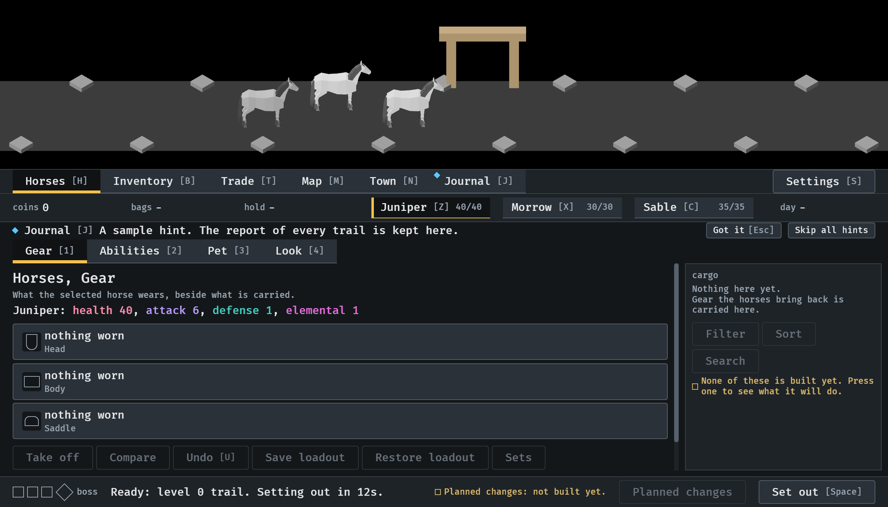
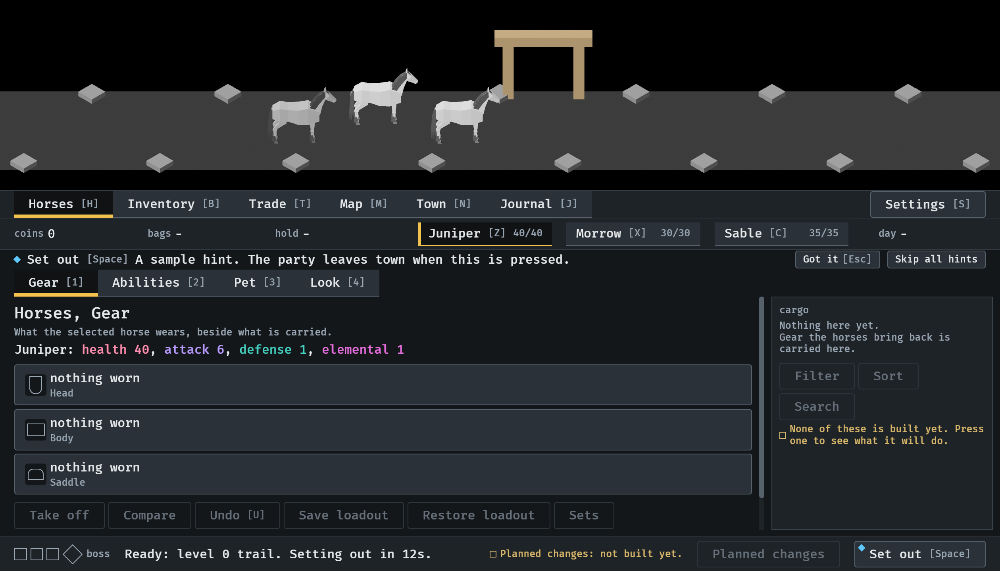
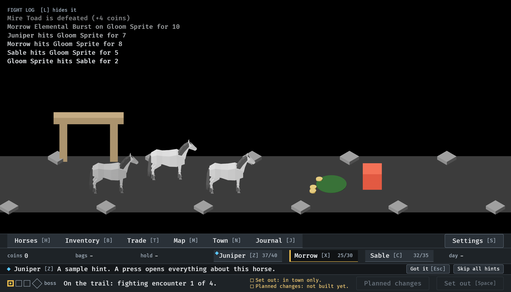
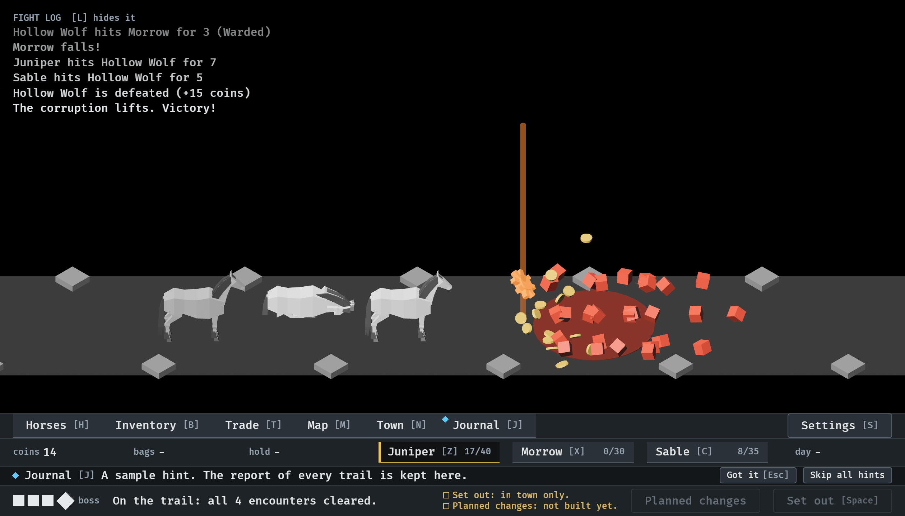
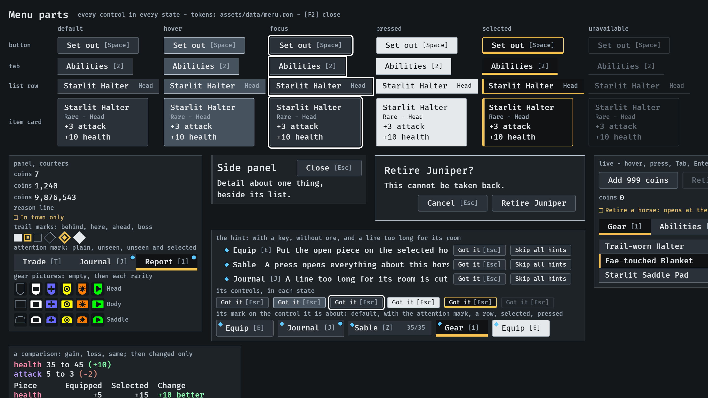

# The hint, 2026-10-12

One menu part for a lesson (#291): a line under the status strip, and a
mark on the control it is about. Stills from the menu tour at `--seed 6`
in the smallest window (1120x640), where the dev key F6 shows a sample
hint; the fourth is `--hint` at 65.9 s; the last is `--parts`. Read by the
session. How it works: [menu-parts.md](../../menu-parts.md), "The hint",
and [menu-shell.md](../../menu-shell.md), "The hint's line".

**1.** In town, a hint about a place. Its line is under the status strip: the mark, the place's name and key, one line, Got it and Skip all hints. The Journal in the bar carries the same mark, a square on a corner. Nothing else is where it was not: against the picture before it, only the line and the mark differ.

**2.** A hint about a control: Set out, in the footer, is marked in its corner.

**3.** On the road with every place closed the hint has the one line that is left, where the line saying how to open a place was. This one is about a horse in the strip.

**4.** The final kill's fountain with a hint showing: the hint is in the menus and none of the fountain is behind it.

**5.** The parts screen: the hint with a key, without one, and with a line too long for its room, which is cut; its two controls in each state; and its mark on a button, on a tab beside the attention mark, on a row, on a selected tab and on a pressed button.

