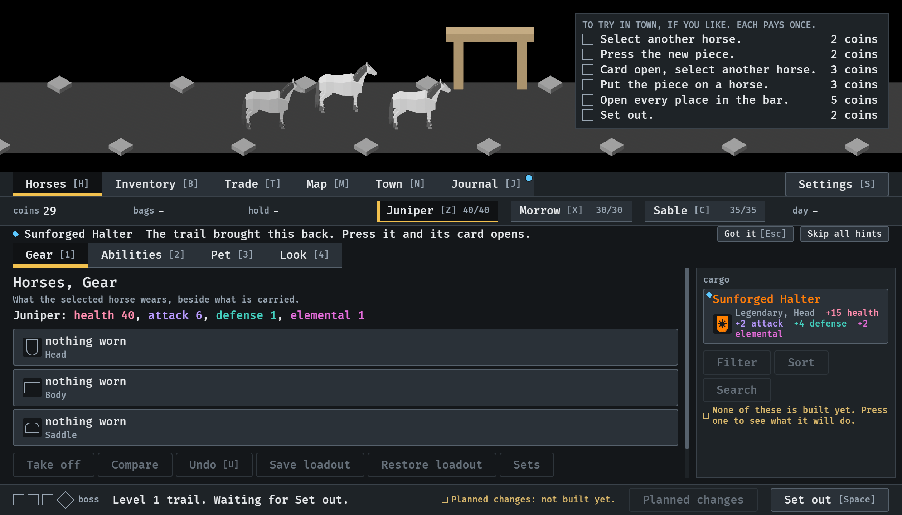
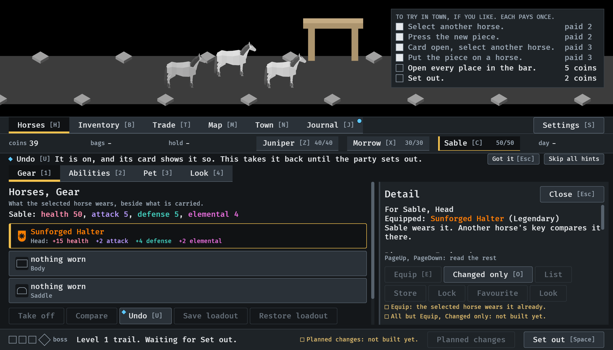
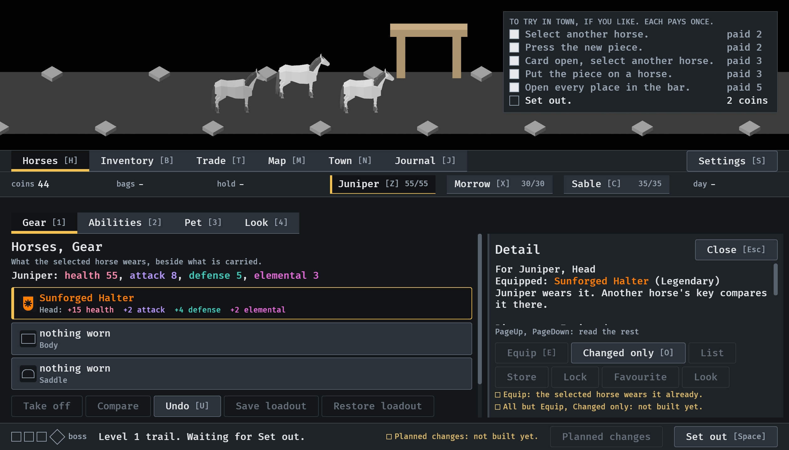

# The things to try, 2026-10-13

The list over the town scene (#303). Stills from `IDLE_LESSON` at `--seed 6`
in the smallest window (1120x640). Read by the session. How it works:
[lessons.md](../../lessons.md), "The things to try".

**1.** Home from the first trail with a piece: the list is at the top right of the scene, clear of the gate and the horses, six things to do and what each pays. The coins are 29.

**2.** The piece pressed, another horse selected with its card open, and Equip: four boxes are filled, their lines are fainter and say "paid", and the coins are 39.

**3.** Every place opened: the fifth is paid, the coins are 44, and Set out is left.

