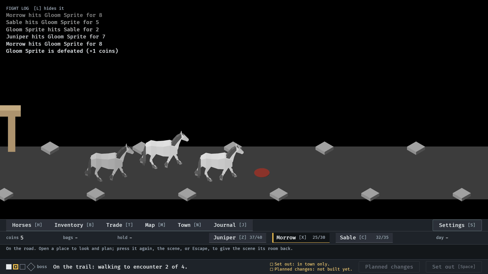

# Where the hints went, 2026-10-13

What Skip all hints is answered with, once (#350). Stills from `IDLE_TOUR`
at `--seed 6`, its pictures 38 and 39. Read by the session. How it works:
[lessons.md](../../lessons.md), "Put away, turned off, found again".

**1.** On the road, Skip all hints has just been pressed on a hint. The line it emptied says where the hints are kept and what brings them back, the Journal in the bar carries the mark, and Got it is the only control beside it: there is no second Skip all hints.

![The road view with the hint's line reading "Hints [4] Kept here, on the Journal. Hints in Settings brings them and the things to try back.", a mark on the Journal in the bar, and Got it at the line's end.](01-the-answer.png)

**2.** Escape, or Got it: the line says what it said before, and the mark is off the Journal. It is not said again.

