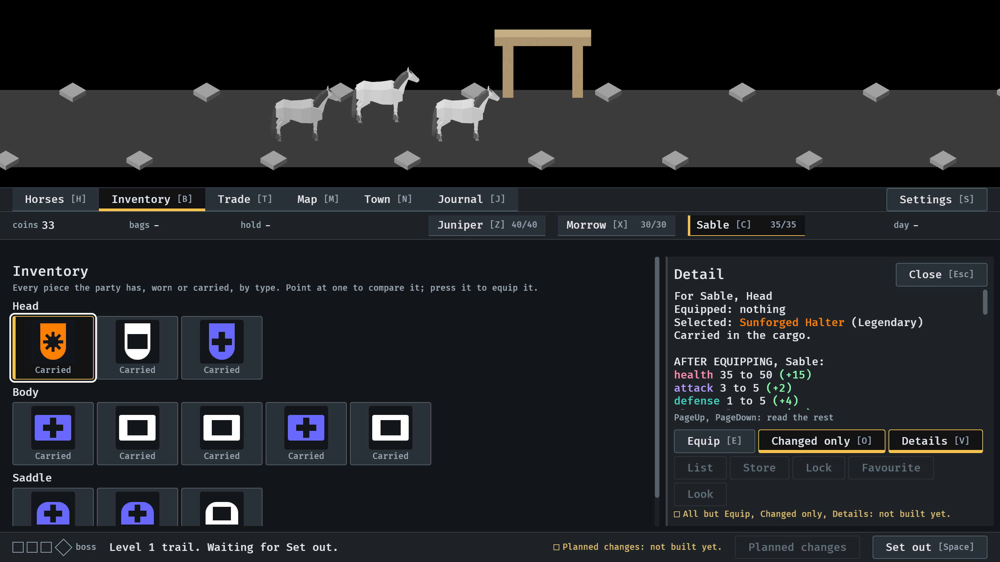
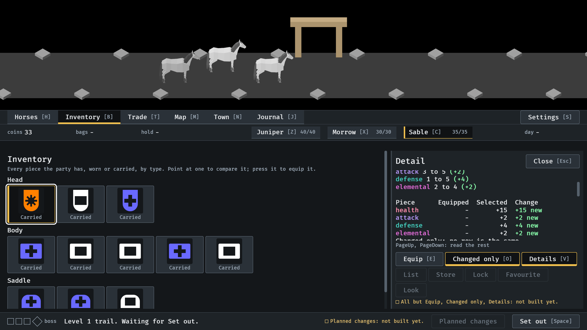
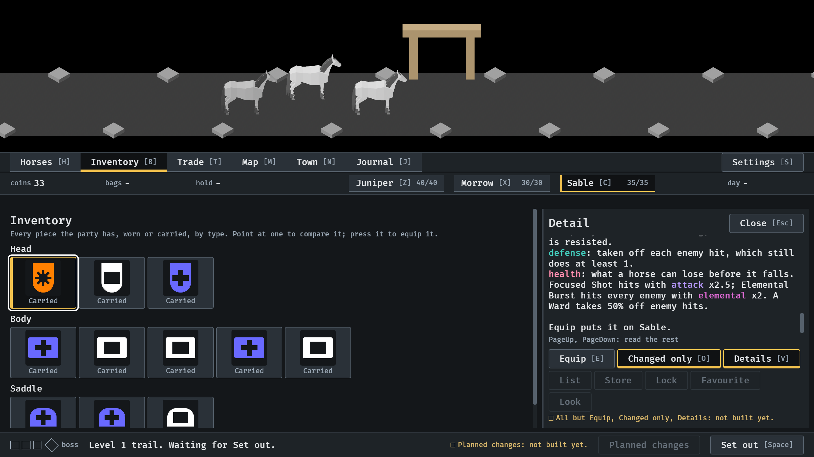

# The card's Details, 2026-10-14

The item card's third layer (#228): its formulas, behind the Details switch
(V). Pictures from the menu tour (`IDLE_TOUR`, `--seed 6`), the Inventory at
the default window, scrolled by PageDown. Read by the session. How it works:
`docs/item-card.md`, "The Details layer".

