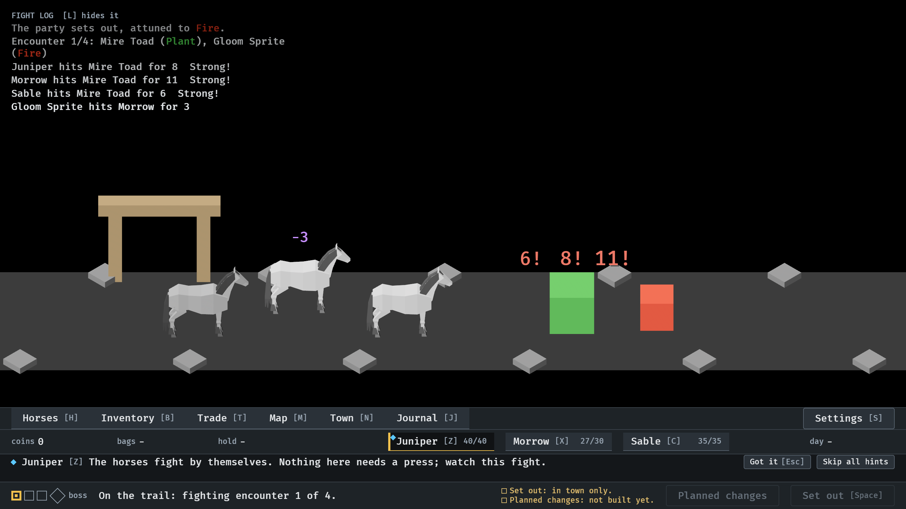
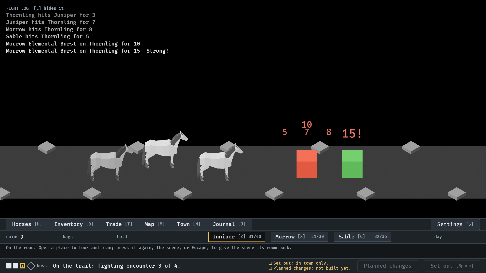
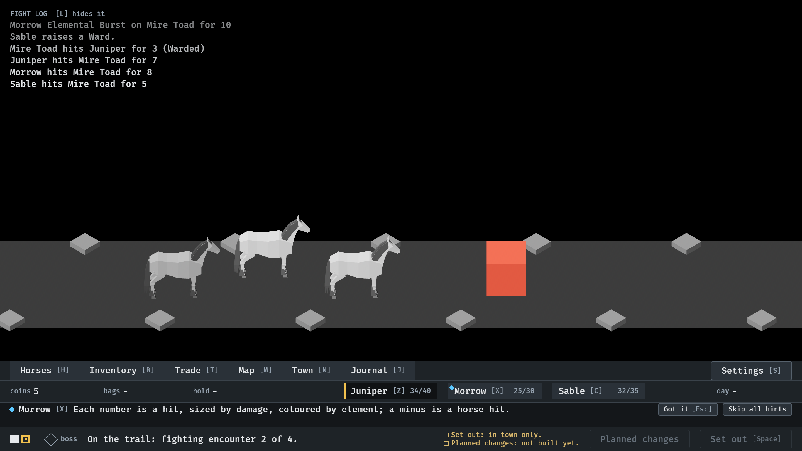
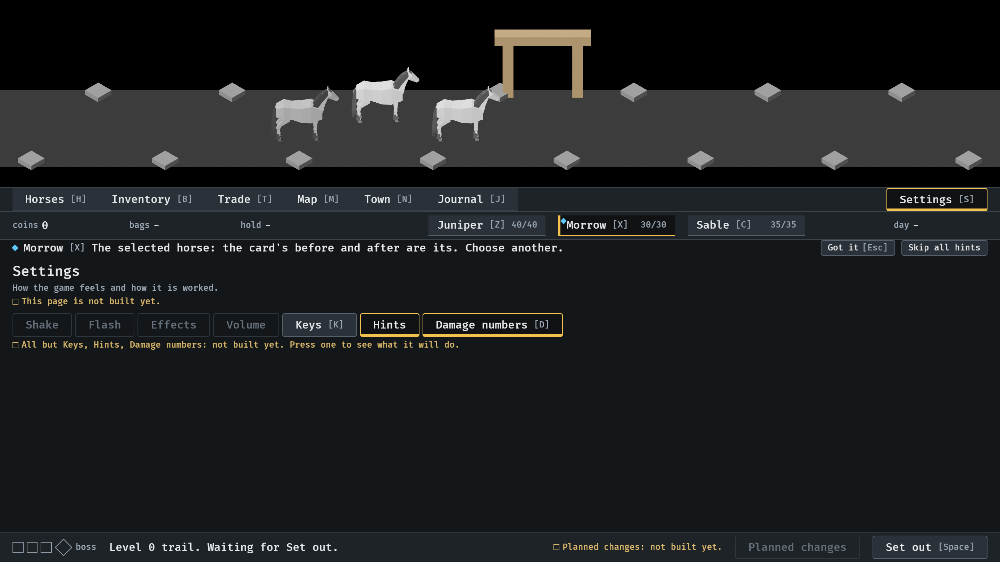

# Damage numbers, 2026-10-14

Each hit's damage rising from what it struck (#249). Stills at `--seed 6
--keep-going`, with nobody at the game, at 17.9, 40 and 32 seconds, and the
menu tour's Settings page. Read by the session. How it works:
`docs/damage-numbers.md`.

