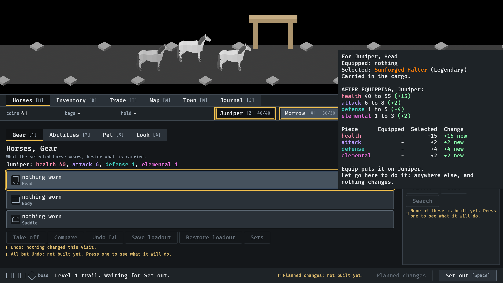
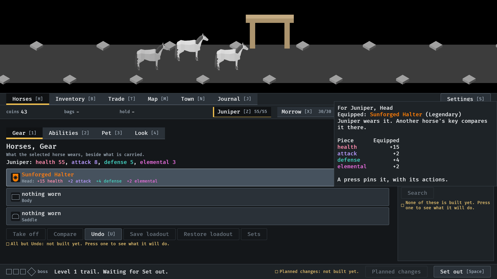
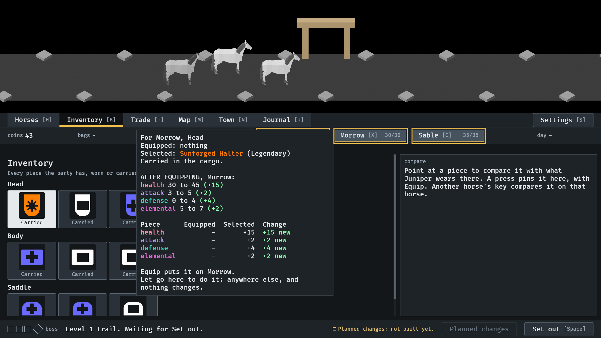
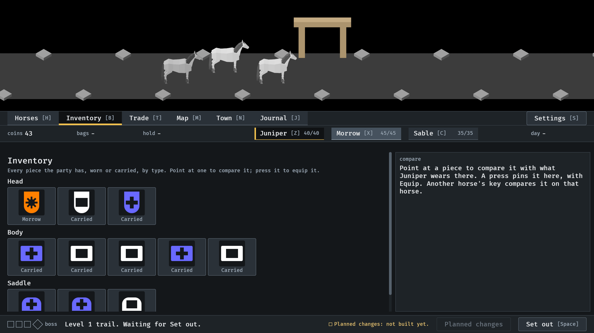

# Dragging a piece, 2026-10-14

Dragging a piece onto a horse or a slot (#228). Pictures from the menu tour
(`IDLE_TOUR`, `--seed 6`), which drags with Bevy's own pointer, at the
default window. Read by the session; nobody has dragged with a mouse. How it
works: `docs/item-card.md`, "Dragging".

