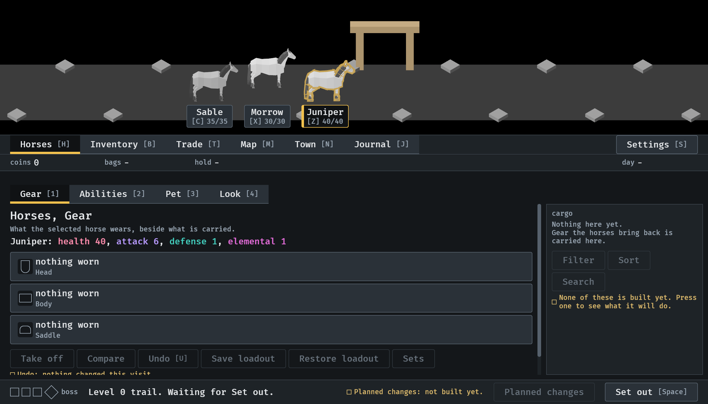
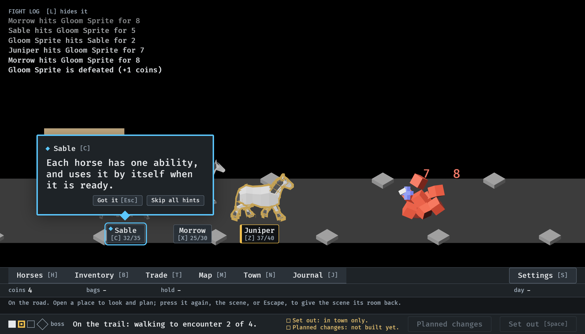
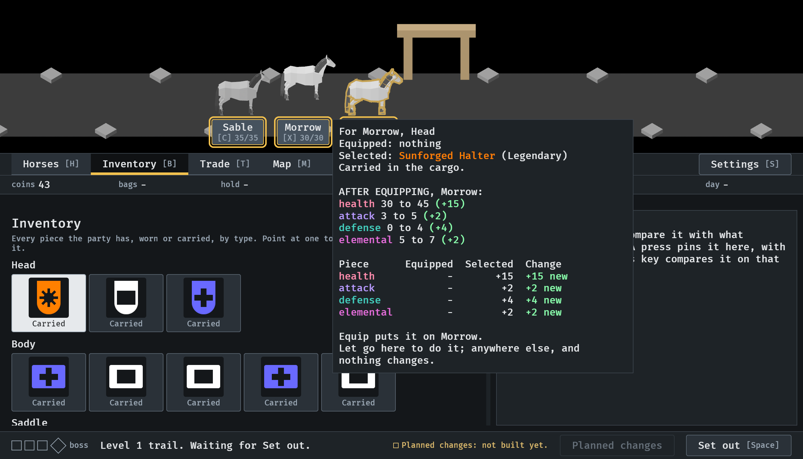
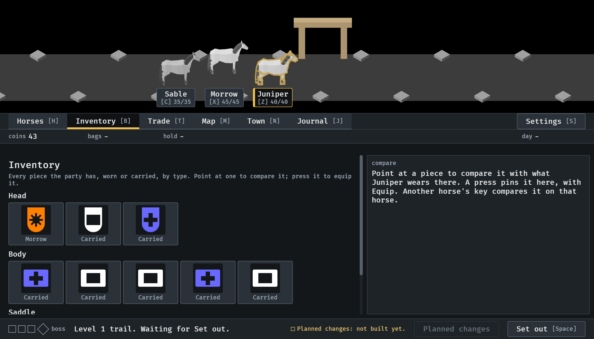

# 2026-10-14, the horses leave the strip (#356, second part)

The status strip has no horse buttons. Each horse has a tag under it in the
scene: its name over its key and its health. A press on the horse selects
it; the tag shows which one is. All at 1120 x 640.

1.  In town, Juniper selected: outlined, and its tag
   marked. The strip has coins, bags, hold and the day.
2.  On the road, a lesson about
   Sable points at Sable's tag, ringed in the pop-up's colour.
3.  A piece dragged from the
   Inventory onto Morrow in the scene: the tags of the horses it may go to
   are marked, and the preview is beside Morrow's tag.
4.  Let go: Morrow wears it (45/45 on its tag).
