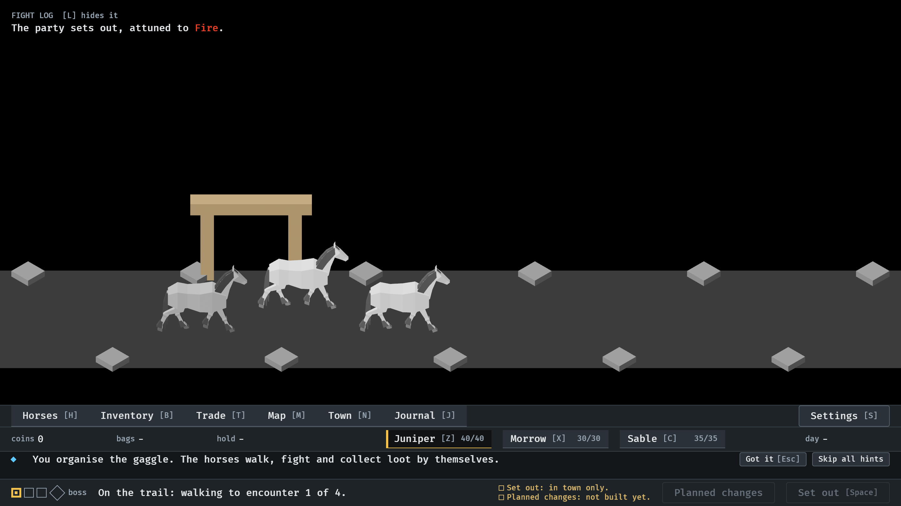
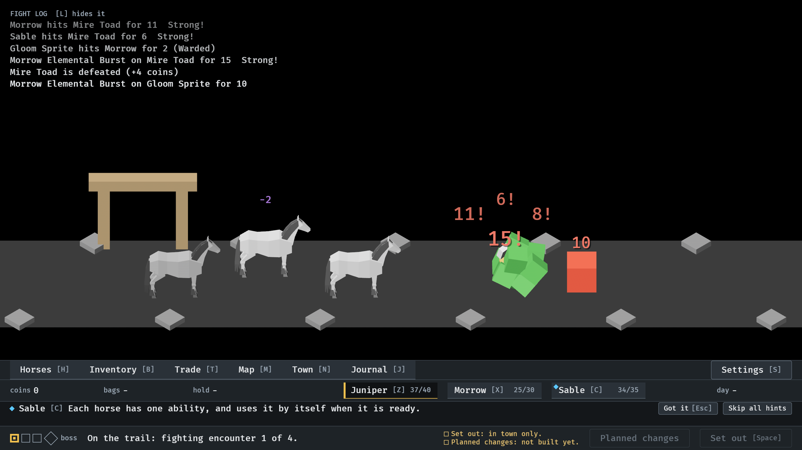
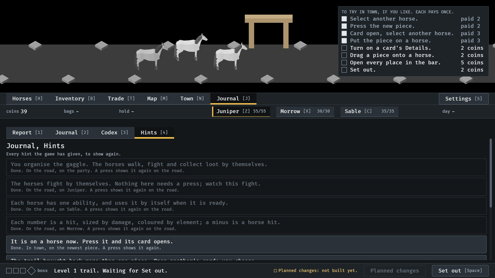

# The opening, 2026-10-14

A new game starts on the road (#292). Pictures of `--seed 6` at the default
window, read by the session; the owner has not looked. How it works:
`docs/menu-shell.md`, "Leaving town", and `docs/lessons.md`, "The opening".

