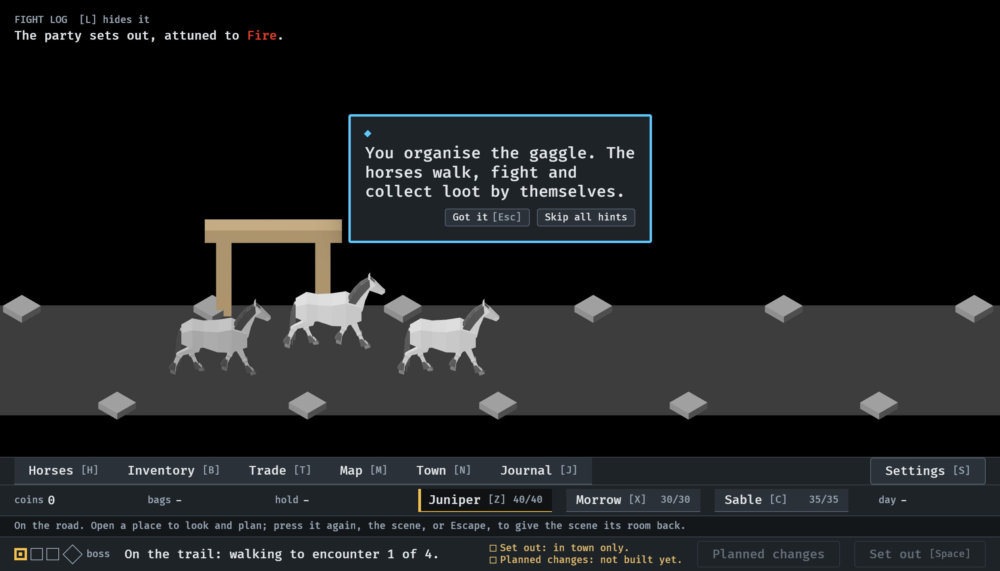
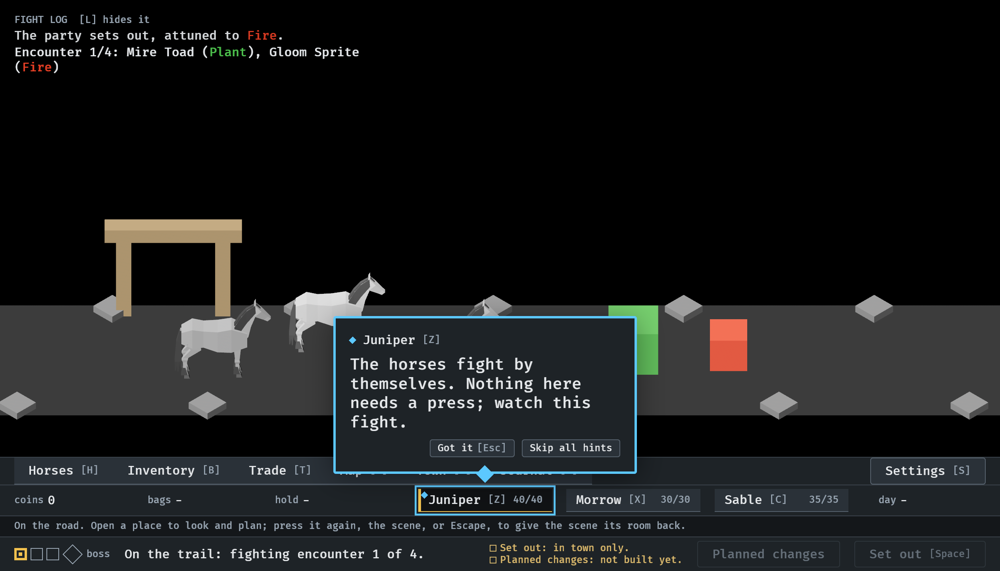
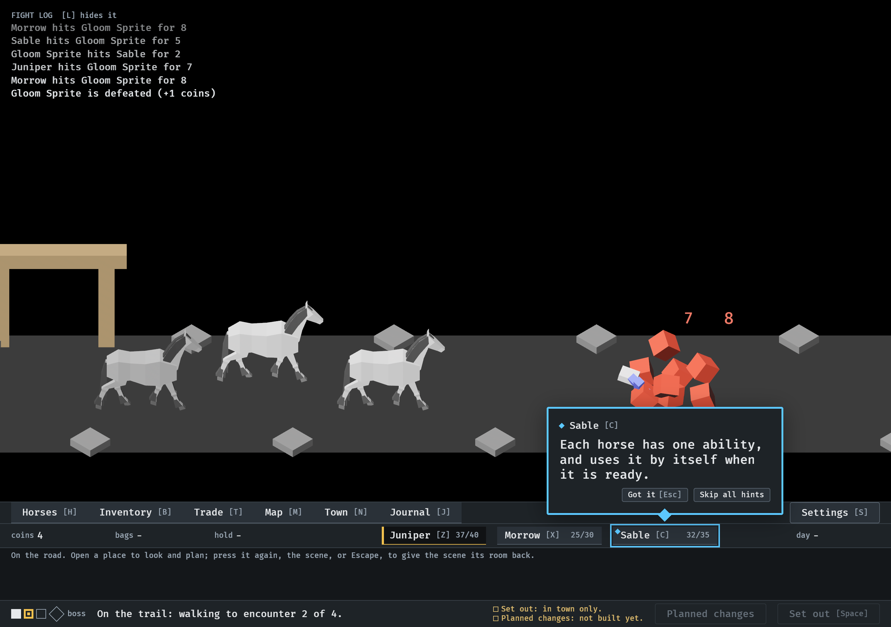
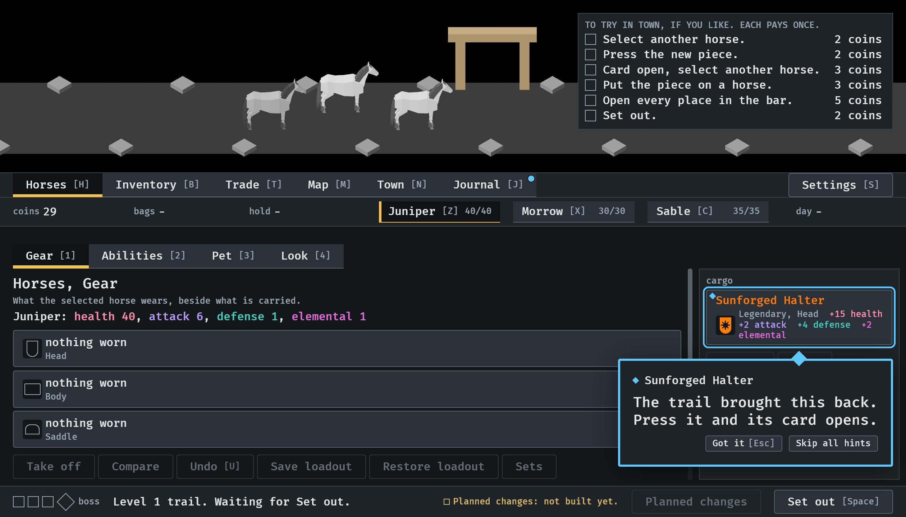
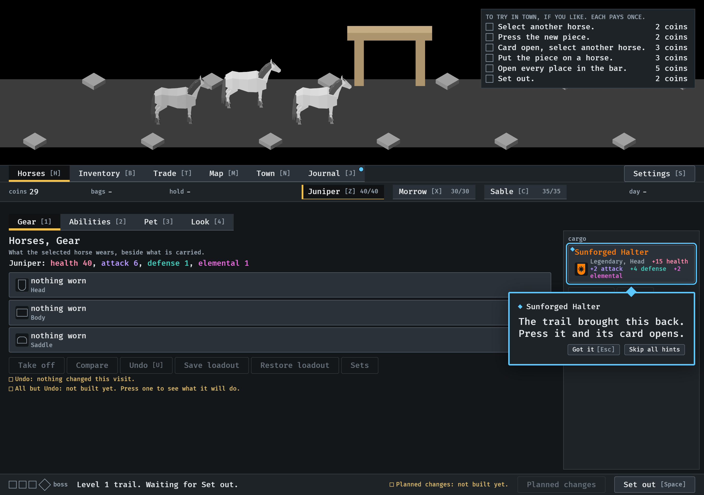
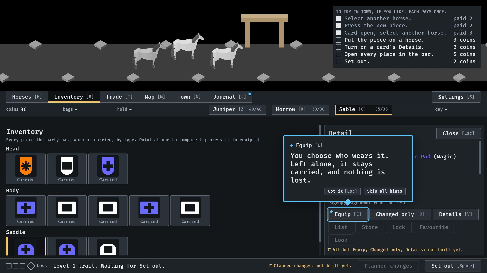
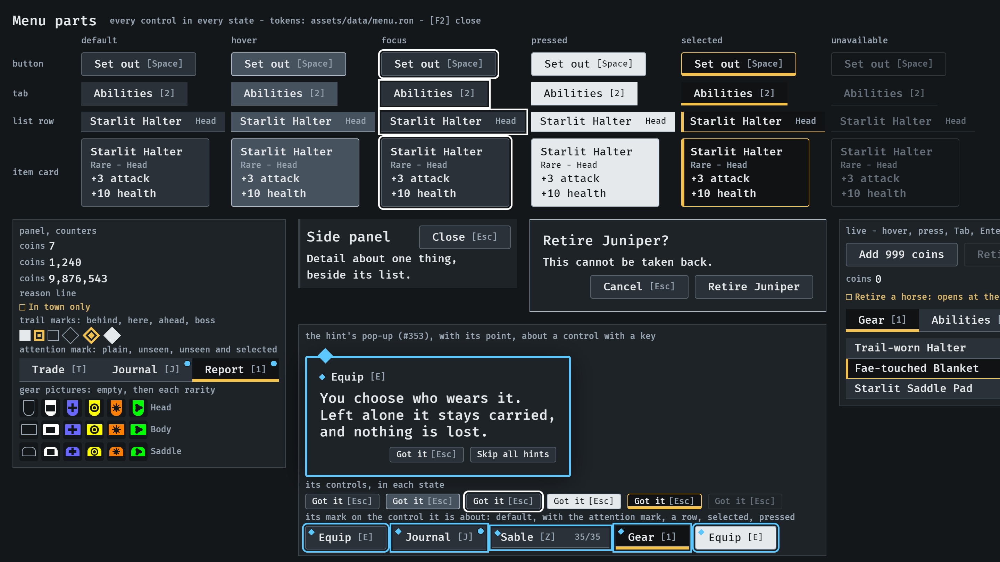

# A lesson as a pop-up, 2026-10-14

The first part of #353: each lesson is a pop-up beside the control it is
about, with a point toward it, and that control is ringed. The game does
not pause for it yet (the next part). Pictures of `--seed 6`, read by the
session; the owner has not looked. How it works: `docs/menu-shell.md`,
"The hint's pop-up", and `docs/lessons.md`.

