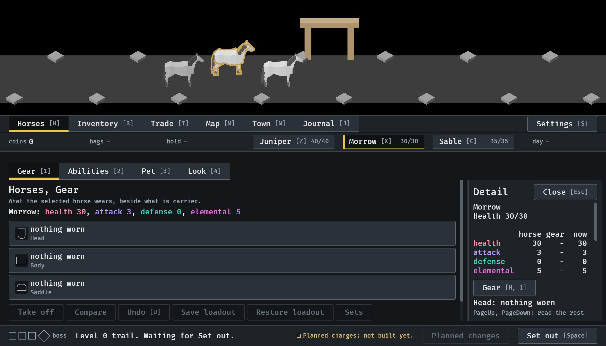
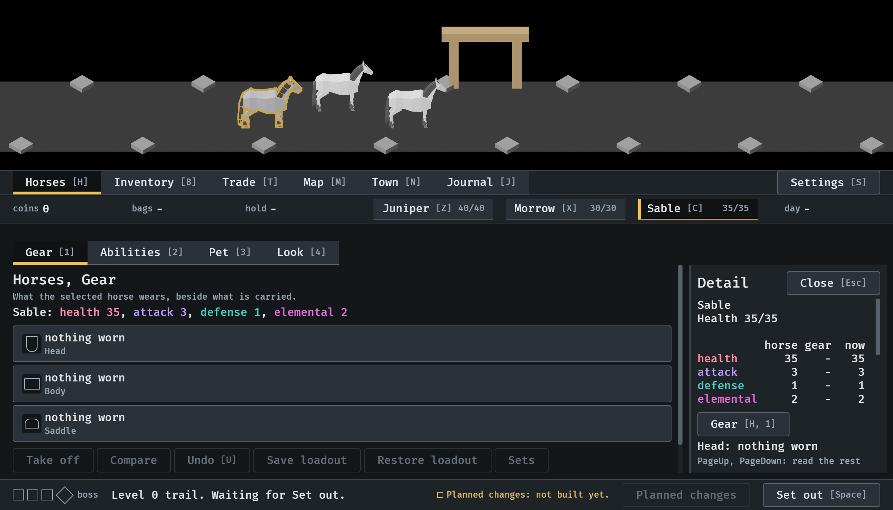
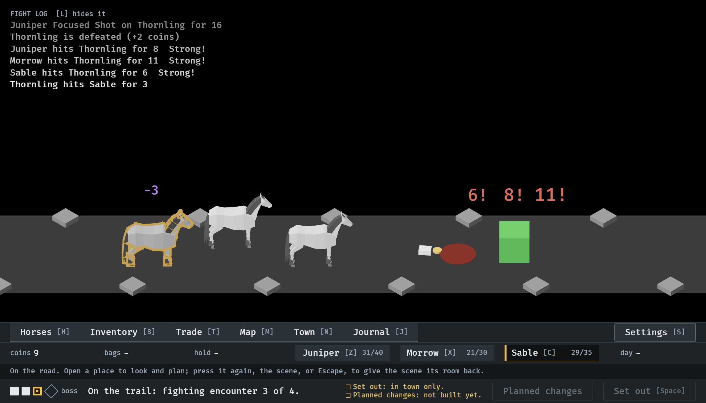
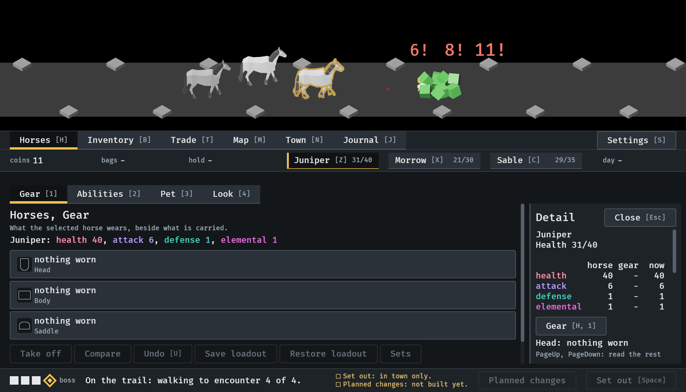

# 2026-10-14, a press on a horse in the scene (#356, first part)

The menu tour, `--seed 6 --window 1120x640`.

1.  Morrow pressed in the strip: Morrow
   is outlined in the scene.
2.  Sable pressed in the scene itself: Sable
   is selected, its view opens, and the outline moves to it.
3.  On the road with every place closed, the
   selected horse keeps its outline through the fight.
4.  There a press on Juniper
   selects it and opens the place with its view.
