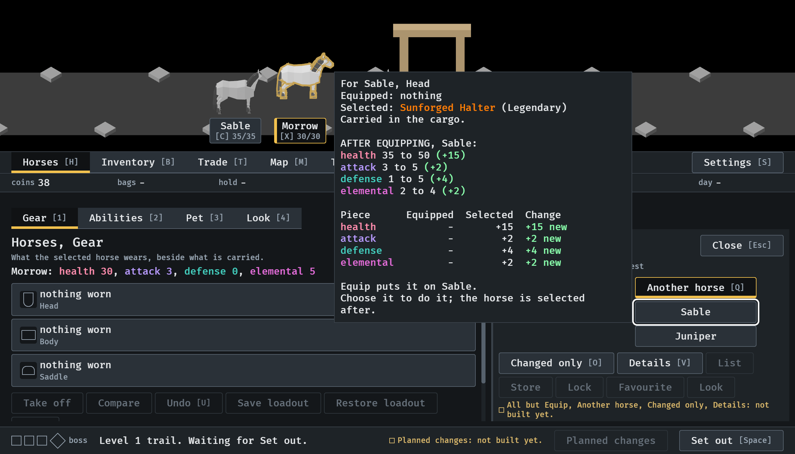
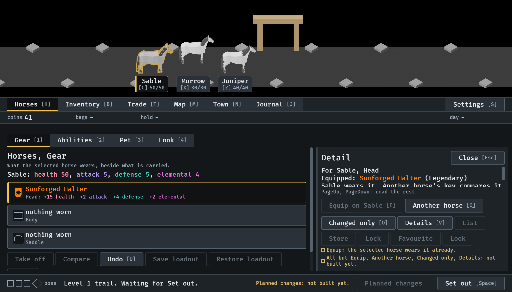
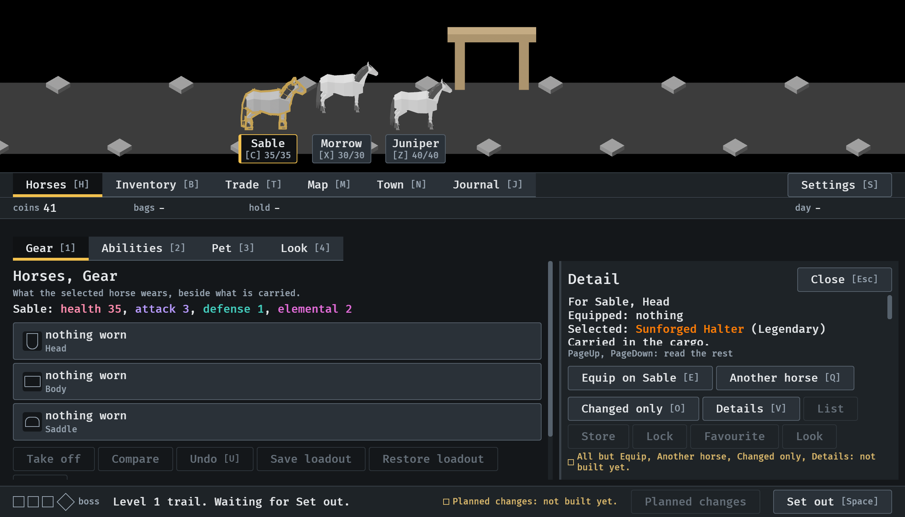

# 2026-10-15, Equip on another horse (#356, part 2)

Equip names the selected horse, and Another horse (Q) opens a list of the
others beside it, in the order they stand across the scene. From the menu
tour, at 1120 x 640.

1.  Morrow selected, the drop's card pinned; Q
   opened the list (Sable, Juniper) with the focus on Sable, and beside it
   what choosing Sable would do.
2.  Enter chose Sable: the halter is
   on Sable (50/50 on its tag), Sable is selected and outlined, and the
   card says Sable wears it. The list closed.
3.  U took it back: the halter is carried again, its card
   on it, and Equip reads "Equip on Sable".
