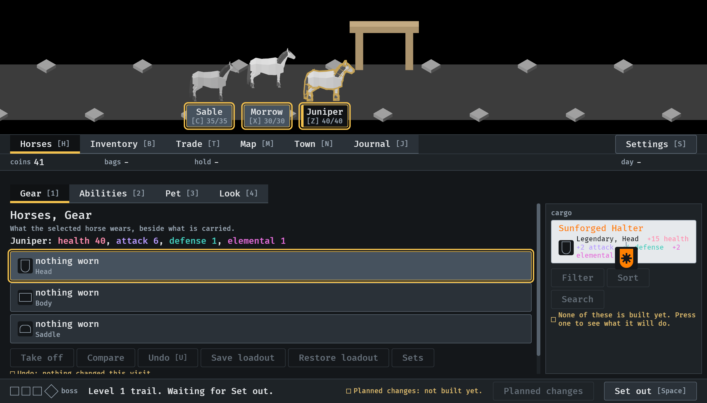
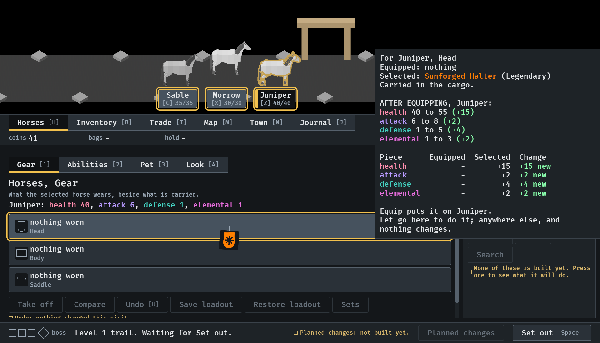
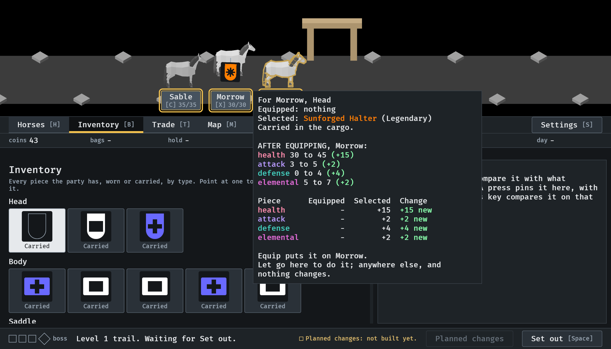
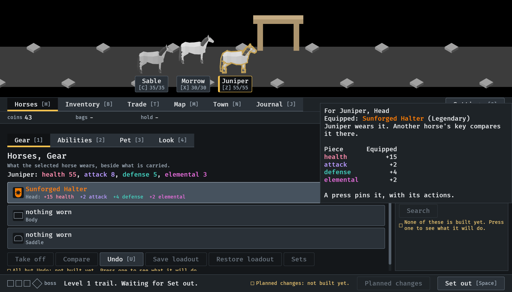

# 2026-10-15, the piece in the hand (#363)

The menu tour (`IDLE_TOUR`, `--seed 6 --window 1120x640`), pictures 89 to 91
and 92.

1.  Grabbed from the cargo: its cell draws the slot empty
   and the piece hangs from the pointer on its string.
2.  Over Juniper's Head slot: the slot marked as the
   target, the preview card above the piece, the piece still settling.
3.  From the Inventory over Morrow in the scene; its
   tile there shows the slot empty.
4.  Let go on the slot: it has flown in and the slot shows it.

A still cannot show the swing; that waits on a hand on the mouse.
